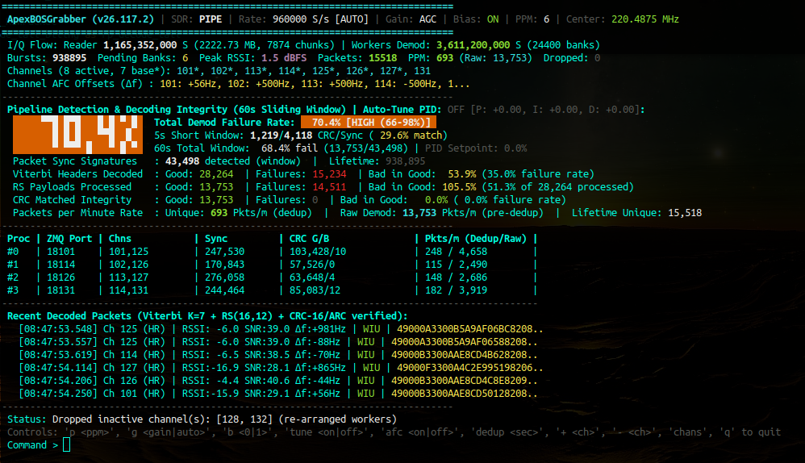
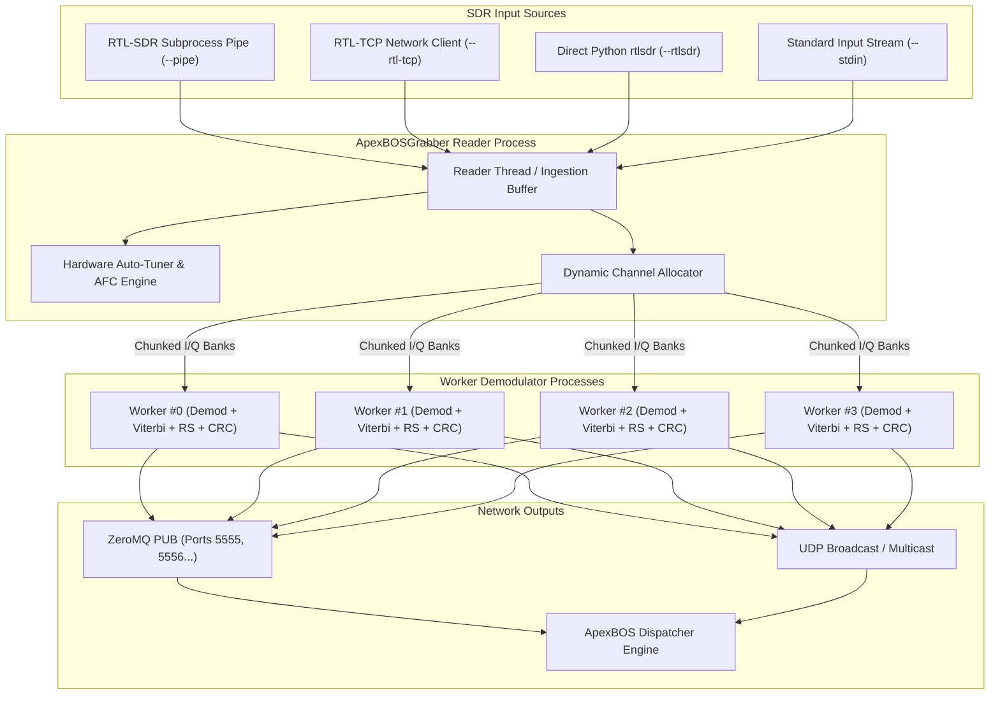

# ApexBOSGrabber: High-Performance PTC 220 MHz SDR Receiver & Demodulator

**ApexBOSGrabber** is a multi-channel Software-Defined Radio (SDR) receiver, physical-layer demodulator, forward error correction (FEC) decoding engine, and real-time telemetry streaming daemon designed specifically for Positive Train Control (PTC) 220 MHz Interoperable Train Control (ITC) communications.

ApexBOSGrabber simultaneously monitors multiple RF channels across the 220–222 MHz band, extracts $\pi/4$-DQPSK bursts, performs Viterbi and Reed-Solomon decoding, validates CRC integrity, dynamically corrects frequency offsets, and publishes decoded messages via ZeroMQ PUB sockets and UDP multicast for ingestion by the ApexBOS Dispatcher Engine and ApexBOSFlux network relays.

---

## Dashboard Overview

ApexBOSGrabber features an interactive ANSI terminal dashboard providing live RF metrics, sliding-window decoding health, per-process worker loads, and real-time decoded packet inspection:



The dashboard is structured into six functional zones:
1. **Hardware & RF Header**: Tuner frequency, sample rate, gain, bias-tee, and SDR source.
2. **I/Q Flow & Pipeline Health**: Sample ingestion throughput, burst count, peak RSSI, and active channel list.
3. **Pipeline Detection & Decoding Integrity**: Big-matrix failure rate indicator, sliding-window FEC health, and sync/packet statistics.
4. **Worker Process Distribution Table**: Multi-core load distribution, assigned channels, port allocations, and per-worker throughput.
5. **Recent Decoded Packets & Telemetry**: Real-time packet scrolling with RSSI, SNR, frequency error ($\Delta f$), and decoded PTC metadata.
6. **Status Bar & Interactive CLI**: Live status updates and on-the-fly hardware/channel configuration controls.

---

## Operating Modes & SDR Ingestion

ApexBOSGrabber supports four input architectures, selectable via CLI flags or automatically discovered at launch:



### 1. Pipe Mode (`--pipe`) - Default
Spawns the native `rtl_sdr` binary as an optimized subprocess, passing raw I/Q samples directly through `stdout` using a 256 KB memory pipe. This provides low overhead and zero memory copies on both Linux and Windows.

### 2. RTL-TCP Mode (`--rtl-tcp`)
Connects over TCP (`127.0.0.1:1234` by default) to an active `rtl_tcp` server. Enables running the SDR receiver on a remote Raspberry Pi, server, or container while running Grabber on a workstation. Socket buffers are tuned to 2 MB to prevent drops under high burst rates.

### 3. Direct RTLSDR Mode (`--rtlsdr`)
Communicates directly with the USB dongle inside the Python process using `pyrtlsdr` (`ctypes` binding to `librtlsdr`). Operates on Linux, macOS, and Windows (with `rtlsdr.dll` and WinUSB driver). Employs 16 KB USB bulk-transfer alignment.

### 4. Stdin Mode (`--stdin`)
Reads raw 8-bit unsigned interleaved I/Q samples from standard input, enabling playback of pre-recorded RF captures or piping from tools like `gqrx`, `hackrf_transfer`, or `airspy_rx`:
```bash
rtl_sdr -f 220487500 -s 960000 - | python ApexBOSGrabber.py --stdin
```

### 5. Automatic Source Detection
When launched without explicit mode flags, Grabber automatically probes available interfaces:
1. Checks if `rtl_sdr` executable is in `PATH` (uses `--pipe` if found).
2. Checks if an `rtl_tcp` server is listening on port `1234` (engages `--rtl-tcp` if active).
3. Checks if `pyrtlsdr` is installed and operational (engages `--rtlsdr`).
4. Checks if `rtl_tcp` binary is installed in `PATH`.
5. If no source is found, prints a comprehensive setup guide and exits gracefully.

---

## Demodulation & Decoding Concepts

### 1. RF Channelization & Bandwidth Scaling
PTC ITC operates across designated 25 kHz channels in the 220–222 MHz frequency band:
$$f_c = 217{,}587{,}500\text{ Hz} + (\text{channel} \times 25{,}000\text{ Hz})$$

When the requested channel selection spans more than the base sample rate (192 kS/s), Grabber automatically calculates the optimal center frequency and scales the hardware sample rate to a multiple of 192 kHz (e.g. 960 kS/s or 1.92 MS/s) to cover all channels in a single SDR tuner passband:
$$f_{\text{center}} = \frac{\min(f_c) + \max(f_c)}{2}$$

### 2. Digital Downconversion (DDC) & Channel Extraction
For each active channel assigned to a worker:
1. The raw hardware I/Q stream is frequency-shifted to baseband by mixing with a complex digital local oscillator:
   $$x_{\text{base}}(t) = x_{\text{in}}(t) \cdot e^{-j 2\pi (f_c - f_{\text{center}}) t}$$
2. The signal is decimated to the symbol processing rate.
3. A matched Root-Raised-Cosine (RRC) filter ($\alpha = 0.2$) is applied to maximize signal-to-noise ratio and eliminate inter-symbol interference (ISI).

### 3. $\pi/4$-DQPSK Demodulation
ITC transmissions use $\pi/4$-DQPSK modulation at 16 kbaud (32 kbps Full Rate / 16 kbps Half Rate).
Consecutive symbols $S_k$ encode dibits into phase changes:
$$\Delta\theta_k = \arg(S_k \cdot S_{k-1}^*)$$

| Dibit ($b_0 b_1$) | Phase Shift ($\Delta\theta_k$) |
| :---: | :---: |
| `00` | $+45^\circ \; (+\pi/4)$ |
| `01` | $+135^\circ \; (+3\pi/4)$ |
| `11` | $-135^\circ \; (-3\pi/4)$ |
| `10` | $-45^\circ \; (-\pi/4)$ |

### 4. Synchronization & Unique Word (UW) Correlation
Transmissions begin with a 64-bit unique word synchronization signature. Grabber continuously evaluates correlation against both normal and polarity-inverted bit patterns. Bursts with Hamming distance $\le 8$ (configurable with `-E`) are locked and aligned for FEC decoding.

### 5. Forward Error Correction (FEC)
1. **Viterbi Convolutional Decoding**:
   - Rate: $R = 1/2$, Constraint Length: $K = 7$.
   - Polynomial generator: $(171_8, 133_8)$.
   - De-interleaved and de-scrambled via a 3-bit LFSR polynomial.
   - Decodes the packet header containing length, modulation mode, and packet type.
2. **Reed-Solomon Block Error Correction**:
   - Code: $RS(16, 12)$ over $\text{GF}(2^4)$ with primitive polynomial $x^4 + x + 1$.
   - Each codeword consists of 12 data nibbles and 4 parity nibbles.
   - Capable of detecting and correcting up to 2 symbol errors per 16-nibble block.
3. **CRC-16/ARC Payload Verification**:
   - Polynomial: $x^{16} + x^{15} + x^2 + 1$ (`0xA001`, reversed `0x8005`).
   - Ensures zero undetected bit errors before forwarding packets to downstream clients.

### 6. Frame Formatting & Deduplication
Packets passing CRC validation are formatted into the standard ApexBOSFlux protocol frame:
```
[ 0x49 ('I') ] [ Length (2 bytes BE) ] [ Packet Type (1 byte) ] [ Flags (0x00) ] [ Payload... ]
```
Because locomotives and base stations often transmit repeatedly or across overlapping channels, an adaptive deduplication filter suppresses identical frames seen within the configured expiration window (`--dedup-ttl`, default: 1.0s).

### 7. Signal Power, dBFS Calibration & ADC Clipping Detection
ApexBOSGrabber evaluates RMS signal power for incoming RF bursts and raw I/Q sample chunks in decibels relative to full scale:
$$P_{\text{dBFS}} = 10 \log_{10}\left(\frac{\langle I^2 + Q^2 \rangle}{127.5^2}\right)$$

#### Why Positive dBFS Numbers Occur ($\ge 0.0\text{ dBFS}$)
The RTL-SDR hardware digitizes RF signals with an 8-bit ADC, producing unsigned values from $0$ to $255$. Centering around DC yields $[-127.5, +127.5]$ for both $I$ (in-phase) and $Q$ (quadrature) components:
- The denominator $127.5^2$ represents the power of a circular full-scale continuous-wave (CW) sinusoid ($I^2 + Q^2 = 127.5^2$), mapping to exactly $0.0\text{ dBFS}$.
- However, the ADC physical clipping boundary is a 2D square in the complex plane: $[-127.5, +127.5] \times [-127.5, +127.5]$.
- When incoming RF bursts saturate the receiver front-end, both $I$ and $Q$ clip simultaneously against the rails:
  $$I_{\max}^2 + Q_{\max}^2 = 127.5^2 + 127.5^2 = 2 \times 127.5^2$$
- Evaluating this in the dBFS formula yields:
  $$10 \log_{10}\left(\frac{2 \times 127.5^2}{127.5^2}\right) = 10 \log_{10}(2) \approx +3.01\text{ dBFS}$$

#### Positive RSSI as a High-Gain & Clipping Indicator
In ApexBOSGrabber, positive dBFS numbers (such as `+1.5 dBFS` in the dashboard screenshot) are **intentionally preserved** as an explicit diagnostic indicator that the tuner gain is set too high for incoming transmitter bursts, driving the ADC converter into digital saturation.

#### Dynamic 60-Second Sliding Window & TUI Alerts
1. **60-Second Sliding Window Decay**: Rather than latching an all-time maximum from process startup, `Peak RSSI` tracks the highest burst level over a rolling 60-second window. Momentary startup spikes or single-burst transients automatically expire after 60 seconds of clean operation.
2. **Visual TUI Clipping Warning**: When `Peak RSSI >= 0.0 dBFS`, the dashboard immediately displays high-visibility visual alerts:
   - Header bar tags the gain in bold red: `Gain: 42.0 dB [CLIP: GAIN HIGH]`.
   - Global metrics line highlights Peak RSSI in red: `Peak RSSI: 1.5 dBFS [CLIPPING: Gain may be set too high!]`.
   - A dedicated warning banner appears: `[!] ADC CLIPPING DETECTED (Peak RSSI >= 0.0 dBFS): Gain may be set too high! Use 'g <gain>' to reduce.`
3. **Instant Peak RSSI Reset on Gain Adjustment**: Whenever tuner gain is adjusted (e.g. typing `g 38.0` or `g auto`), or when the auto-tuner modulates gain, all peak RSSI tracking buffers across the application, sliding windows, and worker processes are immediately reset to `-100.0 dBFS`, instantly clearing the clipping alert.

#### Troubleshooting ADC Clipping & Persistent Positive dBFS Alerts
If the `[CLIPPING: Gain may be set too high!]` alert appears persistently on the dashboard or will not clear, use the following guide to diagnose and resolve the issue:

1. **Beware the "0.01" Gain Trap (Accidental Hardware AGC)**:
   - Tuner gain stages are discrete hardware steps, not continuous analog values:
     $$\text{Supported Steps (dB): } [0.9,\; 1.4,\; 2.7,\; 3.7,\; 7.7,\; 8.7,\; 12.5,\; 14.4,\; \dots,\; 48.0,\; 49.6]$$
   - In `librtlsdr` and RTL-SDR hardware drivers, passing gain `0` or `0.0` is the reserved instruction that commands the hardware to enable **Automatic Gain Control (AGC)**; it does *not* set 0 dB manual gain.
   - When entering fractional values like `g 0.01` or `g 0.0`, the value rounds to 0 tenths of a dB (`0`), which actually activates full Hardware AGC!
   - Under AGC mode, the tuner automatically pumps its internal LNA and mixer gain up to maximum ($\approx 40\text{--}49\text{ dB}$) during quiet intervals, guaranteeing hard ADC saturation whenever RF bursts arrive.
   - **Resolution**: To test minimum manual gain, always set the lowest discrete hardware step:
     ```text
     g 0.9
     ```
     *(or `g 1.4`)*. Setting `g 0.9` forces the tuner out of AGC and locks it into minimum manual hardware amplification.

2. **Bias-Tee (4.5V DC) Short Circuit on DC-Grounded Antennas**:
   - ApexBOSGrabber enables the internal Bias-Tee by default (`Bias: ON`, `--bias-tee 1`) to power inline low-noise pre-amplifiers (LNAs).
   - Many passive VHF antennas (such as 5/8-wave whips with base matching coils, folded dipoles, J-poles, or magnetic loops) present a **direct DC short circuit to ground** at the coaxial connector by design.
   - Connecting a DC-grounded antenna while the Bias-Tee is active shorts the +4.5V power rail directly into RF ground. This pulls down the internal voltage rails of the Rafael Micro tuner chip and drives the I/Q mixer outputs directly into the ADC digital supply rails ($0$ and $255$), producing permanent digital clipping and positive dBFS on all channels regardless of signal presence or gain setting.
   - Alternatively, if the antenna has an active inline LNA, the amplifier may be injecting $+20\text{ dB}$ to $+35\text{ dB}$ of amplification before the signal reaches the SDR, severely overdriving the 8-bit converter.
   - **Resolution**: Disable the Bias-Tee in the interactive TUI:
     ```text
     b 0
     ```
     *(or start with CLI flag `-b 0` / `--bias-tee 0`)*. If the clipping alert clears and signals return to normal negative dBFS, the antenna was DC-grounded or over-amplified.

3. **Step-by-Step Diagnostic Routine**:
   When the clipping alert triggers, follow this sequence:
   1. **Disable Bias-Tee**: Type `b 0`.
   2. **Set Lowest Manual Gain**: Type `g 0.9` (do not use `0` or `0.01`).
   3. **Check Peak RSSI**: Confirm that Peak RSSI drops to normal negative values (e.g. $-10\text{ dBFS}$ to $-50\text{ dBFS}$) and the clipping alert clears.
   4. **Step Gain Up Gradually**: Increment gain in steps (e.g. `g 14.4`, `g 25.4`, `g 36.4`) until desired reception sensitivity is achieved without re-triggering the clipping alert on active bursts.

4. **Out-of-Band RF Overload & Recommended Filtering**:
   The RTL-SDR features an 8-bit ADC with only $\approx 48\text{ dB}$ of effective dynamic range and wide, unshielded front-end filters. High-gain outdoor or rooftop antennas capture massive total RF energy across the entire spectrum. If clipping persists even with `b 0` and `g 0.9`, strong out-of-band transmitters are saturating the front end before digital channelization:
   - **High-Power Broadcast FM (88–108 MHz)**: 50–100 kW commercial FM radio towers.
   - **VHF Commercial Paging / Public Safety (150–174 MHz)**: High-power local simulcast transmitters (especially 152–158 MHz paging).
   - **NOAA Weather Radio (162.400–162.550 MHz)**.
   - **Cellular / LTE Base Stations (700–900 MHz)**.

   **Recommended Filters for High-RF Environments**:
   - **PTC 220 MHz Bandpass Filter (Recommended)**: A dedicated 220–222 MHz SAW or helical bandpass filter (e.g., 220 MHz bandpass filter with SMA connectors). This provides sharp out-of-band attenuation (> 40 dB rejection below 215 MHz and above 225 MHz), eliminating FM, paging, and cellular overload while passing PTC channels with < 2 dB insertion loss.
   - **Broadcast FM Notch / Bandstop Filter (88–108 MHz)**: Attenuates high-power commercial FM broadcast stations by 30–50 dB while passing 220 MHz signals unimpeded.
   - **VHF High-Band Paging Notch Filter**: Attenuates 152–158 MHz paging spikes in dense urban rail corridors.

---

## Detailed Dashboard Field Reference

Reference guide matching the fields shown in [`GrabberMainScreen.png`](file:///c:/Users/abelo/Dropbox/Public/ApexBOS.220/images/GrabberMainScreen.png):

### 1. Header Bar
```
ApexBOSGrabber (v26.119.13) | SDR: PIPE | Rate: 960000 S/s [AUTO] | Gain: AGC | Bias: ON | PPM: 6 | Center: 220.4875 MHz
```
- **`v26.119.13`**: Active Grabber engine release version.
- **`SDR: PIPE`**: Active ingestion mode (`PIPE`, `TCP`, `RTLSDR`, or `STDIN`).
- **`Rate: 960000 S/s [AUTO]`**: Hardware sampling rate. `[AUTO]` denotes that Grabber automatically expanded the sample rate from 192 kS/s to 960 kS/s to span all requested channels.
- **`Gain: AGC`**: Tuner gain setting. Displays `AGC` when auto-gain is active, or fixed gain in dB (e.g. `42.0 dB`). When incoming bursts clip the ADC (`Peak RSSI >= 0.0 dBFS`), an alert tag `[CLIP: GAIN HIGH]` warns in bold red that the gain is set too high.
- **`Bias: ON`**: Status of internal 4.5V LNA bias-tee power (`ON` or `OFF`).
- **`PPM: 6`**: Master oscillator frequency correction offset applied to the tuner.
- **`Center: 220.4875 MHz`**: Tuner RF local oscillator center frequency.

### 2. I/Q Flow & Global Metrics
```
I/Q Flow: Reader 1,165,352,000 S (2222.73 MB, 7874 chunks) | Workers Demod: 3,611,200,000 S (24400 banks)
Bursts: 938895  Pending Banks: 6  Peak RSSI: 1.5 dBFS  Packets: 15518  PPM: 693 (Raw: 13,753)  Dropped: 0
Channels (8 active, 7 base*): 101*, 102*, 113*, 114*, 125*, 126*, 127*, 131
Channel AFC Offsets (Δf) : 101: +56Hz, 102: +500Hz, 113: +500Hz, 114: -500Hz, 1...
```
- **`I/Q Flow: Reader`**: Samples received, total megabytes read, and chunk blocks dispatched by the ingestion reader process.
- **`Workers Demod`**: Cumulative samples and sample banks processed across all worker child processes.
- **`Bursts: 938895`**: Total RF carrier bursts detected across all monitored channels.
- **`Pending Banks: 6`**: Number of I/Q banks buffered in worker IPC queues. Green ($\le 4$) indicates real-time processing; yellow/red indicates worker backlog.
- **`Peak RSSI: 1.5 dBFS`**: Maximum burst signal strength observed within the dynamic 60-second sliding window. Values $\ge 0.0\text{ dBFS}$ (such as `1.5 dBFS`) indicate ADC digital clipping/saturation caused by tuner gain being set too high, triggering an immediate high-visibility red `[CLIPPING: Gain may be set too high!]` alert. When gain is adjusted with `g <gain>` or auto-tuning, peak RSSI tracking is immediately reset to `-100.0 dBFS` across all worker processes. See [Troubleshooting ADC Clipping & Persistent Positive dBFS Alerts](#troubleshooting-adc-clipping--persistent-positive-dbfs-alerts) for step-by-step resolution.
- **`Packets: 15518`**: Total valid, CRC-verified, unique packets decoded since startup.
- **`PPM: 693 (Raw: 13,753)`**: Packets per minute. `693` is post-deduplication unique packet rate sent to clients; `13,753` is pre-deduplication raw RF packet rate.
- **`Dropped: 0`**: Packets dropped due to IPC queue saturation.
- **`Channels`**: List of monitored channels:
  - `*` (e.g. `101*`): Base station channel dynamically discovered and protected from idle timeouts.
  - `.` (e.g. `102.`): Locked channel pinned by user command or CLI configuration.
- **`Channel AFC Offsets (Δf)`**: Real-time frequency correction applied to individual channels by the Automatic Frequency Control loop to compensate for transmitter crystal drift (capped at $\pm 500\text{ Hz}$).

### 3. Pipeline Detection & Decoding Integrity (60s Window)
```
  [ 70.4% ]  Total Demod Failure Rate: 70.4% [HIGH (66-98%)]
             5s Short Window: 1,219/4,118 CRC/Sync ( 29.6% match)
             60s Total Window: 68.4% fail (13,753/43,498) | PID Setpoint: 0.0%
  Packet Sync Signatures   : 43,498 detected (window)  |  Lifetime: 938,895
  Viterbi Headers Decoded  : Good: 28,264  | Failures: 15,234  | Bad in Good: 53.9% (35.0% failure rate)
  RS Payloads Processed    : Good: 13,753  | Failures: 14,511  | Bad in Good: 105.5% (51.3% of 28,264 processed)
  CRC Matched Integrity    : Good: 13,753  | Failures: 0       | Bad in Good:  0.0% ( 0.0% failure rate)
  Packets per Minute Rate  : Unique: 693 Pkts/m (dedup) | Raw Demod: 13,753 Pkts/m (pre-dedup) | Lifetime Unique: 15,518
```
- **Large Digit Matrix (`70.4%`)**: Instantaneous total demodulation failure rate over the short evaluation window, color-coded by severity:
  - Green (`< 35%`): `NOMINAL`
  - Yellow (`35 - 65%`): `MODERATE`
  - Orange (`66 - 98%`): `HIGH`
  - Red (`> 98%`): `CRITICAL`
- **`Auto-Tune PID`**: Status of automated gain/PPM tuning algorithm and active proportional, integral, and derivative terms.
- **`Packet Sync Signatures`**: Number of valid 64-bit unique word correlations detected in the 60s window and lifetime.
- **`Viterbi Headers Decoded`**: Good vs corrupted packet headers passing Viterbi error correction.
- **`RS Payloads Processed`**: Good vs uncorrectable payload blocks evaluated by Reed-Solomon $RS(16, 12)$.
- **`CRC Matched Integrity`**: Good vs failed CRC-16 checks.
- **`Bad in Good`**: Ratio of corrupted packets relative to good packets ($(\text{bad} / \text{good}) \times 100\%$). Useful for tracking RF noise floors and co-channel interference.

### 4. Per-Process Worker Distribution Table
```
Proc | ZMQ Port | Chns     | Sync    | CRC G/B    | Pkts/m (Dedup/Raw) |
#0   | 18101    | 101,125  | 247,530 | 103,428/10 | 248 / 4,658        |
#1   | 18114    | 102,126  | 170,843 | 57,526/0   | 115 / 2,490        |
#2   | 18126    | 113,127  | 276,058 | 63,648/4   | 148 / 2,686        |
#3   | 18131    | 114,131  | 244,464 | 85,083/12  | 182 / 3,919        |
```
- **`Proc`**: Worker process ID (`#0`, `#1`, etc.).
- **`ZMQ Port`**: Port assigned to this worker's local ZeroMQ publisher.
- **`Chns`**: ITC channels allocated to this worker process.
- **`Sync`**: Cumulative sync words detected by this worker.
- **`CRC G/B`**: Ratio of Good CRC packets to Bad CRC packets decoded by this worker.
- **`Pkts/m (Dedup/Raw)`**: Channel packet throughput per worker process.

### 5. Recent Decoded Packets & Telemetry
```
[08:47:53.548] Ch 125 (HR) | RSSI: -6.0 SNR:39.0 Δf:+981Hz | WIU | 49000A3300B5A9AF06BC8208..
[08:47:53.619] Ch 114 (HR) | RSSI: -6.5 SNR:38.5 Δf:-70Hz  | WIU | 49000B3300AAE8CD4B628208..
```
- **`[08:47:53.548]`**: Packet reception timestamp with millisecond resolution.
- **`Ch 125 (HR)`**: Channel number and transmission rate:
  - `(FR)`: Full Rate (32 kbps / 16 kbaud).
  - `(HR)`: Half Rate (16 kbps / 8 kbaud).
- **`RSSI: -6.0`**: Received Signal Strength Indicator in dBFS.
- **`SNR: 39.0`**: Estimated Signal-to-Noise Ratio in dB.
- **`Δf: +981Hz`**: Measured carrier frequency error of the transmitting station.
- **`WIU / Base / EMP`**: High-level packet classification.
- **`49000A33...`**: Extracted metadata (e.g. WIU ID, Switch Status, Base GPS Coordinates, or Raw Hex).

---

## Command Line Reference

```bash
python ApexBOSGrabber.py [OPTIONS]
```

### General & Configuration
| Flag | Description | Default |
| :--- | :--- | :--- |
| `--config <path>` | Load configuration options from a JSON file | `None` |
| `--gen-config` | Generate a template configuration file with defaults and exit | — |
| `--no-color` | Disable ANSI terminal colors | `False` |
| `--full` | Print full packet hex and decoding details | `False` |

### SDR Hardware & Tuning
| Flag | Description | Default |
| :--- | :--- | :--- |
| `--pipe` | Read I/Q from native `rtl_sdr` binary pipe | `True` |
| `--rtl-tcp` | Connect to an RTL-TCP server socket | `False` |
| `--rtlsdr`, `--pyrtlsdr` | Direct in-process access via `pyrtlsdr` package | `False` |
| `--stdin` | Read raw 8-bit unsigned I/Q from standard input | `False` |
| `--auto` | Automatically probe and select available SDR source | `False` |
| `--host <ip>` | RTL-TCP host address | `127.0.0.1` |
| `--port <port>` | RTL-TCP port | `1234` |
| `--device <idx>` | RTL-SDR USB device index | `0` |
| `--rate <sps>` | SDR sampling rate in S/s | `192000` |
| `--gain <dB>` | Tuner gain in dB or tenths (or `0` for AGC) | `0` (AGC) |
| `-b`, `--bias-tee <0\|1>`| Power inline antenna LNA via bias-tee | `1` (ON) |
| `--ppm <int>` | Master tuner frequency correction in PPM | `0` |
| `--auto-tune` | Enable automated PID tuning of gain and PPM | `False` |

### Channels & Demodulation
| Flag | Description | Default |
| :--- | :--- | :--- |
| `--chans <list>` | Comma-separated channels (e.g. `101,102.,107`); suffix `.` or `l` locks channel | `channels.json` |
| `--chans-file <path>` | Path to JSON channels file | `channels.json` |
| `--channel-timeout <s>`| Inactivity seconds before dropping non-base channels | `300.0` (5 min) |
| `--afc` / `--no-afc` | Enable/disable dynamic per-channel AFC frequency tracking | `True` |
| `--afc-limit <Hz>` | Maximum AFC offset allowed per channel | `500.0` Hz |
| `--dedup-ttl <sec>` | Packet deduplication window in seconds | `1.0` s |
| `-E`, `--max-errors <n>`| Maximum unique word Hamming bit errors | `8` |

### Networking & IPC
| Flag | Description | Default |
| :--- | :--- | :--- |
| `--procs <ports>` | Comma-separated ZeroMQ PUB ports | `5555` |
| `--workers <count>` | Number of worker processes (overrides `--procs` port count) | Process count |
| `--udp-port <port>` | Base UDP broadcast port | Same as ZMQ |
| `--no-rssi` | Emit raw hex without RSSI prepended (legacy mode) | `False` |

---

## Interactive Keyboard Commands

While ApexBOSGrabber is running, you can adjust parameters in real time directly from the terminal prompt:

| Command | Action | Example |
| :--- | :--- | :--- |
| `p <ppm>` | Set master frequency correction in PPM | `p 5` |
| `g <gain>` | Set tuner gain (`0` or `auto` for AGC, or dB value) | `g 42.0` |
| `b <0\|1>` | Toggle LNA antenna bias-tee power | `b 1` |
| `+ <chan>` | Add channel (suffix `.` or `l` to lock) | `+ 102.` |
| `- <chan>` | Remove channel | `- 102` |
| `chans` | List all active, locked, and base channels | `chans` |
| `tune <on\|off>`| Enable or disable automated PID tuner | `tune on` |
| `afc <on\|off>` | Enable or disable per-channel AFC frequency correction | `afc off` |
| `dedup <sec>` | Adjust deduplication window in seconds | `dedup 2.0` |
| `t <sec>` | Set channel inactivity timeout | `t 600` |
| `q` | Cleanly terminate all worker processes and exit | `q` |

---

## Example Configuration (`grabber_config.json`)

```json
{
    "pipe": true,
    "stdin": false,
    "rtl_sdr_bin": null,
    "rtl_tcp": false,
    "rtlsdr": false,
    "host": "127.0.0.1",
    "port": 1234,
    "device": 0,
    "rate": 192000,
    "gain": "0",
    "bias_tee": 1,
    "ppm": 0,
    "bank_size": 148000,
    "max_errors": 8,
    "auto_tune": false,
    "tune_interval": 5.0,
    "channel_afc": true,
    "afc_limit": 500.0,
    "dedup_ttl": 1.0,
    "chans": null,
    "chans_file": null,
    "channel_timeout": 300.0,
    "procs": "5555",
    "workers": null,
    "zmq_port": null,
    "udp_port": null,
    "no_color": false,
    "full": false,
    "all": false,
    "no_rssi": false
}
```
Load configuration file:
```bash
python ApexBOSGrabber.py --config grabber_config.json
```

---

## License

This software is released under the **MIT License**.

Copyright (c) 2026 AB

Permission is hereby granted, free of charge, to any person obtaining a copy of this software and associated documentation files (the "Software"), to deal in the Software without restriction, including without limitation the rights to use, copy, modify, merge, publish, distribute, sublicense, and/or sell copies of the Software, and to permit persons to whom the Software is furnished to do so, subject to the following conditions:

The above copyright notice and this permission notice shall be included in all copies or substantial portions of the Software.

THE SOFTWARE IS PROVIDED "AS IS", WITHOUT WARRANTY OF ANY KIND, EXPRESS OR IMPLIED, INCLUDING BUT NOT LIMITED TO THE WARRANTIES OF MERCHANTABILITY, FITNESS FOR A PARTICULAR PURPOSE AND NONINFRINGEMENT. IN NO EVENT SHALL THE AUTHORS OR COPYRIGHT HOLDERS BE LIABLE FOR ANY CLAIM, DAMAGES OR OTHER LIABILITY, WHETHER IN AN ACTION OF CONTRACT, TORT OR OTHERWISE, ARISING FROM, OUT OF OR IN CONNECTION WITH THE SOFTWARE OR THE USE OR OTHER DEALINGS IN THE SOFTWARE.

