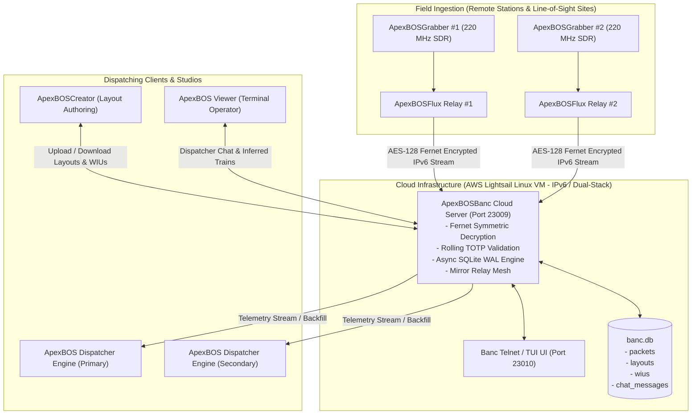
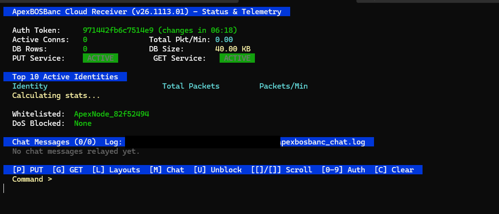
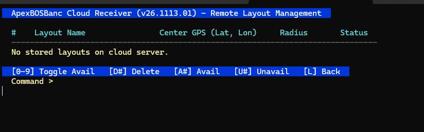
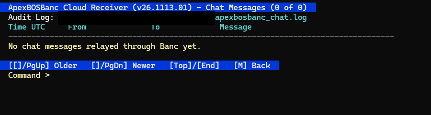

# ApexBOSBanc: Cloud Telemetry Hub, Remote Layout Manager & Inter-Station Relay

> [!IMPORTANT]
> **Disclaimer & Intended Use**: **ApexBOS is NOT a real Positive Train Control (PTC) system and is not affiliated with any railroad or government agency.** ApexBOS is an experimental reference tool designed for amateur train enthusiasts and radio telemetry hobbyists. It attempts to decode 220 MHz digital telemetry packets to facilitate hobbyist research and visualize the status of elements defined on a layout. It must never be used for train movement control, safety-critical railway operations, or commercial dispatching.

**ApexBOSBanc** is an asynchronous, dual-stack (IPv4 & IPv6) cloud telemetry receiver, remote railroad layout distribution server, and inter-station operator communications hub for the **ApexBOS** Railroad Dispatcher & Trackside Simulation ecosystem.

Operating as a centralized relay backbone, ApexBOSBanc aggregates real-time multi-band telemetry streams (220 MHz PTC, 900 MHz ATCS, and 450 MHz EOT/HOT/DPU/RLC) relayed from distributed **ApexBOSFlux** edge receiver nodes, serves layout geometries and WIU status tables to **ApexBOS Dispatcher Engine** and **ApexBOSCreator** studios, runs a **privacy-preserving multi-SDR RF Triangulation Engine** ([rf_localizer.py](rf_localizer.py)), and arbitrates secure, authenticated dispatcher-to-dispatcher chat messaging across remote terminals.

---

## Table of Contents

1. [Architectural Overview](#architectural-overview)
2. [Dashboard Overview & Screenshots](#dashboard-overview--screenshots)
   - [1. Main Telemetry & Cloud Operations](#1-main-telemetry--cloud-operations)
   - [2. Remote Layout Management Console](#2-remote-layout-management-console)
   - [3. Operator & Station Chat Terminal](#3-operator--station-chat-terminal)
3. [Application Modes & Network Architectures](#application-modes--network-architectures)
4. [Interactive Console Commands & Keybindings](#interactive-console-commands--keybindings)
5. [Step-by-Step Deployment: AWS Lightsail Linux VM (IPv6) via Setup Script](#step-by-step-deployment-aws-lightsail-linux-vm-ipv6-via-setup-script)
   - [Phase 1: Provisioning the AWS Lightsail Linux VM](#phase-1-provisioning-the-aws-lightsail-linux-vm)
   - [Phase 2: Deploying via Setup Script](#phase-2-deploying-via-setup-script)
   - [Phase 3: Post-Deployment Verification & Diagnostics](#phase-3-post-deployment-verification--diagnostics)
6. [Security, Cryptography & Anti-DoS Architecture](#security-cryptography--anti-dos-architecture)
7. [Database Schema & Storage Architecture](#database-schema--storage-architecture)
8. [Configuration Reference (`banc.json`)](#configuration-reference-bancjson)

---

## Architectural Overview

ApexBOSBanc links remote field RF receivers (ApexBOSGrabber / ApexBOSFlux) with regional dispatching centers and field engineers:



---

## Dashboard Overview & Screenshots

ApexBOSBanc provides a real-time ANSI terminal console interface (viewable locally via `--display` or remotely via Telnet on `ui_port`). The interface is divided into three full-featured operational views:

### 1. Main Telemetry & Cloud Operations

The primary screen provides an instant status overview of system health, active connections, packet ingestion rates, active mirrors, whitelisted clients, and DoS cooldown stats:



#### Functional Zones:
1. **Header & Authentication Token**:
   - Displays the current server version and the active **Rolling TOTP Auth Token** (`mosfet_auth`).
   - Features a live countdown timer showing remaining seconds in the current 10-minute token epoch (e.g., `A4F92B (changes in 08:42)`).
2. **Operational Metrics**:
   - **Active Conns**: Live count of concurrent client TCP sockets connected to the data server.
   - **Total Pkt/Min**: Aggregated rolling packet throughput received across all field Flux relays.
   - **DB Rows & Size**: Instant SQLite row count and disk consumption of active packet buffers.
3. **Service State Badges & RF Localizer Status**:
   - **PUT Service**: `[ACTIVE]` (normal ingestion) or `[PAUSED]` (temporarily rejecting new packet bursts with `ERROR:PAUSED`).
   - **GET Service**: `[ACTIVE]` (streaming packets to Engines) or `[PAUSED]`.
   - **RF Localizer**: Live summary row showing calibrated sensor anchor count (`N anchor(s)`) and active anonymized location estimates (`X WIU, Y Train, Z Other`).
4. **Active Mirror Relays**:
   - Real-time health monitoring of upstream/downstream Banc mirrors, showing connection state (`ACTIVE`, `PENDING`, or error state) and cumulative transmission errors.
5. **Top 10 Active Identities**:
   - High-resolution accounting of field nodes, displaying Node Identity hash, Lifetime Packets received, and real-time Packets/Minute rate.
6. **Security & Cooldown Status**:
   - **Whitelisted**: Display of pre-approved or dynamically approved node identities.
   - **Pending Identities**: Unrecognized client identities requesting admission, assignable via keybindings `[0-9]`.
   - **DoS Blocked / Cooldowns**: Detailed table listing IP addresses currently in cooldown, identity string, failure reason, and seconds remaining.
7. **Chat Activity Stream**:
   - Live 6-row rolling ticker showing the most recent operator messages, source node, destination `@mentions`, and timestamps.
8. **Interactive Command Bar**:
   - Command prompt with single-character hotkeys and contextual command entry.

---

### 2. Remote Layout Management Console

Accessible by pressing `L` from the main dashboard, this view manages centralized railroad layout files stored in the cloud SQLite repository:



#### Features & Columns:
- **Layout Index (`#`)**: 0-indexed identifier for fast one-key toggling and administration.
- **Layout Name**: Name of the layout configuration file stored on the cloud server.
- **Center GPS (`Lat, Lon`)**: Automatically computed center-of-mass coordinates calculated across all track segments, turnouts, crossings, and signals in the layout.
- **Radius**: Calculated bounding radius in kilometers ($R_{\max}$) encompassing the entire rail district.
- **Status Badge**:
  - `[AVAILABLE]`: Marked available for client Engines and Creators to download.
  - `[UNAVAILABLE]`: Administratively deactivated; hidden from client selection menus.
- **Hotkeys**:
  - `[0-9]`: Instant toggle of layout availability.
  - `D <#|name>`: Delete layout from cloud database.
  - `A <#|name>`: Mark layout available.
  - `U <#|name>`: Mark layout unavailable.
  - `L`: Return to main telemetry view.

---

### 3. Operator & Station Chat Terminal

Accessible by pressing `M` from the main dashboard, this view provides a dedicated full-screen dispatcher communications terminal with audit logging:



#### Features:
- **Audit Log Path**: Displays the active on-disk audit trail (e.g. `/tmp/apexbosbanc_chat.log` or `%TEMP%\apexbosbanc_chat.log`), recording every relayed message with UTC timestamps.
- **Message List**:
  - **Time UTC**: Microsecond-accurate message delivery timestamp.
  - **Source (`From`)**: Sanitized sender identity or station name.
  - **Destination (`To`)**: `ALL` for broadcast messages, or `@StationID` for targeted private communications.
  - **Mirror Indicator `[M]`**: Identifies messages relayed across inter-cloud mirror links.
  - **Message Body**: Cleaned, anti-spoofed plaintext message.
- **Buffer Scrolling Controls**:
  - `[` or `PgUp`: Scroll upwards into older historical messages.
  - `]` or `PgDn`: Scroll downwards towards newest messages.
  - `Top` / `Home`: Jump directly to the oldest recorded message.
  - `Bottom` / `End`: Return to live auto-scrolling tail.
  - `M`: Return to main telemetry view.

---

## Application Modes & Network Architectures

ApexBOSBanc is built on Python's native `asyncio` framework and supports multiple deployment architectures:

### 1. Dual-Stack Auto-Binding (`ip_mode: "auto"`)
By default, Banc creates an `AF_INET6` listening socket with `IPV6_V6ONLY = 0` bound to `[::]`:
- Accepts incoming connections from **both IPv6 and IPv4** clients on the exact same port without needing separate processes.
- Windows, Linux, and macOS dual-stack compatibility is handled automatically.
- Gracefully falls back to IPv4-only (`0.0.0.0`) or IPv6-only (`[::]`) if the host operating system has one stack disabled.

### 2. IPv6-Only Cloud Server (`--ipv6-only` / `ip_mode: "ipv6"`)
Forces Banc to bind solely to IPv6 (`[::]` with `IPV6_V6ONLY = 1`). Ideal for modern IPv6-only cloud instances (such as AWS Lightsail IPv6-only VMs), saving public IPv4 IP costs while guaranteeing global reachability.

### 3. IPv4-Only Mode (`--ipv4-only` / `ip_mode: "ipv4"`)
Restricts Banc to bind `0.0.0.0`, ensuring compatibility with legacy isolated local networks lacking IPv6 routing.

### 4. Inter-Cloud Mirror & Relay Mesh (`--mirror host:port`)
Banc instances can form resilient distributed networks using mirror relays:
- When a packet burst, WIU record, or chat message arrives at Banc $A$, it is automatically forwarded over authenticated TCP links to configured mirror peers (e.g. Banc $B$).
- Built-in **hop and loop suppression**: Relayed packets and messages carry cryptographic relay UIDs (`_relayed: True`, `_relay_uid`) to prevent duplicate rebroadcasts.
- Automatic reconnection with exponential backoff if a peer server temporarily drops.

### 5. Local Console Display, ANSI Fallback & Telnet Remote Management
- **Local Console (`--display`)**: Renders the animated ANSI dashboard directly into your SSH terminal or command prompt, automatically falling back to clean plain-text scroll mode (`--no-tui --no-color`) on Legacy Windows Consoles, `TERM=dumb`, or redirected non-TTY outputs.
- **Telnet Server (`ui_port: 23010`)**: Allows dispatchers to connect remotely using standard telnet or netcat clients (`telnet <banc-ip> 23010`) to view live metrics and issue administrative commands without accessing the server shell.

### 6. Privacy-Preserving Multi-SDR RF Triangulation (`rf_localizer.py`)
When multiple geographically separated SDR stations feed the same Banc server, `ApexBOSBanc` automatically runs [rf_localizer.py](rf_localizer.py) to estimate transmitter locations without compromising receiver privacy:
- **Stationary Transmitters (WIUs, Bases, ATCS MCPs, DPU Offboard Repeaters)**: Uses deterministic cross-node burst fingerprinting (3.0 s coincidence window), automatic per-SDR gain-bias calibration against known-GPS WIUs, and zero-input auto-calibration of PTC SDR anchor positions. Estimates enrich unlocated WIUs in **ApexBOS Creator** (`est_gps`) without ever overwriting verified ground-truth GPS.
- **Moving Trains (EOT, HOT, Direct DPU/DSU)**: Estimates live train positions and headings using RSSI-difference likelihood and exponential kinematic smoothing (filtering strictly to direct `RP==DI` DPU frames to exclude repeater artifacts), feeding the Viewer's **Train Board**.
- **Strict Anti-Doxxing & k-Anonymity Guarantees**:
  - Opt-in private sensor coordinates are stored strictly server-side under opaque random `sensor_id`s decoupled from user identities and are **never** returned by any GET API.
  - Single-SDR observations (`k = 1`) **never** produce a published estimate; `k >= 3` independent sensors produce medium/high-confidence fixes, while `k = 2` produces wide-radius ($\ge 6\text{ km}$) coarse estimates only.
  - Published coordinates are grid-quantized with minimum containment radii, omit all sensor IDs and per-SDR RSSI values, and enforce anti-triangulation query rate limits and minimum query radius floors ($\ge 10\text{ km}$).

### 7. Database Inspection (`--inspect-db <LIMIT>`)
Outputs the latest $N$ raw packet records from `banc.db` directly to stdout in JSON format for debugging and verification, then cleanly terminates:
```bash
python ApexBOSBanc.py --config banc.json --inspect-db 20
```

---

## Interactive Console Commands & Keybindings

Commands can be entered directly into the terminal or Telnet session. Single hotkeys execute immediately; text commands require pressing `Enter`:

| View | Key / Command | Description |
| :--- | :--- | :--- |
| **Global** | `L` | Toggle between **Telemetry View** and **Remote Layouts View**. |
| **Global** | `M` | Toggle between **Telemetry View** and **Operator Chat View**. |
| **Global** | `P` | Toggle **PUT Service** (pause or resume accepting incoming packet bursts from Flux). |
| **Global** | `G` | Toggle **GET Service** (pause or resume streaming packets to Dispatcher Engines). |
| **Global** | `C` | Clear the pending client identities queue. |
| **Global** | `0` – `9` | In Telemetry view: Approve pending identity at index `[0-9]` into `whitelist.txt`. |
| **Cooldown**| `U` or `unblock` | If 1 IP is in cooldown, unblocks it; if multiple, unblocks all IPs from cooldown. |
| **Cooldown**| `U ALL` | Cancels all active cooldown penalties across all blocked IP addresses. |
| **Cooldown**| `U <IP>` | Cancels cooldown penalty for a specific IPv4 or IPv6 address (e.g. `u 192.168.1.50` or `u 2600:1f18::1`). |
| **Cooldown**| `cooldown` / `blocked` | Displays current cooldown statistics and counts in the status banner. |
| **Layouts** | `0` – `9` | In Layouts view: Instantly toggle availability (`[AVAILABLE]` $\leftrightarrow$ `[UNAVAILABLE]`) for layout #. |
| **Layouts** | `D <#\|name>` | Delete layout by index or exact name (e.g. `d 2` or `del desert_subdivision`). |
| **Layouts** | `A <#\|name>` | Mark layout available for client download (e.g. `a 1` or `avail complex_layout`). |
| **Layouts** | `U <#\|name>` | Mark layout unavailable for client download (e.g. `u 1` or `unavail complex_layout`). |
| **Chat** | `[` or `PgUp` | Scroll chat up by 5 lines (towards older historical messages). |
| **Chat** | `]` or `PgDown` | Scroll chat down by 5 lines (towards newer messages). |
| **Chat** | `up` / `down` | Scroll chat up or down by 1 line. |
| **Chat** | `top` / `home` | Jump directly to the oldest message in the chat history. |
| **Chat** | `bottom` / `end` | Jump to the newest message (live auto-scroll tail). |

---

## Step-by-Step Deployment: AWS Lightsail Linux VM (IPv6) via Setup Script

Deploying ApexBOSBanc to a dedicated cloud Linux VM provides a 24/7 central collection point for all your remote 220 MHz radio telemetry receivers. The ApexBOS **Setup Script** (`setup_wizard.py`, `setup.bat`, or `setup.sh`) completely automates packaging, uploading, configuring, and starting Banc on a remote cloud Linux server.

Below is an end-to-end example utilizing an **AWS Lightsail Ubuntu Linux VM in IPv6**.

---

### Phase 1: Provisioning the AWS Lightsail Linux VM

1. **Log in to the AWS Lightsail Console**:
   - Navigate to [https://lightsail.aws.amazon.com/](https://lightsail.aws.amazon.com/).
2. **Create Instance**:
   - **Location**: Select your preferred AWS Region (e.g., `us-east-1`, `us-west-2`).
   - **Platform**: Select **Linux/Unix**.
   - **Blueprint**: Select **OS Only** $\rightarrow$ **Ubuntu 22.04 LTS** (or **Ubuntu 24.04 LTS**).
3. **Configure Networking & IPv6**:
   - Under instance plan, select the desired tier (e.g., standard \$3.50/mo tier or IPv6-only tier).
   - In the **Networking** tab of your Lightsail instance:
     - Ensure **IPv6 networking** is **Enabled**.
     - Note the assigned **Public IPv6 Address** (e.g. `2600:1f18:6325:4000:abcd:ef01:2345:6789`).
4. **Configure Lightsail Firewall Rules**:
   - In the instance **Networking** $\rightarrow$ **IPv4 / IPv6 Firewall** section, add the following custom rules:
     - **SSH**: TCP Port `22` (Allow from your IP or `::/0`).
     - **Banc Data Port**: Custom TCP Port `23009` (Allow from `::/0` and `0.0.0.0/0`).
     - **Banc Telnet UI (Optional)**: Custom TCP Port `23010` (Allow from your specific IP).
5. **Download SSH Private Key**:
   - Download the default Lightsail regional key pair (`LightsailDefaultKey-<region>.pem`) from your Lightsail Account page, or upload your own public SSH key.

---

### Phase 2: Deploying via Setup Script

Launch the ApexBOS Setup Wizard on your workstation:
- **Windows**: Double-click `setup.bat` or run `python setup_wizard.py`.
- **Linux / macOS**: Run `./setup.sh` or `python3 setup_wizard.py`.

Follow the step-by-step graphical or CLI wizard:

```
+-----------------------------------------------------------------------------+
| STEP 1: Installation Option                                                 |
|   Select Option 2 ("With Cloud support") or Option 3 / 4.                   |
+-----------------------------------------------------------------------------+
                                      │
                                      ▼
+-----------------------------------------------------------------------------+
| STEP 2: Banc Cloud Location                                                 |
|   Select "Remote Cloud Banc (Hosted on a remote cloud server)".             |
|   Choose: "2) Setup Cloud Banc from scratch (deploy via SSH to Linux VM)".  |
+-----------------------------------------------------------------------------+
                                      │
                                      ▼
+-----------------------------------------------------------------------------+
| STEP 3: Linux VM Deployment Parameters                                      |
|   - VM Host / IP:   [2600:1f18:6325:4000:abcd:ef01:2345:6789]               |
|   - SSH Port:       22                                                      |
|   - Banc Data Port: 23009                                                   |
|   - SSH Username:   ubuntu                                                  |
|   - SSH Key Path:   C:\Keys\LightsailDefaultKey-us-east-1.pem               |
+-----------------------------------------------------------------------------+
                                      │
                                      ▼
+-----------------------------------------------------------------------------+
| ACTION: Click [Deploy & Start Cloud Banc]                                   |
|   1. Setup computes local node identities for automatic whitelisting.       |
|   2. Generates auth_secret and 44-char Fernet encryption_key.               |
|   3. Builds banc_deploy.zip with ApexBOSBanc.py, start_banc.sh, banc.json.  |
|   4. SCPs banc_deploy.zip to ubuntu@[2600:1f18:...]:~/ over IPv6.           |
|   5. Executes start_banc.sh via SSH to unpack, install deps, and launch     |
|      ApexBOSBanc inside a persistent tmux / screen background session.      |
+-----------------------------------------------------------------------------+
                                      │
                                      ▼
+-----------------------------------------------------------------------------+
| STATUS: [✓] Cloud Banc deployed & started on [2600:1f18:...]:23009          |
|             (whitelisted 4 identity/ies).                                   |
+-----------------------------------------------------------------------------+
```

#### What the Setup Script Performs Under the Hood:
1. **Node Identity Collection**: Computes the SHA-256 LAN default-gateway MAC identity hash for the local network (shared identically by Flux, Engine, Viewer, and Creator on the same home LAN) and writes it into `whitelist.txt`.
2. **Package Construction (`banc_deploy.zip`)**: Packages:
   - `ApexBOSBanc.py`
   - `version.py`
   - `mosfet_auth.py`
   - `mosfet_client.py`
   - `start_banc.sh`
   - `banc.json` (configured with `ip_mode: "ipv6"` or `"auto"`, `port: 23009`, `ui_port: 23010`)
   - `whitelist.txt`
   - `requirements_banc.txt` (`cryptography`, `colorama`)
3. **IPv6 Transfer & Remote Launch**:
   - Executes `scp -P 22 -i key.pem banc_deploy.zip ubuntu@[2600:1f18:...]:~/`
   - Executes remote SSH commands to unpack into `~/ApexBOSBanc/` and execute `bash start_banc.sh`.
   - `start_banc.sh` checks for Python 3, ensures `cryptography` is installed, and spawns `ApexBOSBanc.py` in a detached `tmux` session named `apexbos_banc` (with fallback to `screen` or `nohup`).

---

### Phase 3: Post-Deployment Verification & Diagnostics

#### 1. Verifying Remote Process Status
Connect to your Lightsail VM via SSH using its IPv6 address:
```bash
ssh -i /path/to/key.pem ubuntu@2600:1f18:6325:4000:abcd:ef01:2345:6789
```

Check the process and recent logs:
```bash
# Check if Banc process is running
ps aux | grep ApexBOSBanc.py

# Inspect real-time log output
tail -f ~/ApexBOSBanc/banc.log
```

Expected log output:
```text
[*] Starting ApexBOSBanc v26.1127.14 (PID: 12450)
[INFO ] Initializing SQLite database at 'banc.db'...
[INFO ] Data server listening on [::]:23009 (dual-stack / IPv6)
[INFO ] Telnet UI server listening on [::1]:23010
[INFO ] Whitelist loaded: 4 authorized identities
[INFO ] Database retention policy: 86400 seconds (24.0 hours)
```

#### 2. Attaching to the Live Interactive Console
Because `start_banc.sh` starts Banc inside `tmux`, you can attach directly to the running visual dashboard:
```bash
tmux attach -t apexbos_banc
```
*(To detach without stopping Banc, press `Ctrl+B`, followed by `D`)*.

#### 3. Verifying Client Ingestion
On your client machine:
1. **ApexBOSFlux**: Starts uploading packet bursts to `[2600:1f18:6325:4000:abcd:ef01:2345:6789]:23009`.
2. **ApexBOSBanc Dashboard**: The `Active Conns` count increases to `1`, and `Total Pkt/Min` shows positive ingestion throughput.
3. **ApexBOS Dispatcher Engine**: Selects Banc as source and receives real-time telemetry packet updates over IPv6.

---

## Security, Cryptography & Anti-DoS Architecture

ApexBOSBanc enforces defense-in-depth security suitable for public cloud hosting:

### 1. Symmetric Payload Encryption
- All packet bursts, layout payloads, and chat messages are encrypted on the wire using **Fernet (AES-128-CBC with HMAC-SHA256)** authentication.
- Unencrypted plaintext is never transmitted across the network or stored in intermediate socket buffers.
- Sockets use a 4-byte big-endian framing length prefix:
  $$\text{Frame} = [\text{Length: 4 bytes}] + [\text{Fernet Encrypted Ciphertext}]$$

### 2. Dynamic Rolling TOTP Authentication (`mosfet_auth`)
- Connections authenticate using a shared `auth_secret` combined with UTC time epochs:
  $$\text{Token} = \text{HMAC-SHA256}(\text{Secret}, \lfloor t_{\text{UTC}} / 600 \rfloor)$$
- Tokens are valid for 10-minute blocks (600 seconds), with a $\pm 60$-second window grace to absorb minor client-server clock drift.
- Replay attacks outside the token window are automatically dropped.

### 3. Node Identity Whitelisting
- Every client calculates a stable 12-character SHA-256 identity hash anchored to its local network's physical default gateway MAC address (preferring the physical IPv4 gateway and skipping VPN tunnels, with IPv6-only and local outbound prefix fallbacks—and zero third-party lookup servers).
- All computers on the same home LAN generate the exact same identity hash regardless of ISP routing or dynamic public IP changes, while remaining unique across different users' private networks. Users on isolated VLANs or double-NAT setups can also manually pin an `"identity"` override in their configuration file.
- Only identities listed in `whitelist.txt` (or approved dynamically via `[0-9]` in the console) are permitted to submit or fetch data.

### 4. Automated Anti-DoS Cooldown Defense
- If a remote IP address fails authentication **3 times within a 60-second window**, Banc immediately blacklists the IP for **300 seconds (5 minutes)**.
- Subsequent connections from that IP are rejected before entering decryption or database routines, preventing CPU exhaustion.
- Administrators can inspect cooldown details and immediately unblock IPs using the `u <ip>` or `u all` console commands.

---

## Database Schema & Storage Architecture

ApexBOSBanc utilizes an optimized SQLite database (`banc.db`) configured in **WAL (Write-Ahead Logging)** mode with `NORMAL` synchronous commits, providing non-blocking asynchronous concurrent reads and writes:

```sql
-- 220 MHz Radio Telemetry Packet Buffer
CREATE TABLE IF NOT EXISTS packets (
    id INTEGER PRIMARY KEY AUTOINCREMENT,
    timestamp REAL,
    raw_packet TEXT,
    identity TEXT
);
CREATE INDEX IF NOT EXISTS idx_ident ON packets(identity);
CREATE INDEX IF NOT EXISTS idx_ts ON packets(timestamp);

-- Centralized Layout Configurations
CREATE TABLE IF NOT EXISTS layouts (
    name TEXT PRIMARY KEY,
    data TEXT,
    center_lat REAL,
    center_lon REAL,
    radius_km REAL,
    updated_at REAL,
    is_available INTEGER DEFAULT 1
);

-- Wayside Interface Unit (WIU) Cache
CREATE TABLE IF NOT EXISTS wius (
    wiu_id TEXT PRIMARY KEY,
    lat REAL,
    lon REAL,
    subdivision TEXT,
    updated_at REAL,
    source_identity TEXT
);

-- Inter-Station Dispatcher Chat
CREATE TABLE IF NOT EXISTS chat_messages (
    id INTEGER PRIMARY KEY AUTOINCREMENT,
    timestamp REAL,
    sender_identity TEXT,
    target_identities TEXT,
    text TEXT,
    relayed_from_mirror INTEGER DEFAULT 0,
    relay_uid TEXT
);
CREATE INDEX IF NOT EXISTS idx_chat_ts ON chat_messages(timestamp);
CREATE INDEX IF NOT EXISTS idx_chat_uid ON chat_messages(relay_uid);
```

### Automated Pruning:
A background worker executes every 5 minutes, purging packet records older than `db_retention_sec` (default: 86,400 seconds / 24 hours) to keep storage consumption lean and predictable.

---

## Configuration Reference (`banc.json`)

The following is an annotated example of a standard `banc.json` configuration file:

```json
{
  "port": 23009,
  "ui_port": 23010,
  "ip_mode": "auto",
  "bind_host": null,
  "ui_bind_host": "localhost",
  "auth_secret": "YourSecretPhraseMin8Chars",
  "encryption_key": "YOUR_44_CHARACTER_BASE64_FERNET_KEY=",
  "whitelist_file": "whitelist.txt",
  "db_path": "banc.db",
  "db_retention_sec": 86400,
  "stats_interval_sec": 300,
  "chat_log_filepath": "/tmp/apexbosbanc_chat.log",
  "chat_tui_rows": 6,
  "mirrors": [
    "banc-backup.railroad.net:23009",
    "[2600:1f18:4000::2]:23009"
  ]
}
```

### Parameter Details:

| Parameter | Type | Default | Description |
| :--- | :--- | :--- | :--- |
| `port` | Integer | `23009` | Inbound TCP data port for Flux uploads and Engine downloads. |
| `ui_port` | Integer | `23010` | Inbound TCP port for the remote Telnet dashboard UI. |
| `ip_mode` | String | `"auto"` | IP protocol stack mode: `"auto"` (dual-stack), `"ipv6"`, or `"ipv4"`. |
| `bind_host` | String | `null` | Explicit IP to bind (e.g. `"::"`, `"0.0.0.0"`). Defaults to wildcard based on `ip_mode`. |
| `ui_bind_host` | String | `"localhost"`| Interface for Telnet server (`"localhost"` limits to local loopback; `"::"` exposes externally). |
| `auth_secret` | String | `""` | Shared secret string used for dynamic TOTP token generation. |
| `encryption_key` | String | `""` | 44-character Base64 Fernet key used for end-to-end payload encryption. |
| `whitelist_file` | String | `"whitelist.txt"`| Path to the text file containing authorized client identity hashes. |
| `db_path` | String | `"banc.db"` | Path to the SQLite storage database file. |
| `db_retention_sec`| Integer | `86400` | Packet retention lifetime in seconds (86,400s = 24 hours). |
| `stats_interval_sec`| Integer | `300` | Recalculation interval (in seconds) for top identity packet rates. |
| `chat_log_filepath`| String | `/tmp/apexbosbanc_chat.log`| Path to the append-only dispatcher chat audit trail file. |
| `chat_tui_rows` | Integer | `6` | Number of chat rows displayed in the telemetry dashboard view. |
| `mirrors` | Array | `[]` | List of peer Banc servers (`host:port`) for mesh relaying. |

---

## Summary Checklist for Deployment

- [x] AWS Lightsail Linux instance running (Ubuntu 22.04/24.04 or Amazon Linux).
- [x] IPv6 networking enabled and public IPv6 address noted.
- [x] Inbound firewall ports `22` (SSH) and `23009` (Banc Data) opened.
- [x] Setup Script run with Option 2/3/4 $\rightarrow$ Remote Cloud Banc $\rightarrow$ Setup from scratch.
- [x] SSH parameters verified and `Deploy & Start Cloud Banc` executed.
- [x] Verified running state via `ssh ubuntu@[ipv6] "tmux attach -t apexbos_banc"` or `tail -f ~/ApexBOSBanc/banc.log`.
- [x] Local Flux relays and Dispatcher Engines pointed to `[ipv6]:23009`.
