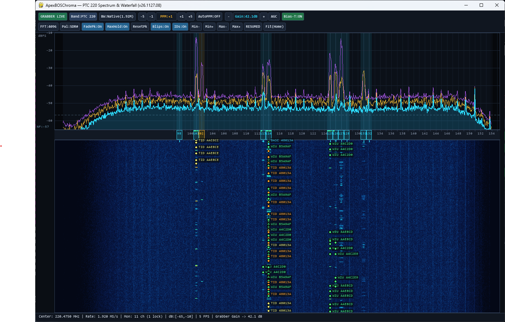
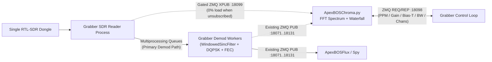
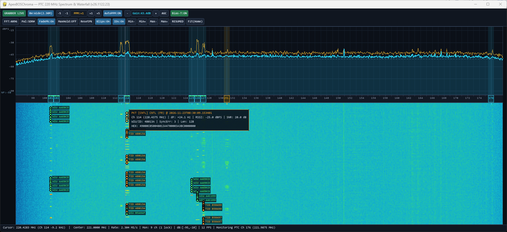
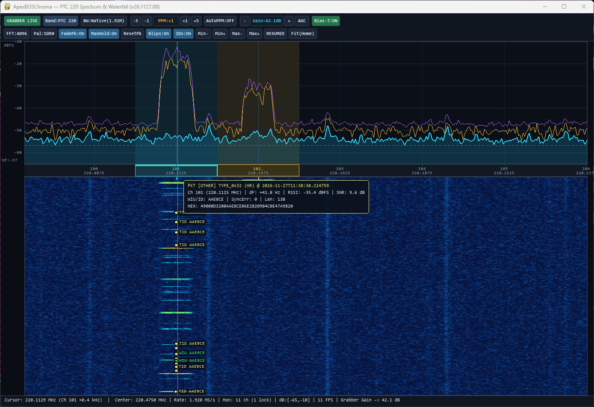
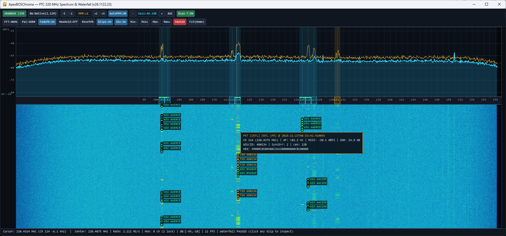
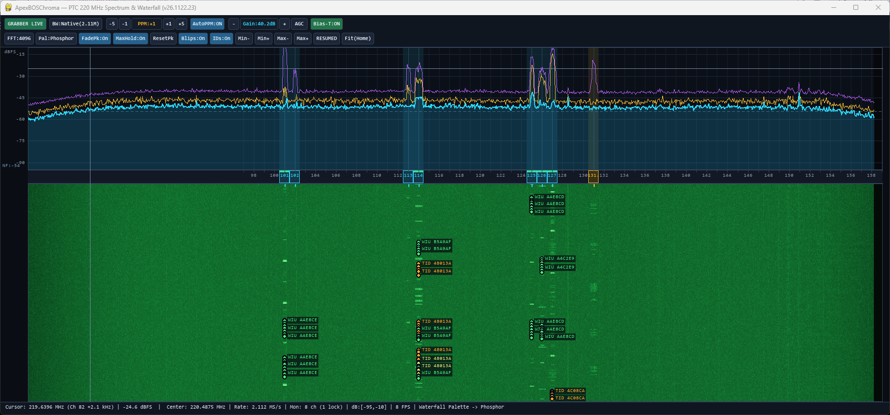
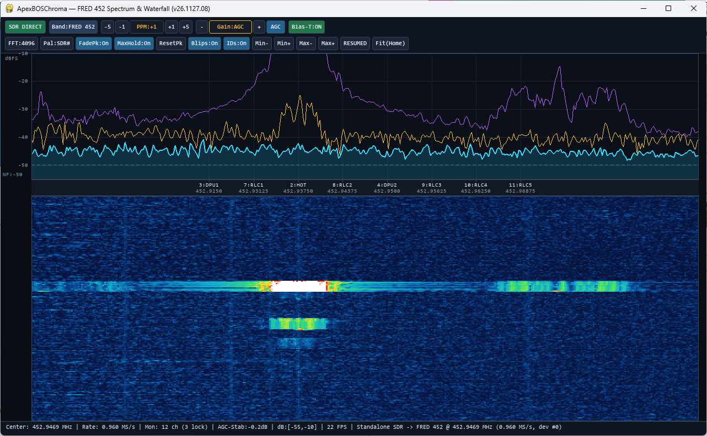

# ApexBOSChroma: Multi-Band Railway RF Spectrum Analyzer & Packet Waterfall

> [!IMPORTANT]
> **Disclaimer & Intended Use**: **ApexBOS is NOT a real Positive Train Control (PTC) system and is not affiliated with any railroad or government agency.** ApexBOS is an experimental reference tool designed for amateur train enthusiasts and radio telemetry hobbyists. It attempts to visualize and decode 220 MHz, 450 MHz, and 900 MHz digital telemetry packets to facilitate hobbyist research and observe SDR reception quality. It must never be used for train movement control, safety-critical railway operations, or commercial dispatching.

**ApexBOSChroma** ([ApexBOSChroma.py](ApexBOSChroma.py)) is a real-time, Pygame-powered FFT spectrum analyzer and scrolling waterfall tailored specifically to North American railway telemetry bands—**ITC 220 MHz PTC (Channels 97–176)**, **900 MHz ATCS (`935`/`896 MHz`)**, and **450 MHz EOT/HOT/DPU/RLC (`457`/`452 MHz`)**.

Designed in the spirit of GQRX and SDR#, Chroma runs directly **alongside [ApexBOSGrabber](GRABBER_README.md), [ApexBOSLatch](LATCH_README.md), or [ApexBOSFred](FRED_README.md) from the same SDR** (RTL-SDR, SDRplay RSP1B/1A/dx/duo, or SoapySDR) without diminishing demodulation sensitivity or packets/min—while also supporting **Standalone Direct SDR** operation across all 3 bands and an offline **`--mock`** demonstration mode.



---

## Table of Contents

1. [Architectural Overview: Zero-Impact Grabber Co-Existence](#architectural-overview-zero-impact-grabber-co-existence)
2. [Interface Overview & Visual Gallery](#interface-overview--visual-gallery)
3. [Spectrum & Waterfall DSP Engine](#spectrum--waterfall-dsp-engine)
4. [PTC Channel Grid & Interactive Ruler (Ch 97–176)](#ptc-channel-grid--interactive-ruler-ch-97176)
5. [Dynamic Bandwidth Switching (Native vs. Wideband)](#dynamic-bandwidth-switching-native-vs-wideband)
6. [Flowing Packet Blips, Enrichment & Inspector](#flowing-packet-blips-enrichment--inspector)
7. [Live SDR Hardware Controls (PPM, Gain, AGC & Bias-T)](#live-sdr-hardware-controls-ppm-gain-agc--bias-t)
8. [Operating Modes & Launcher Integration](#operating-modes--launcher-integration)
9. [Command-Line Reference](#command-line-reference)
10. [Mouse & Keyboard Controls Reference](#mouse--keyboard-controls-reference)
11. [RF Research & SDR Tuning Tips](#rf-research--sdr-tuning-tips)

---

## Architectural Overview: Zero-Impact Grabber Co-Existence

Because an RTL-SDR USB dongle can only be claimed by one OS process at a time, ApexBOSChroma attaches cleanly to a running **ApexBOSGrabber** instance via three lightweight, non-blocking ZeroMQ channels on `127.0.0.1`:



- **Zero Overhead When Closed**: Grabber's gated tap (`zmq.XPUB` on `tcp://127.0.0.1:18099`, with matching taps on `18299` for Latch and `18399` for Fred) tracks active subscribers via XPUB subscription events. When no Chroma window is open (`chroma_subs == 0`), the demodulator performs **zero** copies, serialization, or sends.
- **Full All-Packet Visibility (Including Grabber-Filtered Packets)**: Chroma subscribes to both `b"IQ"` and `b"PKT"` on Grabber's XPUB tap (`18099`). Even when Grabber's default outbound filter (`--filter-ctrl`) withholds `QSTAT/ACK` (`0x01`), `ACQ` (`0x04`), and `CNTL` (`0x05`) from Flux/Engine, Grabber still forwards **all** demodulated packets over `b"PKT"` whenever Chroma is open—so the waterfall never appears to "miss" live RF bursts.
- **Non-Blocking Drop-Oldest IPC & Atomic Retuning**: Even while Chroma is open, the IQ tap uses `SNDHWM=2`, `LINGER=0`, and `zmq.NOBLOCK` throttled to ~26 Hz—if Chroma lags or pauses, frames are dropped silently without ever stalling the SDR reader or worker queues. When toggling Wideband (`W`) or adding/removing channels on the ruler, Chroma keeps its spectrum axes locked to incoming IQ metadata so the trace transitions atomically without frequency jumps.
- **Unmodified Demodulation DSP**: Grabber's `WindowedSincFilter` channelizer and FEC demodulator remain completely untouched, preserving full packet sensitivity and decode yield.
- **Out-of-Process Packet Enrichment**: Chroma runs `parse_packets.py` rule enrichment (including `ctc_rules.json`, `dpu_rules.json`, `atcs_rules.json`, and `rrdata.json` Railroad lookups) inside Chroma's own process.

---

## Interface Overview & Visual Gallery

### Main Live Spectrum & Packet Waterfall (`ChromaMainScreen.png`)
The primary workspace combines a two-row control toolbar, a live dBFS FFT spectrum analyzer (with live EMA trace, translucent fill, fading RSSI peak-hold envelope, and noise-floor line), an interactive PTC 25 kHz channel ruler, a vectorized scrolling waterfall with flowing packet blips and ID flags, and a live cursor telemetry footer.


### Wideband Full-Band PTC View (`ChromaWidebandMode.png`)
Clicking **`BW:Native`** toggles Grabber into **`BW:Wide(2.30M)`** (`2.304 MS/s` centered at `221.000 MHz`), revealing the entire PTC 220 MHz allocation from **Ch 97 (`220.0125 MHz`)** through **Ch 176 (`221.9875 MHz`)** simultaneously while Grabber continues demodulating all configured channels without interruption.



### Zoomed Channel View & Aligned Blips (`ChromaZoomedBlips.png`)
Using the mouse wheel zooms smoothly around the cursor down to a 30 kHz span (~1.2 channels), exposing exact channel center frequencies in MHz on the ruler, burst carrier offsets ($\Delta f$), and pixel-locked packet blips with WIU / `src->dst` / Railroad flags.



### Paused Waterfall & Packet Inspector Card (`ChromaBlipInspector.png`)
Pressing **`Space`** freezes both the waterfall and its locked packet blips. Hovering or clicking any blip opens an on-screen inspector card displaying message category, type, rate (`FR`/`HR`), channel, exact frequency and $\Delta f$ offset, RSSI/SNR, Railroad prefix, WIU/Node ID, route (`src -> dst`), sync bit errors, byte length, and raw HEX payload.



### Alternate Colormaps & Max-Hold Envelope (`ChromaPalettesAndPeaks.png`)
Cycle through five scientific and SDR-inspired colormaps (**`SDR#`**, **`Turbo`**, **`Viridis`**, **`Inferno`**, **`Phosphor`**) and enable **`MaxHold:On`** (violet trace) alongside **`FadePk:On`** (amber decaying peaks) to spot intermittent wayside transmitters over time.



### Standalone Direct SDR Mode (`ChromaStandaloneMode.png`)
When ApexBOSGrabber is not running, click **`Standalone SDR`** (or launch with `--standalone`) to open the RTL-SDR directly at `2.304 MS/s` (`221.000 MHz`) with full live PPM, Gain, and Bias-T control.



---

## Spectrum & Waterfall DSP Engine

- **Vectorized 16-Segment Adaptive Burst-Preserving Welch FFT**: Computes a batch Hann-windowed FFT (`2048`, `4096`, `8192`, or `16384` bins) across up to 16 overlapping segments inside each IQ snapshot. Steady noise bins use pure Welch averaging for a clean, low-variance floor, while short 15–40 ms PTC bursts automatically blend toward segment peak power so brief wayside transmissions never disappear.
- **Max-Pooled Zoom-Out Rendering**: When viewing wide spans where multiple FFT bins map to a single horizontal pixel, Chroma max-pools bins per pixel so narrowband 25 kHz PTC carriers remain sharp and visible at any zoom level.
- **Fading RSSI Peak-Hold & Max-Hold**:
  - **Live EMA Trace (Cyan)**: Smoothed real-time spectrum with translucent under-fill.
  - **Fading Peak-Hold (Amber, `FadePk`)**: Holds peak burst energy briefly (`0.8 s`), then smoothly decays back toward the live trace—ideal for visually tracking sporadic wayside bursts.
  - **Infinite Max-Hold (Violet, `MaxHold`)**: Latches the highest observed power at every frequency bin until cleared (`ResetPk` or **`R`**).
- **Noise Floor & ADC Clipping Detector**: Continuously calculates the 25th-percentile noise floor (dashed horizontal reference line + `NF` readout on the dBFS axis) and inspects raw 8-bit I/Q saturation (`0`/`255` samples). If strong RF energy overloads the RTL-SDR ADC, a red **`! ADC CLIP !`** warning badge appears in the toolbar.
- **AGC Gain-Pump Stabilization (`AGC-Stab`)**: When hardware AGC (`Gain:AGC` / `gain=0`) is active on a bursty TDMA band, the R820T tuner AGC continuously pumps gain up and down. Chroma tracks the 25th-percentile thermal noise floor and automatically cancels per-frame AGC gain shifts so the waterfall stays flat without horizontal zebra striping, while preserving true carrier SNR and leaving absolute dBFS uncompensated whenever fixed manual gain is selected.
- **5 Built-In Waterfall Palettes**: `SDR#`, `Turbo`, `Viridis`, `Inferno`, and `Phosphor`—all applied dynamically via a 256×3 NumPy LUT over a raw `float32` dBFS ring buffer, meaning palette, contrast (`Min`/`Max`), zoom, and pan updates repaint the entire historical waterfall instantaneously.

---

## PTC Channel Grid & Interactive Ruler (Ch 97–176)

Between the spectrum pane and the waterfall sits the **ITC 220 MHz PTC Channel Ruler** covering standard channels **97 through 176** ($f = 217.5875\text{ MHz} + \text{ch} \times 25\text{ kHz}$):

| Visual Indicator | Meaning |
| :--- | :--- |
| **Cyan Shaded Band & Label** | Channel is currently monitored by `ApexBOSGrabber`. |
| **Amber/Gold Shaded Band & `.` Suffix** (e.g. `102.`) | Channel is **locked** in `ApexBOSGrabber` (protected against auto-pruning). |
| **Green Top Activity Bar** | Rolling 60-second decoded packet rate on that channel. |
| **Vertical Channel Gridlines** | Automatically scale density (1, 2, 5, or 10 channel steps) as you zoom in/out; exact MHz frequencies appear when zoomed in. |

- **Click-to-Toggle Channel Monitoring**: In Grabber mode, **left-click or right-click any channel** on the ruler to immediately add or remove it from Grabber's live channel list (Grabber refuses only if you attempt to remove the last remaining channel).

---

## Dynamic Bandwidth Switching (Native vs. Wideband)

To keep Grabber's CPU footprint minimal during normal operation while still letting you survey the entire 220 MHz PTC band when desired:

- **Native Mode (`BW:Native`)**: Grabber runs at its normal minimal sample rate covering only your configured channels.
- **Wideband Mode (`BW:Wide(2.30M)`)**: Clicking **`BW:Native`** (or pressing **`W`**, or launching with `--wideband`) instructs Grabber to expand dynamically to **`2.304 MS/s`** (`12 × 192 kS/s`) centered at **`221.000 MHz`**, covering the entire Ch 97–176 band cleanly. Grabber's worker processes seamlessly rebuild their `ContinuousChannelizer` on the fly with zero restart.
- **Automatic Revert on Close**: When you exit Chroma (or toggle back to Native), Chroma requests Native mode immediately; as a safety net, Grabber also automatically reverts to its original minimal sample rate **8 seconds** after the last Chroma subscriber disconnects (even if Chroma is force-closed).

---

## Flowing Packet Blips, Enrichment & Inspector

Every packet demodulated by Grabber's workers is plotted directly onto the scrolling waterfall at its exact carrier frequency ($f_{\text{ch}} + \Delta f$) and **pixel-locked directly to the waterfall ring buffer's row timestamps** so blips and flags glide down in rigid lockstep with their RF bursts at every depth:

| Blip Color | Category | Typical Railway Telemetry Traffic |
| :---: | :--- | :--- |
| **Black Dot (White Halo)** | `EMP` | Class D Edge Message Protocol / CTC packets (`0x50–0x5F`, `0x70–0x7F`), labeled `EMP 0x70 src->dst` |
| **Green** | `WIU` | Wayside Interface Unit status packets (`0x33`, `0x34`) |
| **Cyan** | `BASE` | Base station beacons & status (`0x02`) |
| **Orange** | `CNTL` | Locomotive / wayside control messages (`0x04`, `0x05`) |
| **Violet** | `TIME` | Time sync / network timing (`0x06`) |
| **Yellow** | `QSTAT` | Query / status messages (`0x01`) |
| **Light Blue** | `ACK` | Acknowledgements |
| **Sky Blue** | `ATCS` | 900 MHz ATCS Spec 200 packets (when viewing `--band atcs` / `atcs_mcp`) |
| **Pink / Amber / Teal** | `EOT` / `HOT` / `DPU` / `RLC` | 450 MHz EOT, HOT, Distributed Power, and Remote Control Locomotive frames (`--band fred` / `fred452`) |

- **Automatic Label Enrichment**: Using `parse_packets.py`, `ptc_status_parser.json`, `config/*rule*.json`, and `rrdata.json`, Chroma annotates blips with concise flags such as `RR:WIU 401001`, `RR:401001->401999`, or `BASE 10A4C2`, with automatic overlap avoidance. Toggle markers with **`Blips`** (`B`) and text flags with **`IDs`** (`I`).
- **Hover & Click Inspection**: Hover over any blip (or press **`Space`** to pause and click a blip to pin it) to inspect full RF & protocol metadata including $\Delta f$, RSSI, SNR, WIU/Route IDs, sync errors, byte length, and raw HEX. Press **`Esc`** to dismiss a pinned card.

---

## Live SDR Hardware Controls (PPM, Gain, AGC & Bias-T)

Row 1 of the toolbar provides real-time hardware tuning (forwarded to Grabber in Grabber mode, or applied directly in Standalone mode):

- **PPM Calibration (`-5`, `-1`, `+1`, `+5`)**: Adjust master oscillator frequency correction live while watching carrier peaks center onto the 25 kHz channel gridlines.
- **Auto-PPM Toggle (`AutoPPM:ON/OFF`)**: Enable or pause Grabber's automated 7-second Δf-based PPM tracker while performing manual RF experiments.
- **RF Gain (`-`, `+`, `AGC`)**: Step through standard R820T/R820T2 discrete gain steps (`0.0` through `49.6 dB`) or enable hardware `AGC`. When `Gain:AGC` is active, the readout highlights in amber and Chroma engages `AGC-Stab` noise-floor stabilization; clicking **`+`** switches to steady fixed manual gain.
- **Bias-T (`Bias-T:ON/OFF`)**: Toggle the RTL-SDR's 4.5 V inline LNA / active-antenna power live.

---

## Operating Modes & Launcher Integration

### 1. Launch from ApexBOS Control Center (`ApexBOSLauncher.py`)
Click the cyan **`Chroma RF Spectrum`** button under **Utilities & Settings** in `ApexBOSLauncher.py`.
- If **ApexBOSGrabber** is already running, Chroma attaches automatically to its IQ tap (`18099`), control bridge (`18098`), and worker packet ports.
- If Grabber is stopped, Chroma shows **`WAIT GRABBER`** and offers a one-click **`Standalone SDR`** button right in the toolbar.
- Clicking **`Stop All Running`** in the Launcher also cleanly stops Chroma.

### 2. Grabber Co-Existence Mode (Default CLI)
```bash
python ApexBOSChroma.py
# Or auto-expand Grabber to 2.304 MS/s wideband on connect:
python ApexBOSChroma.py --wideband
```

### 3. Standalone Direct SDR Mode (No Grabber Required — All 3 Bands)
```bash
python ApexBOSChroma.py --standalone
# Or launch directly on ATCS 935/896 MHz or FRED 457/452 MHz:
python ApexBOSChroma.py --standalone --band atcs
python ApexBOSChroma.py --standalone --band atcs_mcp
python ApexBOSChroma.py --standalone --band fred
python ApexBOSChroma.py --standalone --band fred452
```
Opens your configured SDR directly (supporting RTL-SDR via `pyrtlsdr` / `rtl_tcp` / `rtl_sdr` pipe, **SDRplay RSP1B/RSP1A/RSPdx/RSPduo** via `rsp_tcp` standard 8-bit or `-E` 16-bit `CS16`, and **SoapySDR** `CS16` devices via `config.json`'s `grabber.sdr_mode`) and supports live spectrum & waterfall monitoring across **all 3 bands** via the **`Band:`** toolbar button (or `--band`): **PTC 220 MHz**, **ATCS 935 MHz (BCP)**, **ATCS 896 MHz (MCP)**, **FRED 457 MHz (EOT + DPU Ch 3–4)**, and **FRED 452 MHz (HOT + DPU Ch 1–2 + RLC Ch 1–5)**. Both 8-bit (`u8`) and 16-bit signed (`s16`) IQ streams from Grabber or Standalone mode are decoded with calibrated dBFS scaling and ADC clipping detection.

### 4. Offline Mock PTC Mode (No Hardware Needed)
```bash
python ApexBOSChroma.py --mock
```
Generates realistic synthetic 220 MHz PTC bursts, live PPM/gain response, and enriched packet blips for offline testing, UI demos, and layout verification.

---

## Command-Line Reference

| Flag | Default | Description |
| :--- | :---: | :--- |
| `--config PATH` | `config.json` | Path to unified ApexBOS `config.json` (loads channels, PPM, gain, bias-T, and worker ZMQ ports). |
| `--chroma-port PORT` | `18099` | Grabber `XPUB` IQ tap port on `127.0.0.1`. |
| `--ctrl-port PORT` | `18098` | Grabber `REP` control bridge port on `127.0.0.1`. |
| `--wideband` | `False` | Automatically expand Grabber to `2.304 MS/s` wideband (Ch 97–176) upon connecting. |
| `--standalone` | `False` | Open the SDR directly without attaching to Grabber/Latch/Fred. |
| `--band BAND` | `ptc` | Active RF band profile: `ptc` (220 MHz), `atcs` (935 MHz BCP), `atcs_mcp` (896 MHz MCP), `fred` (457 MHz EOT/DPU3–4), or `fred452` (452 MHz HOT/DPU1–2/RLC1–5). |
| `--mock` | `False` | Run with synthetic bursts and packet blips across all 3 bands (no SDR required). |
| `--width PX` | `1280` | Initial resizable window width in pixels. |
| `--height PX` | `760` | Initial resizable window height in pixels. |

---

## Mouse & Keyboard Controls Reference

### Mouse Controls
| Action | Target Area | Behavior |
| :--- | :--- | :--- |
| **Scroll Wheel** | Spectrum, Ruler, or Waterfall | Zoom frequency span in/out anchored at the cursor frequency. |
| **Scroll Wheel** | Left dBFS Axis | Adjust waterfall / spectrum minimum dB floor (`±5 dB`). |
| **Left-Click & Drag** | Spectrum or Waterfall | Pan horizontally across the 220 MHz band. |
| **Left-Click & Drag** | Left dBFS Axis | Shift the visible dBFS amplitude window up or down. |
| **Right-Click** | Spectrum or Waterfall | Reset zoom & pan to fit the captured band (`Fit`). |
| **Left- or Right-Click** | Channel Ruler | Toggle monitoring of that PTC channel in Grabber. |
| **Hover / Left-Click** | Waterfall Packet Blip | Hover to preview packet details; click to pin the Inspector card (click empty waterfall or press `Esc` to unpin). |

### Keyboard Shortcuts
| Key | Action |
| :---: | :--- |
| **`Space`** | Pause / resume waterfall & spectrum updates (freezes blips for easy inspection). |
| **`Home`** | Reset zoom and pan to fit the currently captured RF bandwidth. |
| **`+` / `=`** | Zoom in around the center of the current view. |
| **`-`** | Zoom out around the center of the current view. |
| **`W`** | Toggle Wideband (`2.304 MS/s`) vs. Native Grabber bandwidth. |
| **`P`** | Cycle waterfall color palette (`SDR#`, `Turbo`, `Viridis`, `Inferno`, `Phosphor`). |
| **`R`** | Reset fading RSSI peaks and Max-Hold envelope. |
| **`B`** | Toggle packet blip markers on/off. |
| **`I`** | Toggle packet blip WIU / `src->dst` / Railroad text flags on/off. |
| **`Esc`** | Close pinned packet inspector card (or exit Chroma if no card is pinned). |

---

## RF Research & SDR Tuning Tips

- **Dialing In Gain for Clean Decoding**: Switch from `AGC` to fixed manual gain (`+`/`-`) and raise gain until the noise floor rises ~3–5 dB above its baseline while keeping strong local bursts below `-10 dBFS` so **`! ADC CLIP !`** never triggers.
- **Verifying Master Oscillator PPM**: Zoom into an active continuous or frequent channel (such as a base station beacon), disable `AutoPPM`, and step PPM (`-1`/`+1`) until the carrier spike sits dead-center on the vertical channel gridline (and blip inspector $\Delta f$ reads near `0 Hz`).
- **Hunting Unmonitored Channels**: Click **`BW:Native`** to expand to **`BW:Wide(2.30M)`**, turn on **`MaxHold:On`**, and watch for violet energy peaks appearing on unhighlighted channels—then simply click those channels on the ruler to start demodulating them live in Grabber.
