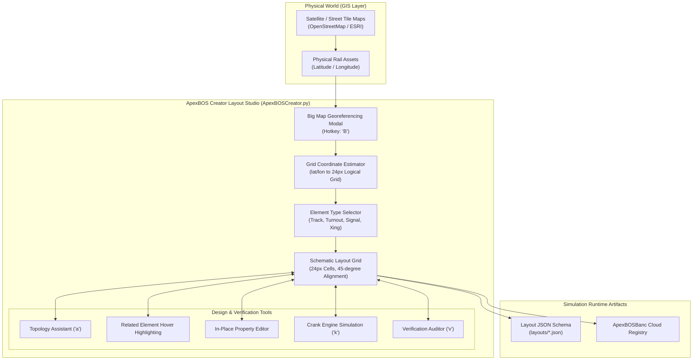
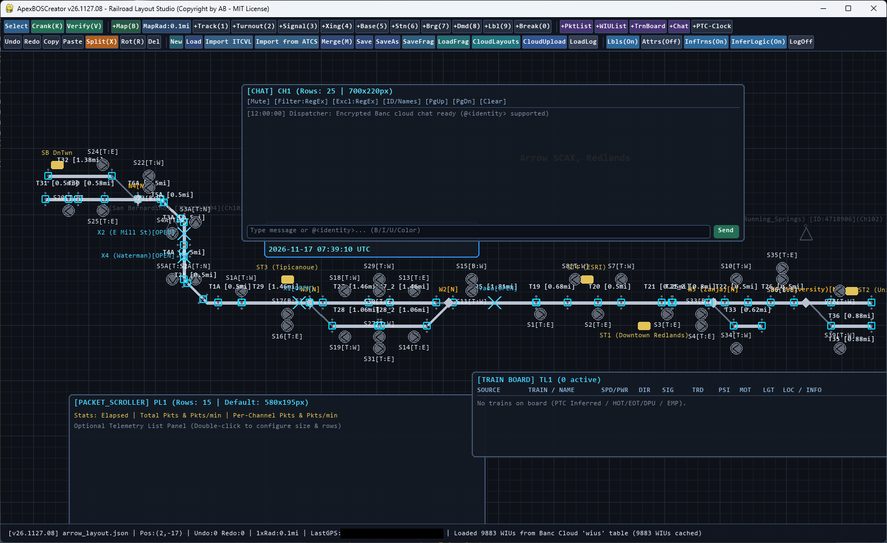
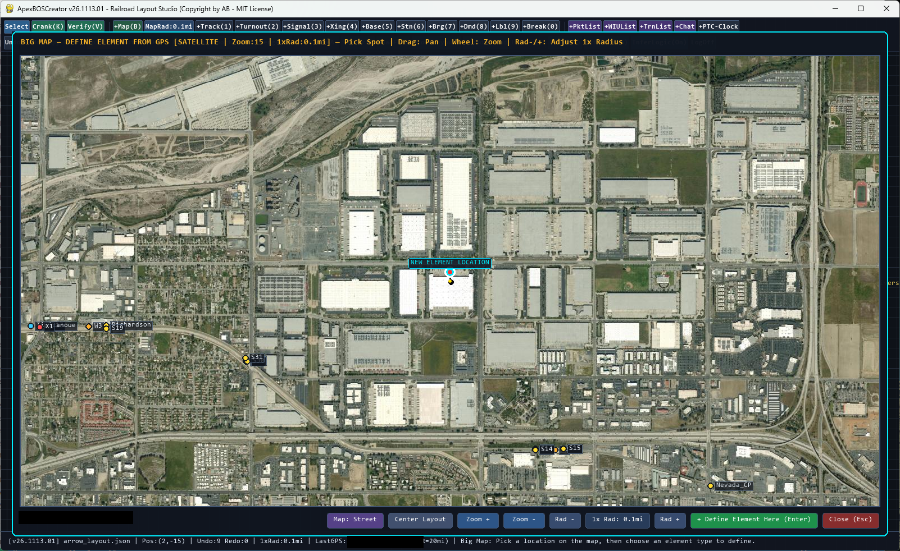
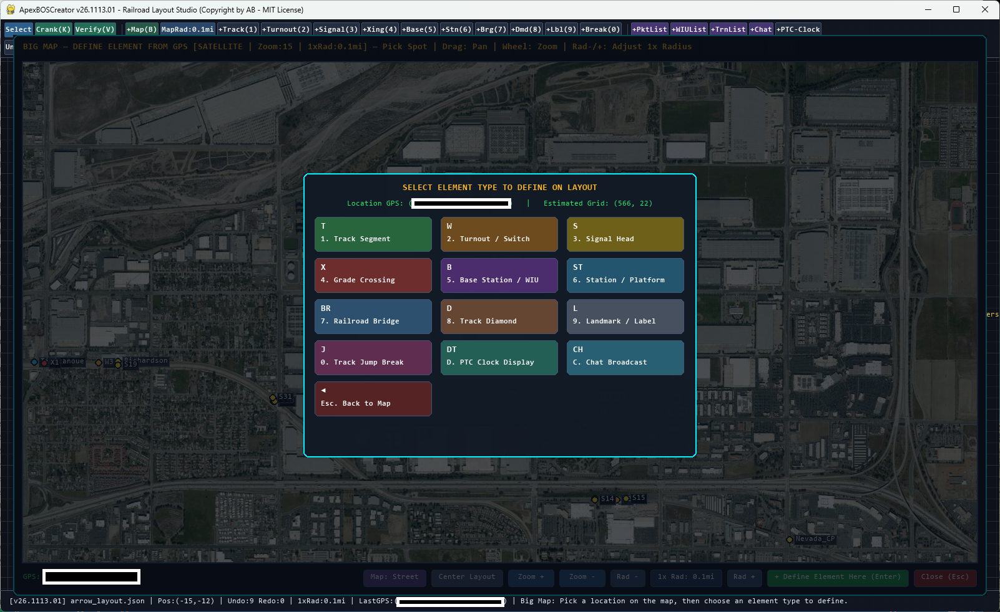
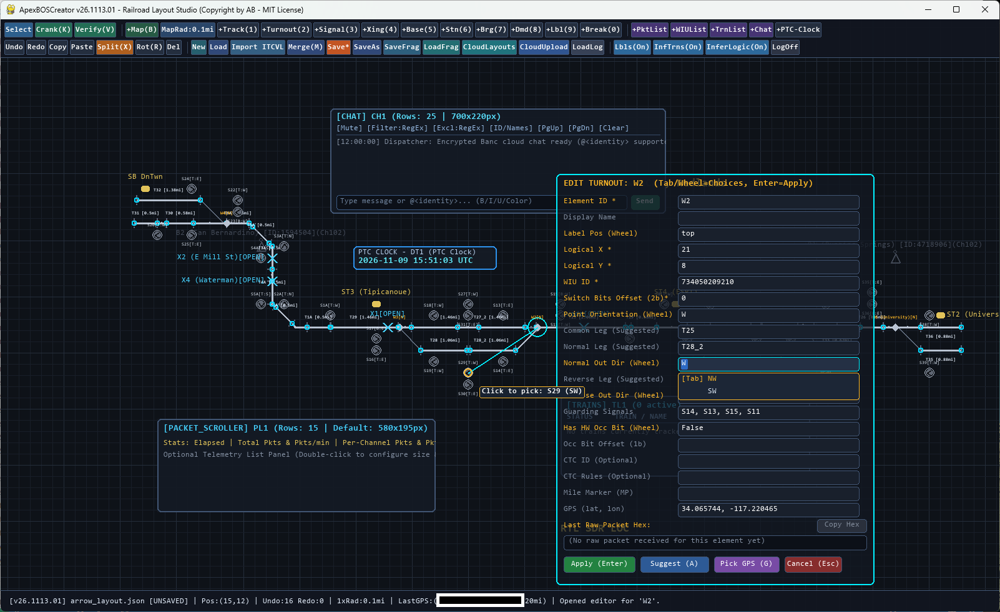
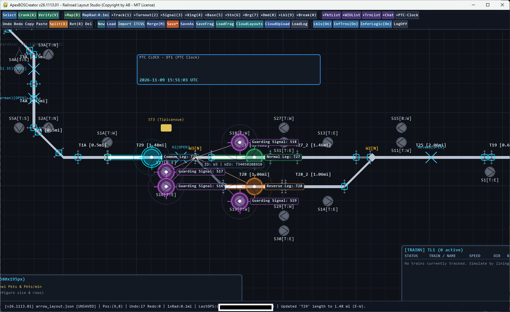
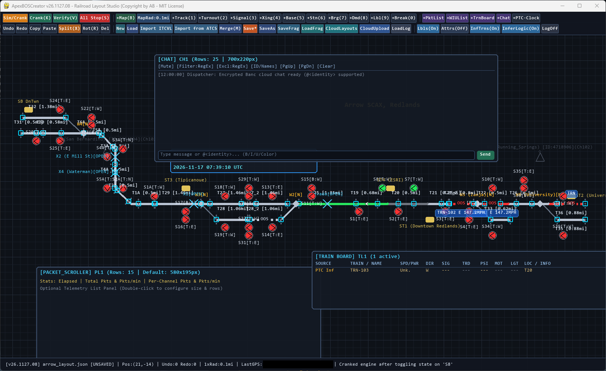

# ApexBOS Creator: Railroad Layout Editor, GPS Georeferencing & Verification Studio

> [!IMPORTANT]
> **Disclaimer & Intended Use**: **ApexBOS is NOT a real Positive Train Control (PTC) system and is not affiliated with any railroad or government agency.** ApexBOS is an experimental reference tool designed for amateur train enthusiasts and radio telemetry hobbyists. It attempts to decode 220 MHz digital telemetry packets to facilitate hobbyist research and visualize the status of elements defined on a layout. It must never be used for train movement control, safety-critical railway operations, or commercial dispatching.

**ApexBOS Creator** ([ApexBOSCreator.py](ApexBOSCreator.py)) is the graphical layout design, georeferenced authoring environment, and simulation verification studio of the **ApexBOS** Railroad Dispatcher & Trackside Simulation ecosystem.

Built on Pygame with anti-aliased vector rendering, the Creator allows hobbyists, track enthusiasts, and armchair dispatchers to build precision track network layouts from scratch. It features an innovative **GPS-driven authoring pipeline** that lets operators locate physical rail infrastructure on live satellite and street maps and instantiate georeferenced dispatcher elements directly onto the schematic grid. It also includes an embedded simulation engine, live topology assistant, multi-element relationship inspector, packet playback studio, and automated layout verification auditor.

```
+----------------------------------------------------------------------------------------------------+
|                                    GEOGRAPHIC INGESTION LAYER                                      |
|  OpenStreetMap & ESRI Satellite Tile Cache    <--->    Wayside Telemetry / WIU Cache               |
+--------------------------------------------------+-------------------------------------------------+
                                                   |
                                                   v
+----------------------------------------------------------------------------------------------------+
|                     APEXBOS CREATOR STUDIO (ApexBOSCreator.py Layout Studio)                       |
|                                                                                                    |
|  [ GPS-Driven Design ]      --> [ Schematic Vector Grid ]   --> [ Topological Assistant ]          |
|  - Fullscreen Big Map (B)       - 24px Logical Grid Scale       - Auto-Connection Wiring ('a')     |
|  - Real-World Satellite Pick    - 1-Cell Gapless Welding        - Interlocking Path Solvers        |
|  - Grid Position Estimation     - 45-Degree Route Geometry      - Split & Join Tracks ('x')        |
|                                                                                                    |
|  [ Relationship Inspector ]                                 [ Simulation & Verification ]          |
|  - Shift+Hover: Legs, Guards & Blocks                       - All Stop ('S') & Crank Engine ('k')  |
|  - Signal Guard & Rear Track Highlighting                   - Green Path Alignment Check           |
|  - In-Place Property Editor & Wi-Fi WIU Mapper              - Automated Topological Audit ('v')    |
|  - Reusable Sub-Layout Fragments (Ctrl+F)                   - Recorded Packet Playback (Space)     |
+--------------------------------------------------+-------------------------------------------------+
                                                   |
                                                   v
+----------------------------------------------------------------------------------------------------+
|                                      SIMULATION DISTRIBUTION                                       |
|  - Local Layout JSON (`layouts/*.json`)                                                            |
|  - Banc Cloud Remote Repository (Ctrl+Shift+B)                                                     |
|  - Dispatcher Engine Runtime (dispatcher_engine.py / ApexBOS.220.py)                               |
+----------------------------------------------------------------------------------------------------+
```

---

## Table of Contents

1. [Architectural Overview & Design Philosophy](#architectural-overview--design-philosophy)
2. [Interface Overview & Visual Gallery](#interface-overview--visual-gallery)
   - [Main Editor Canvas (`CreatorMainScreen.png`)](#main-editor-canvas-creatormainscreenpng)
   - [Big Map Georeferencing Modal (`CreatorBigMapGPS.png`)](#big-map-georeferencing-modal-creatorbigmapgpspng)
   - [Element Type Selector (`CreatorElementTypeSelector.png`)](#element-type-selector-creatorelementtypeselectorpng)
   - [In-Place Property Editor (`CreatorInplaceEditor.png`)](#in-place-property-editor-creatorinplaceeditorpng)
   - [Related Element Hover Highlighting (`CreatorRelatedElementsHover.png`)](#related-element-hover-highlighting-creatorrelatedelementshoverpng)
   - [Simulation & Verification Studio (`CreatorSimulationVerification.png`)](#simulation--verification-studio-creatorsimulationverificationpng)
3. [GPS-Driven Layout Authoring Tutorial](#gps-driven-layout-authoring-tutorial)
   - [Concept: Grounding Schematics in Real Geography](#concept-grounding-schematics-in-real-geography)
   - [Step-by-Step Walkthrough: Building a Simple Interlocking](#step-by-step-walkthrough-building-a-simple-interlocking)
   - [Adjusting Map View Radius & Estimated Grid Scale](#adjusting-map-view-radius--estimated-grid-scale)
4. [Schematic Editing & Track Geometry Engine](#schematic-editing--track-geometry-engine)
   - [Placement Tools (Tracks, Turnouts, Signals, Crossings, Base Stations)](#placement-tools-tracks-turnouts-signals-crossings-base-stations)
   - [1-Cell Gapless Track Welding & 45-Degree Geometry](#1-cell-gapless-track-welding--45-degree-geometry)
   - [Track Splitting (`'x'`) & Handle-Based Reshaping](#track-splitting-x--handle-based-reshaping)
   - [Multi-Selection, Box Selection & Bulk Movement](#multi-selection-box-selection--bulk-movement)
5. [Topology Assistant & Connection Wiring](#topology-assistant--connection-wiring)
   - [Automatic Adjacency Suggestion (`'a'`)](#automatic-adjacency-suggestion-a)
   - [Track Neighbor Relationships (`N`, `S`, `E`, `W`)](#track-neighbor-relationships-n-s-e-w)
   - [Turnout Common, Normal & Reverse Route Binding](#turnout-common-normal--reverse-route-binding)
   - [Signal Governance, Protected & Rear Block Correlation](#signal-governance-protected--rear-block-correlation)
6. [Related Elements Hover Visualization](#related-elements-hover-visualization)
   - [Track Element Hover: Neighbors & Parallel Tracks](#track-element-hover-neighbors--parallel-tracks)
   - [Signal Element Hover: Protected vs. Rear Blocks](#signal-element-hover-protected-vs-rear-blocks)
   - [Turnout Element Hover: Common, Normal, Reverse & Guard Signals](#turnout-element-hover-common-normal-reverse--guard-signals)
7. [In-Place Property Editor & WIU Assignment](#in-place-property-editor--wiu-assignment)
   - [Editing Element Properties](#editing-element-properties)
   - [Wayside Interface Unit (WIU ID) Assignment](#wayside-interface-unit-wiu-id-assignment)
   - [Bit Offsets: Signal Aspects, Switch Alignment & Track Occupancy](#bit-offsets-signal-aspects-switch-alignment--track-occupancy)
8. [Simulation, Verification & Packet Playback](#simulation-verification--packet-playback)
   - [Sim Mode & All Signals to Stop (`All Stop(S)` / `'S'`)](#sim-mode--turn-all-signals-to-stop-all-stops--s)
   - [The Crank Engine Simulation (`'k'`)](#the-crank-engine-simulation-k)
   - [Verifying Cleared Green Paths & Route Interlocking](#verifying-cleared-green-paths--route-interlocking)
   - [Automated Layout Topology Audit (`'v'`)](#automated-layout-topology-audit-v)
   - [Recorded Packet Stream Playback (`Space`, `[`, `]`)](#recorded-packet-stream-playback-space---)
9. [Sub-Layout Fragments, Cloud Sync & Merging](#sub-layout-fragments-cloud-sync--merging)
   - [Saving & Loading Layout Fragments (`Ctrl+F` / `Ctrl+Shift+F`)](#saving--loading-layout-fragments-ctrlf--ctrlshiftf)
   - [ApexBOSBanc Cloud Layout Publishing (`Ctrl+Shift+B`)](#apexbosbanc-cloud-layout-publishing-ctrlshiftb)
   - [Merging External Layout Files (`'m'`)](#merging-external-layout-files-m)
10. [Command-Line Options & Configuration](#command-line-options--configuration)
11. [Interactive Keyboard & Mouse Reference](#interactive-keyboard--mouse-reference)

---

## Architectural Overview & Design Philosophy

Railway dispatcher displays represent a deliberate abstraction: tracks are straightened into clean horizontal lines, curves are normalized to 45-degree angles, and complex interlocking geography is formatted for instant dispatcher legibility. However, modern Positive Train Control systems operate strictly on physical GPS coordinates and microsecond RF telemetry.

ApexBOS Creator bridges this divide through a dual-representation architecture:



Every element on the schematic grid retains its physical latitude and longitude coordinates. This enables:
- **Automatic Direction & Length Calculation**: Track segment lengths (in miles) can be automatically calculated from physical endpoint coordinates.
- **Accurate Train Kinematics**: Train speeds in the Dispatcher Engine are calculated using physical GPS coordinates rather than schematic grid distances.
- **Viewer GIS Map Alignment**: The [ApexBOS Viewer](VIEWER_README.md) can seamlessly render physical satellite overlays behind schematic tracks.

---

## Interface Overview & Visual Gallery

Below is the visual gallery of the Creator's operational tools:

### Main Editor Canvas (`CreatorMainScreen.png`)



- **Toolbar (Top HUD)**: Single-click tools for saving, loading, georeferencing (`+Map(B)`), radius selection, element placement (`+Track`, `+Turnout`, `+Signal`, `+Xing`), verification (`Verify(V)`), and simulation (`Crank(K)`).
- **Schematic Canvas**: 24-pixel logical grid with minor and major grid subdivisions, element labels, multi-head signal heads, and turnout ties.
- **Status & Coordinates Bar (Bottom Footer)**: Shows active placement tool, cursor grid position `(X, Y)`, selection counts, undo/redo depth, and operation toasts.

---

### Big Map Georeferencing Modal (`CreatorBigMapGPS.png`)



- **Fullscreen GIS Navigator**: Opened with `'b'` or the `+Map(B)` button.
- **Satellite & Street Layers**: Toggle between high-resolution ESRI Aerial Satellite imagery and OpenStreetMap cartography.
- **Target Pinning**: Left-drag to pan; scroll wheel to zoom. Clicking drops a target locator pin showing `Picked GPS: lat, lon` and automatically calculating `Estimated Grid: (X, Y)`.
- **Define Action**: Pressing `Enter` or clicking `+ Define Element Here` opens the element selection menu.

---

### Element Type Selector (`CreatorElementTypeSelector.png`)



- **Numbered Palette**: Quick numeric selection (`1` for Track, `2` for Turnout, `3` for Signal, `4` for Grade Crossing, `5` for Base Station, etc.).
- **Automatic Coordinates Seeding**: Instantiates the selected element directly on the dispatcher canvas with the exact GPS coordinates captured from the map.

---

### In-Place Property Editor (`CreatorInplaceEditor.png`)



- **Floating Inspector Window**: Double-clicking or selecting an element opens its in-place property table.
- **Field Editing**: Adjust Element ID, Display Label, Orientation, Length (Miles), WIU Address, Bit Offsets, and Adjacency links without leaving the canvas.
- **GPS Verification**: Includes a direct button to inspect or fine-tune GPS coordinates on a localized map inset.

---

### Related Element Hover Highlighting (`CreatorRelatedElementsHover.png`)



- **Interactive Visual Debugger**: Holding `Shift` while hovering the mouse over any element illuminates its entire relational topology:
  - **Tracks**: Shows neighboring tracks in green and parallel tracks in gray.
  - **Signals**: Shows governed/protected block in green and rear approach block in yellow.
  - **Turnouts**: Shows common leg in yellow, normal tangent leg in green, reverse diverging leg in blue/magenta, and guarding signals with leader lines and pulsing rings.
  *(Normal hover without `Shift` displays standard element tooltip metadata without cluttering the canvas).*

---

### Simulation & Verification Studio (`CreatorSimulationVerification.png`)



- **Sim / Crank Mode**: Interactive simulation mode toggled via `Sim/Crank` HUD button. Clicking elements directly cycles signal aspects, switch points, and track occupancy.
- **Turn All Signals to Stop (`All Stop(S)` / `'S'`)**: Instantly turns every signal across the layout to Red (Stop), triggering restrictive drop notifications and running engine simulation passes.
- **Crank Engine (`'k'`)**: Simulates live dispatcher rules directly inside the Creator. Signals transition between Stop, Approach, and Clear; turnouts swing between Normal and Reverse; and authorized green routes light up along cleared blocks.
- **Verification Audit (`'v'`)**: Evaluates the network for missing connections, unreferenced signals, and orphan tracks, outputting an instant diagnostic report.

---

## GPS-Driven Layout Authoring Tutorial

The **GPS-Driven Authoring Technique** is the fastest and most accurate way to create prototypical railway layouts in ApexBOS.

### Concept: Grounding Schematics in Real Geography

Rather than arbitrarily placing tracks on an empty canvas and later attempting to match them to field equipment, the operator works directly from physical rail alignments:
1. Locate the physical railroad interlocking or corridor on aerial satellite imagery.
2. Select the key track components (switches, signals, crossings) directly from the imagery.
3. The Creator automatically projects physical latitude/longitude positions onto the schematic grid while maintaining topological proportions.

### Step-by-Step Walkthrough: Building a Simple Interlocking

Let us construct a standard single-track mainline diverging into a passing siding via a power turnout with governing signals:

#### Step 1: Open the Big Map
1. Launch ApexBOSCreator:
   ```bash
   python ApexBOSCreator.py
   ```
2. Press `B` on your keyboard (or click `+Map(B)` on the top toolbar).
3. The **Big Map** modal appears, displaying aerial imagery.

#### Step 2: Locate the Physical Railway Junction
1. Left-click and drag to pan across the territory (e.g. following a Union Pacific or BNSF mainline corridor).
2. Rotate the mouse scroll wheel to zoom in to rail level (Zoom 15–17).
3. Click the `Map: Street / Satellite` button to toggle imagery if track details or switch frogs are obscured.

#### Step 3: Pick and Define the Power Turnout
1. Click the crosshair cursor directly on the physical switch points (where the turnout splits).
2. The coordinate banner updates: `Picked GPS: 34.123456, -118.654321 ➔ Estimated Grid: (0, 0)`.
3. Click `+ Define Element Here (Enter)` or press `Enter`.
4. The Element Selector menu opens. Press `2` (Turnout / Switch).
5. *Result*: The modal closes, the canvas centers on grid `(0, 0)`, and a new Turnout `W1` is instantiated with its physical GPS pre-populated.

#### Step 4: Define the West Mainline Track
1. Press `B` to re-open the Big Map.
2. Pan slightly west along the mainline track (~0.5 miles).
3. Click the track center line and press `Enter`.
4. In the Element Selector, press `1` (Track Segment).
5. *Result*: A new Track segment `T1` is instantiated west of the switch.

#### Step 5: Define the East Mainline and Siding Tracks
1. Press `B`, pan slightly east along the tangent mainline, click, and press `Enter` $\rightarrow$ `1` (Track `T2`).
2. Press `B`, pan slightly northeast along the diverging siding, click, and press `Enter` $\rightarrow$ `1` (Track `T3`).

#### Step 6: Define Governing Signals
1. Press `B`, click on the physical signal mast governing eastward moves into the turnout, and press `Enter` $\rightarrow$ `3` (Signal `S1`).
2. Repeat for the two signals governing westward moves off the mainline (`S2`) and siding (`S3`).

#### Step 7: Auto-Wire Topology with the Assistant
1. On the schematic canvas, press `Ctrl+A` (or drag a box selection) to select all placed elements.
2. Press `A` (Topology Assistant).
3. The Topology Assistant automatically analyzes relative orientations and connects:
   - `W1` Common Leg $\rightarrow$ `T1`
   - `W1` Normal Leg $\rightarrow$ `T2`
   - `W1` Reverse Leg $\rightarrow$ `T3`
   - `S1` Protects $\rightarrow$ `W1`, Rear $\rightarrow$ `T1`
4. Press `K` (Crank Engine). The interlocking immediately simulates, showing green authorized routes and valid signal aspects!

### Adjusting Map View Radius & Estimated Grid Scale

The scale relationship between physical GPS miles and schematic grid units is governed by the `MapRad` setting:
- Click `MapRad:Nmi` on the toolbar (or press `Rad -` / `Rad +` inside the Big Map).
- Selecting smaller radii ($0.25\text{ mi} - 1.0\text{ mi}$) expands dense interlocking switches over wider grid areas.
- Selecting larger radii ($10\text{ mi} - 50\text{ mi}$) condenses multi-subdivision corridors onto a single dispatching board.

---

## Schematic Editing & Track Geometry Engine

### Placement Tools (Tracks, Turnouts, Signals, Crossings, Base Stations)

Elements can also be placed manually using the top toolbar buttons or numeric keys:

| Key | Tool | Schema Element | Description & Placement Mechanics |
| :---: | :--- | :--- | :--- |
| `1` | **Track** | `track` | Click and drag across the canvas to draw tangent or 45-degree track segments. |
| `2` | **Turnout** | `turnout` | Click to place switch points. Automatically aligns common and diverging legs. |
| `3` | **Signal** | `signal` | Click adjacent to track to place mast. Direction arrows indicate governed route. |
| `4` | **Crossing** | `crossing` | Click to place grade crossing island circuit across highway intersections. |
| `5` | **Base Station**| `base` | Places 220 MHz base radio tower for RF coverage monitoring. |
| `6` | **Station** | `station` | Places passenger platform or station stop marker. |
| `7` | **Bridge** | `bridge` | Places truss bridge or viaduct decorative symbol over water/canyons. |
| `8` | **Diamond** | `diamond` | Places non-interlocked rail crossing diamond. |
| `9` | **Label** | `label` | Places customizable text banner, milepost, or control point name. |
| `0` | **Track Jump** | `track_jump` | Places broken-line track connector for layout jumps across screen edges. |

### 1-Cell Gapless Track Welding & 45-Degree Geometry

- **Magnetic Snapping**: Dragging a track endpoint within 1 grid cell of another track endpoint automatically welds them into a continuous circuit.
- **Prototypical Angles**: Diagonal track movements strictly adhere to 45-degree angles (`NE`, `NW`, `SE`, `SW`), preserving authentic railroad board aesthetics.

### Track Splitting (`'x'`) & Handle-Based Reshaping

- **Splitting Blocks (`'x'`)**: Select any track segment and press `'x'`. The track splits at its midpoint into two connected segments (`T1_A` and `T1_B`), ideal for inserting intermediate signals or crossovers.
- **Endpoint Handles**: Clicking a track segment reveals cyan endpoint handles (`COLOR_HANDLE`). Dragging a handle moves that end while keeping the opposite end pinned.

### Multi-Selection, Box Selection & Bulk Movement

- **Box Selection**: Left-click and drag across an empty area of the canvas to draw a selection rectangle.
- **Bulk Dragging**: Click and drag any selected element to move the entire interlocking as a unified block without breaking internal connections.

---

## Topology Assistant & Connection Wiring

The Creator ensures layouts function as unified electrical networks rather than isolated visual drawings.

### Automatic Adjacency Suggestion (`'a'`)

Selecting one or more elements and pressing `'a'` triggers `LayoutTopologyAssistant.auto_suggest_connections`:
- Evaluates spatial proximity, directional vectors, and endpoint alignment.
- Binds neighboring tracks into bidirectional adjacency lists (`neighbors: { "E": ["T2"], "W": ["T0"] }`).
- Sets common, normal, and reverse switch legs.

### Turnout Common, Normal & Reverse Route Binding

Turnout routing defines train paths through junctions:
- **Common Neighbor**: The single track feeding the points of the switch.
- **Normal Neighbor**: The straight/tangent route continuation (active when switch is Normal).
- **Reverse Neighbor**: The diverging route continuation (active when switch is Reverse).

### Signal Governance, Protected & Rear Block Correlation

Signals govern movements across specific track blocks:
- **Protected Element**: The block immediately in advance of the signal head. If occupied, signal displays Stop (`red`).
- **Rear Element**: The approach block preceding the signal mast. Used by the Dispatcher Engine to project stopping headway and train progression.

---

## Related Elements Hover Visualization

To eliminate guesswork when inspecting complex junctions, the Creator incorporates real-time relationship highlighting activated by holding the **`Shift`** key while hovering over an element:

> [!NOTE]
> **Shift Key Requirement**: Visual relationship lines, leader callouts, and target reticles appear **only when holding the `Shift` key** while hovering over a track, signal, or turnout. Normal hovering without `Shift` displays the standard compact element information tooltip (ID, display name, WIU address, and RSSI) to keep the canvas clean during authoring.

```
        [ Shift + Hovering Cursor Over Turnout W1 ]
                         |
         +---------------+---------------+
         |               |               |
         v               v               v
  Common Leg (T3)  Normal Leg (T2) Reverse Leg (T1)
  [Yellow Leader]  [Green Leader]  [Blue Leader]
         |               |               |
         +---------------+---------------+
                         |
                         v
                Guarding Signals (S2, S3, S4, S5)
                [Cyan Rings & Connecting Lines]
```

### Track Element Hover: Neighbors & Parallel Tracks
- **Green Outline**: Highlights adjacent connecting neighbor tracks (`E`, `W`, `N`, `S`).
- **Gray Outline**: Highlights designated parallel mainline tracks used for siding correlation.

### Signal Element Hover: Protected vs. Rear Blocks
- **Green Outline**: Highlights the protected forward track block.
- **Yellow Outline**: Highlights the rear approach track block.

### Turnout Element Hover: Common, Normal, Reverse & Guard Signals
- **Yellow Outline & Leader Line**: Highlights the common entry track leg.
- **Green Outline & Leader Line**: Highlights the normal tangent track leg.
- **Blue/Magenta Outline & Leader Line**: Highlights the reverse diverging track leg.
- **Cyan Pulsing Rings**: Highlights all signals guarding movements across the switch points.

---

## In-Place Property Editor & WIU Assignment

Double-clicking any element (or pressing `Enter`) opens the In-Place Property Editor:

### Editing Element Properties
- **ID & Display Label**: Assign canonical IDs (e.g. `CP_NEVADA_1`) and dispatcher display names.
- **Orientation**: Sets track compass heading (`E-W`, `N-S`, `NE-SW`, `NW-SE`).
- **Length in Miles**: Physical segment length used for train speed calculation.

### Wayside Interface Unit (WIU ID) Assignment
- Assigns the 24-bit Wayside Interface Unit (WIU) hardware address.
- Multiple signals and switches can share the same WIU ID to emulate integrated field controller bungalows.

### Bit Offsets: Signal Aspects, Switch Alignment & Track Occupancy
- **`sig_bit_offset`**: Starting bit offset in the WIU status word for decoding 5-bit signal aspect codes.
- **`cmd_bit_offset`**: Starting bit offset for 2-bit switch position verification (`01` Normal, `10` Reverse).
- **`occ_bit_offset`**: Bit index for direct hardware track circuit occupancy.

---

## Simulation, Verification & Packet Playback

### Sim Mode & Turn All Signals to Stop (`All Stop(S)` / `'S'`)

Clicking `Sim/Crank` in the HUD switches the Creator into simulation mode, allowing authors to manually test interlockings, route permissions, and train detection logic:
- **Click Elements to Toggle Physical State**:
  - **Tracks**: Cycles unallocated -> train occupied (Eastbound) -> clear.
  - **Turnouts**: Toggles Normal (0) -> Reverse (1) -> Occupied.
  - **Signals**: Cycles aspects (Clear/Green -> Approach/Yellow -> Flashing Yellow -> Stop/Red -> MOW/Magenta -> Dark).
- **Turn All Signals to Stop (`All Stop(S)` / `'S'`)**:
  - In `Sim/Crank` mode, a red **`All Stop(S)`** button appears in the primary HUD toolbar (also mapped to keyboard shortcut **`'S'`**).
  - Clicking this button instantly sets **every signal across the entire layout to Stop (Red)**.
  - Permissive signals that drop to restrictive Stop aspects automatically record drop timestamps and notify the downstream inference engine, followed by an immediate simulation crank. This allows authors and dispatchers to verify emergency all-stop actions, signal drop reactions, and route revocations across complex plant interlockings with a single click.

### The Crank Engine Simulation (`'k'`)

Pressing `'k'` (or clicking `Crank(K)`) executes an in-memory instance of the [Dispatcher Engine](ENGINE_README.md) across the active layout:
- Cycles signals through valid aspect sequences.
- Aligns turnouts between Normal and Reverse.
- Illuminates authorized routes with bright green lines to verify signal interlocks.

### Verifying Cleared Green Paths & Route Interlocking

If a green path fails to illuminate when an approach signal clears, the Creator allows immediate diagnosis:
1. Verify the turnout's `common_neighbor`, `normal_neighbor`, and `reverse_neighbor` match adjacent track IDs.
2. Confirm the signal's `protects_element` points to the turnout and `rear_element` points to the approach track.
3. Press `'k'` to re-evaluate the circuit until the complete route lights up green.

### Automated Layout Topology Audit (`'v'`)

Pressing `'v'` (or clicking `Verify(V)`) runs the automated diagnostic engine, checking for:
- Orphan tracks lacking connections.
- Mismatched turnout leg IDs.
- Unreferenced signal guards.
- Overlapping element coordinates.
- Missing WIU hardware addresses.

### Recorded Packet Stream Playback (`Space`, `[`, `]`)

The Creator can load raw captured packet logs and play them back frame-by-frame:
- `Space`: Pause / Resume telemetry playback.
- `[` / `]`: Step backward and forward across recorded packets to verify that real-world RF telemetry drives layout elements accurately.

---

## Sub-Layout Fragments, Cloud Sync & Merging

### Saving & Loading Layout Fragments (`Ctrl+F` / `Ctrl+Shift+F`)

Save repetitive track formations (such as standard universal crossovers, passing sidings, or yard ladders) into `frags/`:
- **Save Selection (`Ctrl+Shift+F`)**: Saves selected elements as a reusable `.json` fragment.
- **Load Fragment (`Ctrl+F`)**: Opens the Fragment Picker modal to stamp pre-built interlockings directly onto the canvas.

### ApexBOSBanc Cloud Layout Publishing (`Ctrl+Shift+B`)

Publish authored layouts directly to [ApexBOSBanc](BANC_README.md) servers:
- Authenticates using TOTP credentials.
- Makes the layout immediately accessible to remote Dispatcher Engines and Viewers via the `'o'` cloud loader.

### Merging External Layout Files (`'m'`)

Pressing `'m'` prompts for an external layout file to merge into the current canvas, allowing multiple authors to develop adjacent subdivisions and unite them into a continuous transcontinental mainline.

---

## Command-Line Options & Configuration

```bash
python ApexBOSCreator.py --lat 34.1234 --lon -118.6543 --radius 25.0 layouts/my_subdivision.json
```

| Argument | Type | Default | Description |
| :--- | :---: | :---: | :--- |
| `layout` | Positional Path | *None* | Path to layout JSON file to open on startup. |
| `--lat` | Float | `33.0522` | Initial latitude for Big Map centering and GPS proximity sorting. |
| `--lon` | Float | `-110.2400` | Initial longitude for Big Map centering and GPS proximity sorting. |
| `--radius` | Float | `20.0` | Default geographic search radius in miles. |
| `--map-radius` | Float | `0.5` | Layout view radius (miles) visible at 1.0x schematic zoom. |
| `--banc-config`| Path | `config.json` | Path to configuration file containing Banc Cloud credentials. |

---

## Interactive Keyboard & Mouse Reference

### Keyboard Shortcuts

| Key | Context | Action |
| :---: | :--- | :--- |
| `B` | Canvas | **Open Big Map**: Launches fullscreen georeferencing map modal. |
| `1` – `9` | Canvas | **Select Placement Tool**: Activates Track (`1`), Turnout (`2`), Signal (`3`), etc. |
| `0` | Canvas | **Track Jump Tool**: Activates broken-line track connector placement. |
| `A` | Selected Elem | **Topology Assistant**: Auto-wires neighbors and route links. |
| `X` | Selected Track | **Split Track**: Divides selected track segment into two halves. |
| `K` | Canvas | **Crank Engine**: Runs in-memory DispatcherEngine simulation pass. |
| `S` | Sim/Crank Mode | **All Stop**: Instantly turns all signals across layout to Red/Stop aspect. |
| `V` | Canvas | **Verify Layout**: Runs automated topological and syntax audit. |
| `Ctrl+Z` | Canvas | **Undo**: Reverts last layout edit (up to 50 steps). |
| `Ctrl+Y` / `Ctrl+Shift+Z`| Canvas | **Redo**: Re-applies reverted edit. |
| `Ctrl+S` | Canvas | **Save Layout**: Writes active layout to disk. |
| `Ctrl+Shift+S` | Canvas | **Save As**: Prompts for new destination layout filename. |
| `Ctrl+O` | Canvas | **Open Layout**: Prompts to load an existing layout file. |
| `Ctrl+F` | Canvas | **Load Fragment**: Opens reusable sub-layout fragment modal. |
| `Ctrl+Shift+F` | Canvas | **Save Fragment**: Saves selected elements as a reusable fragment. |
| `Ctrl+B` | Canvas | **Banc Coverage**: Opens regional cloud station coverage map modal. |
| `Ctrl+Shift+B` | Canvas | **Upload to Banc**: Publishes active layout to Banc Cloud. |
| `M` | Canvas | **Merge Layout**: Merges an external layout into the active canvas. |
| `Space` | Playback | **Play/Pause Playback**: Toggles recorded packet stream playback. |
| `[` / `]` | Playback | **Step Playback**: Steps backward or forward through packet stream. |
| `Home` | Canvas | **Center View**: Centers camera viewport on layout elements. |
| `Esc` | Modal / Editor | **Cancel / Close**: Dismisses active modal, popup, or selection. |

### Mouse Actions

- **Left Click & Drag (Canvas)**: Pans schematic canvas across the screen.
- **Scroll Wheel (Canvas)**: Zooms in and out centered on the mouse cursor.
- **Left Click on Element**: Selects element for dragging or editing.
- **Double Click on Element**: Opens the In-Place Property Editor.
- **Right Click & Drag (Track End)**: Stretches or curves track segment using endpoint handles.
- **Hover on Element**: Displays contextual element identification tooltip (ID, Display Label, WIU, RSSI).
- **Shift + Hover on Element**: Displays contextual related-element lines, pulse rings, and relationship callouts (neighbors, normal/reverse legs, protected blocks).
- **Inside Big Map (`B`)**:
  - Left-drag to pan geographic map.
  - Scroll wheel to zoom map tiles.
  - Click to drop target pin at latitude/longitude.
  - Press `Enter` to open Element Type Selector.

---

## Summary of Ecosystem Integration Files

- [ApexBOSCreator.py](ApexBOSCreator.py) — Core layout designer and verification studio.
- [View_ApexBOS.220.py](View_ApexBOS.220.py) — Client graphical terminal renderer.
- [dispatcher_engine.py](dispatcher_engine.py) — Core simulation and runtime dispatching engine.
- [train_logic.py](train_logic.py) — Train kinematics, GPS interpolation, and collision detection.
- [VIEWER_README.md](VIEWER_README.md) — Dispatcher Viewer terminal documentation.
- [ENGINE_README.md](ENGINE_README.md) — Dispatcher Engine Host documentation.
- [BANC_README.md](BANC_README.md) — Cloud telemetry storage and layout repository.
- [SPY_README.md](SPY_README.md) — Protocol analyzer and live rule verification terminal.
- [PACKFIG_README.md](PACKFIG_README.md) — Packet disassembler and rule development guide.
- [GRABBER_README.md](GRABBER_README.md) — Physical layer RF demodulation and receiver engine.
