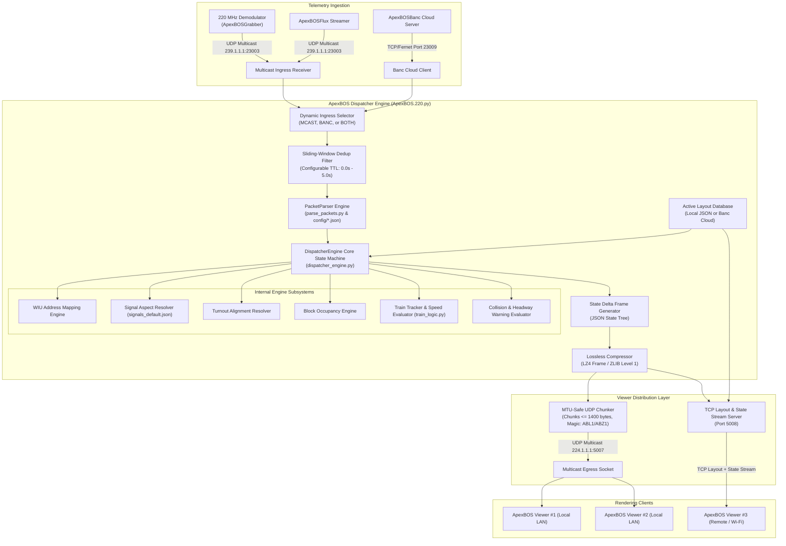
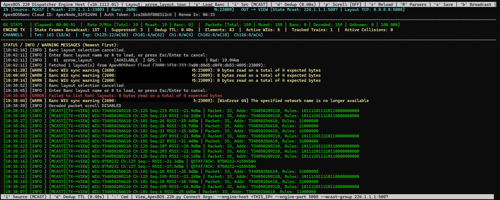
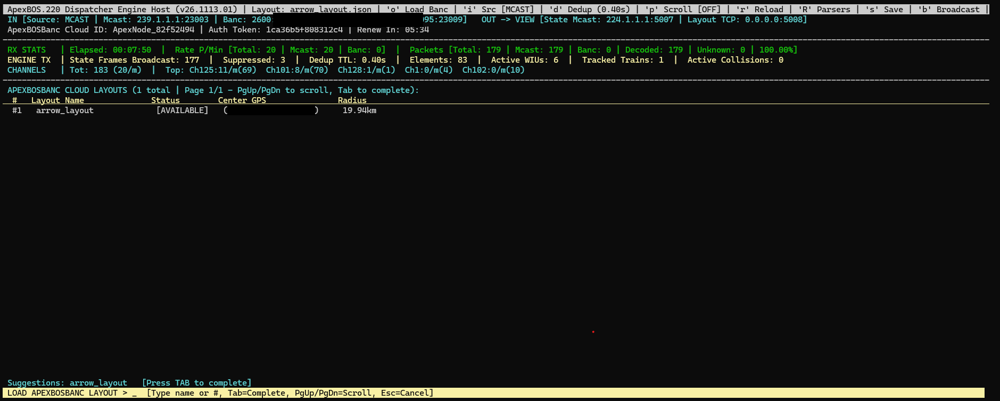
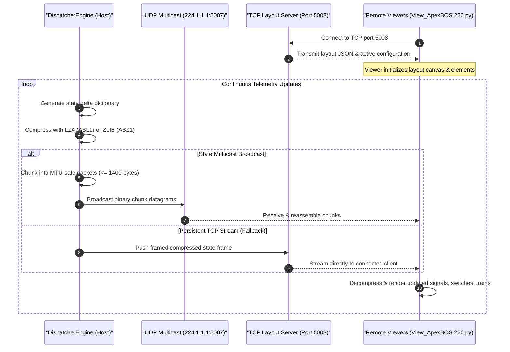

# ApexBOS Dispatcher Engine: Core Logic, Telemetry Ingestion & State Synthesis Host

> [!IMPORTANT]
> **Disclaimer & Intended Use**: **ApexBOS is NOT a real Positive Train Control (PTC) system and is not affiliated with any railroad or government agency.** ApexBOS is an experimental reference tool designed for amateur train enthusiasts and radio telemetry hobbyists. It attempts to decode 220 MHz digital telemetry packets to facilitate hobbyist research and visualize the status of elements defined on a layout. It must never be used for train movement control, safety-critical railway operations, or commercial dispatching.

The **ApexBOS Dispatcher Engine** (hosted via [ApexBOS.220.py](ApexBOS.220.py) and implemented in [dispatcher_engine.py](dispatcher_engine.py)) is the central computational host of the **ApexBOS** Railroad Dispatcher & Trackside Simulation ecosystem.

Acting as the bridge between raw RF demodulation and live graphical dispatcher boards, the Engine ingests high-speed multi-band digital radio telemetry streams—**220 MHz PTC** (`ApexBOSGrabber`), **900 MHz ATCS** (`ApexBOSLatch`), and **450 MHz EOT/HOT/DPU/RLC** (`ApexBOSFred`)—from local UDP multicast networks or the **ApexBOSBanc** cloud. It continuously executes track circuit logic, evaluates both PTC WIU status words and CTC boolean rules (including Out-of-Service `; Z...` bits and PTC-over-CTC priority), aligns switch points, tracks PTC and EOT/HOT/DPU trains (with Banc RF-triangulated positions and geographic territory filtering), predicts headway collisions, and broadcasts compressed state-delta frames to local and remote terminal Viewers ([View_ApexBOS.220.py](View_ApexBOS.220.py)).

```
+----------------------------------------------------------------------------------------------------+
|                                     TELEMETRY INGRESS LAYER                                        |
|  ApexBOSFlux / Grabber (UDP 239.1.1.1:23003)    <--->    ApexBOSBanc Cloud (TCP/Fernet 23009)     |
+--------------------------------------------------+-------------------------------------------------+
                                                   |
                                                   v
+----------------------------------------------------------------------------------------------------+
|                        APEXBOS DISPATCHER ENGINE (ApexBOS.220.py / dispatcher_engine.py)           |
|                                                                                                    |
|  [ Multi-Source Ingress ]   --> [ Bit-Level Rule Parsing ]  --> [ Element State Machine ]          |
|  - UDP Multicast Ingestion      - parse_packets.py              - Signals (Aspect Table Mapping)   |
|  - Banc Cloud TOTP Ingestion    - Configurable Rule Schemas     - Turnouts (Normal / Reverse)      |
|  - Sliding-Window Dedup         - WIU Node ID Extraction        - Tracks (Occupancy & Power)       |
|                                                                                                    |
|  [ Train Tracker & Safety Engine ]                          [ TCP Layout & Remote Sync Server ]    |
|  - Active Train Tracker (MPH, Head/Tail GPS)                - Serves Layout JSON to Viewers (5008) |
|  - Dynamic Headway & Collision Prediction                   - Banc Cloud Layout Hot-Download ('o') |
|  - Signal Aspect Fallback & Dark Territory Inference        - Hot-Reload Parser Rules ('R')        |
+--------------------------------------------------+-------------------------------------------------+
                                                   |
                                                   v
+----------------------------------------------------------------------------------------------------+
|                                     STATE SYNTHESIS & EGRESS                                       |
|  - Lossless Delta Compression (LZ4 / ZLIB)                                                         |
|  - MTU-Safe UDP Multicast Broadcasting (224.1.1.1:5007 | Chunk Size <= 1400 bytes)                 |
|  - Persistent TCP State Streaming (0.0.0.0:5008 | Firewall & Wi-Fi Safe)                           |
+--------------------------------------------------+-------------------------------------------------+
                                                   |
                                                   v
+----------------------------------------------------------------------------------------------------+
|                                      REMOTE DISPATCHER VIEWERS                                     |
|                                   View_ApexBOS.220.py Terminal Displays                            |
+----------------------------------------------------------------------------------------------------+
```

---

## Table of Contents

1. [Architectural Overview & System Topology](#architectural-overview--system-topology)
2. [Dashboard Overview & Screenshots](#dashboard-overview--screenshots)
   - [Main Engine Host Dashboard](#main-engine-host-dashboard)
   - [Banc Cloud Layout Selection Modal](#banc-cloud-layout-selection-modal)
3. [Multi-Source Packet Ingress Engine](#multi-source-packet-ingress-engine)
   - [Supported Ingress Channels (Multicast, Banc, Both)](#supported-ingress-channels-multicast-banc-both)
   - [Dynamic Source Selection & Hot-Switching (`'i'`)](#dynamic-source-selection--hot-switching-i)
   - [Banc Cloud Initial History Lookback Configuration](#banc-cloud-initial-history-lookback-configuration)
   - [Sliding-Window Deduplication Engine (`'d'`)](#sliding-window-deduplication-engine-d)
4. [Track, Signal & Switch Logic State Machine](#track-signal--switch-logic-state-machine)
   - [Element Modeling: Tracks, Signals, Turnouts, Radios & Clocks](#element-modeling-tracks-signals-turnouts-radios--clocks)
   - [Wayside Interface Unit (`_node_id_`) Address Resolution](#wayside-interface-unit-_node_id_-address-resolution)
   - [Signal Aspect Resolution & Position Mapping](#signal-aspect-resolution--position-mapping)
   - [Turnout Normal/Reverse Alignment Logic](#turnout-normalreverse-alignment-logic)
   - [Track Block Occupancy & Indication Propagation](#track-block-occupancy--indication-propagation)
5. [Train Tracking, Inference & Collision Prediction](#train-tracking-inference--collision-prediction)
   - [Real-Time Train Tracking & Speed Calculation](#real-time-train-tracking--speed-calculation)
   - [Inferred Train Trajectories & Head/Tail Tracking](#inferred-train-trajectories--headtail-tracking)
   - [Headway Conflict & Collision Prediction Alerts](#headway-conflict--collision-prediction-alerts)
6. [State Frame Compression & Viewer Distribution Protocol](#state-frame-compression--viewer-distribution-protocol)
   - [Binary Framing & MTU-Safe Chunking](#binary-framing--mtu-safe-chunking)
   - [High-Efficiency Compression: LZ4 vs. ZLIB](#high-efficiency-compression-lz4-vs-zlib)
   - [Dual Delivery: UDP Multicast (5007) and Persistent TCP (5008)](#dual-delivery-udp-multicast-5007-and-persistent-tcp-5008)
7. [Banc Cloud Layout Synchronization](#banc-cloud-layout-synchronization)
   - [Authenticated Cloud Layout Browsing](#authenticated-cloud-layout-browsing)
   - [Hot-Loading Remote Layouts Without Restarting](#hot-loading-remote-layouts-without-restarting)
8. [Configuration Reference & Command-Line Options](#configuration-reference--command-line-options)
   - [CLI Argument Reference for `ApexBOS.220.py`](#cli-argument-reference-for-apexbos220py)
   - [CLI Argument Reference for `dispatcher_engine.py`](#cli-argument-reference-for-dispatcher_enginepy)
   - [Host Configuration Schema (`config.json`)](#host-configuration-schema-configjson)
9. [Interactive Console Keybindings & Operator Commands](#interactive-console-keybindings--operator-commands)
10. [Network Configuration & Windows Firewall Setup](#network-configuration--windows-firewall-setup)

---

## Architectural Overview & System Topology

The Dispatcher Engine decouples physical packet capture from the user interface. Rather than requiring individual viewing terminals to maintain raw RF connections, parse bit-level packets, or calculate train kinematics, the Engine runs as a centralized server process:



---

## Dashboard Overview & Screenshots

The Engine host interface ([ApexBOS.220.py](ApexBOS.220.py)) provides a high-density, curses-based ANSI operations console.

### Main Engine Host Dashboard



The dashboard is structured into nine operational zones:

1. **Pinned Header & Operator Action Bar (Row 0)**:
   - Version identifier: `ApexBOS.220 Dispatcher Engine Host (v26.1127.14)`.
   - Active layout file: `Layout: arrow_layout.json`.
   - Single-key commands: `'o' Load Banc`, `'i' Src [MCAST]`, `'d' Dedup (0.40s)`, `'p' Scroll [OFF]`, `'r' Reload`, `'R' Parsers`, `'s' Save`, `'b' Broadcast`.
2. **Network & Engine Endpoints Bar (Row 1, Cyan)**:
   - Ingress endpoints: `IN [Source: MCAST | Mcast: 239.1.1.1:23003 | Banc: 2600:1f14:...:23009]`.
   - Egress endpoints: `OUT -> VIEW [State Mcast: 224.1.1.1:5007 | Layout TCP: 0.0.0.0:5008]`.
3. **Banc Cloud Session & TOTP Auth Status (Row 2)**:
   - Authenticated Cloud Node ID: `ApexNode_82f52494`.
   - Live Time-Based One-Time Password: `Auth Token: 1ca36b5+808312c4`.
   - Token Renewal Countdown: `Renew In: 06:33` (auto-renews every 10 minutes).
4. **Packet Ingestion Statistics (`RX STATS`, Row 4, Green)**:
   - Elapsed runtime (`00:06:51`).
   - Rolling packet rate per minute: `Total: 19`, `Mcast: 19`, `Banc: 0`.
   - Lifetime counters: `Total: 159`, `Decoded: 159`, `Unknown: 0` (`100.00%` decode ratio).
5. **Engine State Frame Synthesis Metrics (`ENGINE TX`, Row 5, Yellow/Red)**:
   - Transmitted state frames: `State Frames Broadcast: 157`.
   - Echo suppression: `Suppressed: 3` frames.
   - Dedup window: `Dedup TTL: 0.40s`.
   - Managed elements count: `Elements: 83`.
   - Active field telemetry: `Active WIUs: 5`, `Tracked Trains: 1`, `Active Collisions: 0`.
6. **Channel Frequency Distribution (`CHANNELS`, Row 6, Cyan)**:
   - Aggregated RF channels with rates and counts: `Ch125:12/m(58)`, `Ch101:6/m(62)`, etc.
7. **Collision Alert Banner (Row 7)**:
   - When conflicts occur, highlights in flashing red: `!! ACTIVE COLLISION ALERTS: [Train ID / Milepost]`. If no collisions are active, renders a clean divider line.
8. **Main Scrolling Telemetry & Event Log (Rows 8+)**:
   - Shows system events, warnings, layout sync messages, and decoded packet telemetry:
     ```text
     [10:38:31] [INFO ] [MCAST][TX->VIEW] WIU:734050209210 Ch:125 Seq:215 RSSI:-21.9dBm | Packet: 33, Addr: 734050209210, Rules: 10111101111011000000000
     [10:38:16] [INFO ] [MCAST][TX->VIEW] WIU:8750232 Ch:127 Seq:- RSSI:-21.3dBm | QSTAT/ACK: 8750232->1594504
     ```
9. **Interactive Help & Client Connection Bar (Bottom Row)**:
   - Live reminder of exact connect arguments for remote viewers:
     `View_ApexBOS.220.py Connect Args: --engine-host <THIS_IP> --engine-port 5008 --mcast-group 224.1.1.1:5007`

---

### Banc Cloud Layout Selection Modal

Pressing `'o'` pauses background display logging and opens the **ApexBOSBanc Cloud Layouts** browser:



- **Interactive Cloud Catalog**: Lists available layouts registered on the Banc server with operational radius and GPS coordinates.
- **Tab Autocompletion**: Typing initial letters and pressing `Tab` automatically completes matching layout names.
- **Instant Hot-Load**: Pressing `Enter` downloads the layout over TCP/Fernet, loads the track network into the Engine, and immediately begins broadcasting the new layout to all connected Viewers.
- **Escape / Cancellation**: Pressing `Esc` or `Enter` on an empty line returns to the primary console without interrupting operation.

---

## Multi-Source Packet Ingress Engine

The Engine supports hybrid telemetry acquisition, capable of operating from local off-air SDR demodulation, remote cloud archives, or both simultaneously.

```
                     +---------------------------------------+
                     |        Telemetry Input Sources        |
                     +-------------------+-------------------+
                                         |
               +-------------------------+-------------------------+
               |                                                   |
               v                                                   v
   +-----------------------+                           +-----------------------+
   |  UDP Multicast Ingress |                           |  Banc Cloud Ingress   |
   |   (239.1.1.1:23003)   |                           |    (TCP/Fernet 23009) |
   +-----------+-----------+                           +-----------+-----------+
               |                                                   |
               +-------------------------+-------------------------+
                                         |
                                         v
                         +-------------------------------+
                         | Dynamic Source Selector ('i') |
                         |   [MCAST]   [BANC]   [BOTH]   |
                         +---------------+---------------+
                                         |
                                         v
                         +-------------------------------+
                         | Sliding-Window Dedup (0.40s)  |
                         +---------------+---------------+
                                         |
                                         v
                         +-------------------------------+
                         |  PacketParser (parse_packets) |
                         +-------------------------------+
```

### Supported Ingress Channels (Multicast, Banc, Both)

1. **Multicast UDP (`mcast`)**:
   - Ingests raw packet datagrams broadcast by [ApexBOSGrabber.py](ApexBOSGrabber.py) or [ApexBOSFlux.py](ApexBOSFlux.py) on group `239.1.1.1:23003`.
   - Ideal for local installations with on-site SDR receivers. Launching via **ApexBOSLauncher's "Start Local Monitoring"** automatically forces `--source mcast`.
2. **ApexBOSBanc Cloud (`banc`)**:
   - Connects to remote [ApexBOSBanc.py](ApexBOSBanc.py) servers over IPv4 or IPv6 TCP port `23009`.
   - Authenticates using TOTP credentials via [mosfet_auth.py](mosfet_auth.py) and decrypts payloads via Fernet.
   - Ideal for remote dispatchers without local antenna infrastructure.
3. **Dual Hybrid (`both`)**:
   - Ingests both streams concurrently. The sliding-window deduplicator eliminates identical frames received over both paths.

### Dynamic Source Selection & Hot-Switching (`'i'`)

The operator can cycle the active packet source in real time without restarting the process:
- Pressing `'i'` rotates through:
  $$\text{MCAST} \longrightarrow \text{BANC} \longrightarrow \text{BOTH} \longrightarrow \text{MCAST}$$
- The top header and endpoint bar update immediately:
  - `IN [Source: MCAST ...]` $\rightarrow$ Multicast packets accepted, Banc packets ignored.
  - `IN [Source: BANC ...]` $\rightarrow$ Cloud packets accepted, Multicast packets ignored.
  - `IN [Source: BOTH ...]` $\rightarrow$ Packets from both paths accepted and deduplicated.

### Banc Cloud Initial History Lookback Configuration

When connecting to Banc Cloud, the Engine queries recent historical packets to immediately initialize track circuits and signal aspects rather than waiting for field units to cycle.
- **Default Window**: 60 seconds.
- **Configuration Option**: Configurable in `config.json` via `banc_initial_history_sec`:
  ```json
  "connections": {
      "banc_initial_history_sec": 60
  }
  ```
- **Startup Bursting**: Initial packets are ingested at maximum line rate to prime the state machine; subsequent incoming packets are paced in real time.

### Sliding-Window Deduplication Engine (`'d'`)

Because multiple SDRs may receive the same 220 MHz RF burst on adjacent frequencies, the Engine incorporates a microsecond-accurate deduplication filter:
- Computes SHA-256 hashes of incoming raw byte buffers and tracks sequence counters.
- **Configurable TTL**: Default $0.40\text{ seconds}$ (`--dedup-ttl 0.4`).
- **Interactive Tuning**: Pressing `'d'` prompts to change the deduplication window (e.g. `0.2` to `2.0` seconds) or set to `0` to disable deduplication entirely.
- Metrics are tracked in `ENGINE TX | Suppressed: N` to quantify filtered duplicates.

---

## Track, Signal & Switch Logic State Machine

The Engine converts wire bits into physical railway infrastructure states:

```
        Raw Packet Buffer (parse_packets.py)
                         |
                         v
     Extract _node_id_ (e.g. WIU 734050209210)
                         |
         +---------------+---------------+
         |                               |
         v                               v
[ Signal Element ]              [ Turnout Element ]
- Bit Offset Extraction         - Common, Normal, Reverse Legs
- DEFAULT_SIGNAL_TABLE          - Normal / Reverse Alignment
- Head Positions (Top/Mid/Bot)  - Guarded Signals Correlation
         |                               |
         +---------------+---------------+
                         |
                         v
                [ Track Element ]
                - Track Occupancy Bit Extraction
                - Inferred Train Block Propagation
```

### Element Modeling: Tracks, Signals, Turnouts, Radios & Clocks

The layout schema defines interconnected elements:
- `TrackElement`: Mainline, siding, or crossover segments. Defines physical length in miles, geographical GPS coordinates, orientation, and neighbor adjacency (`N`, `S`, `E`, `W`).
- `SignalElement`: High-mast or dwarf signals. Defines governed direction (`E`, `W`), protected track segment, rear track segment, and aspect bit offsets.
- `TurnoutElement`: Switch points. Defines `common_neighbor`, `normal_neighbor`, `reverse_neighbor`, switch orientation, command bits, and guarded signals.
- `RadioElement`: 220 MHz base station tower health and channel telemetry.
- `ClockElement`: Type 6 date/time synchronization beacons.

### Wayside Interface Unit (`_node_id_`) Address Resolution

Field signals and switches report telemetry under 24-bit Wayside Interface Unit (WIU) identifiers. The Engine maintains an indexed address table:
- When a packet arrives, the Engine matches `_node_id_` against all layout elements.
- Multiple elements (e.g. 4 signals guarding an interlocking and a power switch) sharing a single WIU address are resolved simultaneously by extracting their respective bit offsets from the status word.

### Signal Aspect Resolution & Position Mapping

Signal status words are decoded into operational aspects using modular lookup tables:
- **Aspect Bit Extraction**: Extracts status bits starting at `sig_bit_offset`.
- **Aspect Lookup**: Maps numeric aspect codes to lamp definitions via [DEFAULT_SIGNAL_TABLE](dispatcher_engine.py#L83) or regional configuration files (e.g. `config/signals_default.json`).
- **Lamp Position Normalization**: Supports multi-headed signals (`top`, `middle`, `bottom`), resolving complex indications such as `top:rd,mid:yl,bot:gr` (Diverging Clear) or `top:fyl` (Approach Restricting).
- **Color Aliases**: Standardizes color codes (`green`, `yellow`, `red`, `flashing_green`, `flashing_yellow`, `lunar`, `flashing_lunar`, `dark`).

### Turnout Normal/Reverse Alignment Logic

Turnouts determine train routes and signal governance:
- Reads switch position indication bits from the WIU status word.
- Compares against normal and reverse command offsets.
- Transitions switch points between **Normal** (tangent route) and **Reverse** (diverging route).
- Automatically updates signal interlocks: if a turnout reverses toward Track B, signals governing opposing routes are held at Stop (`top:rd`).

### Track Block Occupancy, CTC Rules Engine & Out-of-Service (`; Z...`) Handling

Track circuits, turnouts, and signals support both **220 MHz PTC WIU status words** and **CTC / ATCS code-line boolean rules**:
- **Direct WIU Occupancy & PTC Priority**: Extracted from 220 MHz WIU status words (`has_occ_bit` / `occ_bit_offset`). When an element defines both a 220 MHz `wiu_id` and `ctc_rules`, live PTC WIU telemetry takes priority and automatically falls back to CTC if PTC goes stale.
- **Multi-Address CTC Matching (`ctc_id`)**: Elements accept one or more comma-separated CTC addresses (`ctc_id`), matched against EMP CTC packets decoded by `config/ctc_rules.json` (ordered before generic `x70_rules.json`) or 900 MHz ATCS packets from `ApexBOSLatch`.
- **Direction-Aware CTC Boolean Rule Engine (`ctc_rules`)**:
  - Uses precomputed 128-bit lookup tables, compiled `@lru_cache` AST evaluation, and single-mask bit folding for minimal CPU overhead.
  - Supports boolean operators (`OR`, `AND`, `AND/OR`, `NOT`, parentheses, and commas).
  - Defaults to **`LSB-LT`** (LSB on the left / transmitted first); prepend optional **`LSB-RT:`** to decode packets whose LSB is on the right (transmitted last).
  - Honors the packet's `_kc_` field: **`K<n>`** bits match only Indication (`K`) packets, **`C<n>`** bits match only Command (`C`) packets, and **bare letterless integers** (e.g. `11`, `25`) match **both `K` and `C`** packets. Packets whose `_kc_` does not match an element's rule preserve the element's previous state cleanly.
  - **Out-of-Service (OOS) Clause (`; Z<expr>`)**: Trailing `; Z...` bit expressions (matched on `K` indication packets only) place a track block into an **Out-of-Service** state rendered in the Viewer as dotted white-and-red track with a centered `OOS` badge.
- **Live Session-Only Temporary Overrides**: Accepts `SET_TEMP_OVERRIDE` and `REVERT_TEMP_OVERRIDE` requests from Viewer's Element Inspector so operators can test `wiu_id`, bit offsets, `ctc_id`, and `ctc_rules` live without editing the layout JSON on disk.
- **Dynamic Inferred Occupancy**: When trains move across blocks without discrete track circuits, the Engine infers occupancy by analyzing signal drops and train progression.

### Multi-Band EOT / HOT / DPU Train Inference & Geographic Filtering

- **450 MHz EOT/HOT & DPU Integration (`ApexBOSFred`)**: Decodes EOT/HOT (AAR S-9152) and DPU/DSU (`config/dpu_rules.json`) packets into unified **Train Board** rows (brake pressure, motion, battery, lead/remote consist state) and correlates them with PTC tracks and **ApexBOSBanc** multi-SDR RF-triangulated train coordinates/headings.
- **Banc Geographic Territory Filtering**: When ingesting telemetry from a remote **ApexBOSBanc** hub serving multiple regions, the Engine filters inferred RF trains geographically to the active layout's territory so distant out-of-region trains do not pollute the local board.

---

## Train Tracking, Inference & Collision Prediction

The Engine incorporates an advanced kinematics and collision-avoidance system via [train_logic.py](train_logic.py).

```
   [ Telemetry Packets ] --> [ TrainTracker ] --> Calculate Speed (MPH) & Distance
                                   |
                                   v
                      [ TrainInferenceManager ]
                      - Determine Head & Tail Track Elements
                      - Predict Forward Stopping Distance
                                   |
                                   v
                      [ Collision Detection Engine ]
                      - Detect Headway Violations (Rear-End)
                      - Detect Opposing Movements (Head-On)
                      - Detect Switch Misalignments
                                   |
                                   v
             [ Flash Red Collision Banner on Engine & Viewers ]
```

### Real-Time Train Tracking & Speed Calculation

- **Identity Tracking**: Correlates locomotive radio addresses and train IDs.
- **Velocity Estimation**: Computes instantaneous speed (MPH) using haversine GPS deltas and microsecond timestamps across successive wayside beacons.
- **Directional Heading**: Determines train heading relative to track orientation (`Eastbound` vs. `Westbound`).

### Inferred Train Trajectories & Head/Tail Tracking

To accurately reflect real-world train lengths on the layout:
- **Train Tail Inference**: Tracks trailing cars behind the lead locomotive based on estimated train length and route history.
- **Ghost Train Suppression**: Timeouts clear stale train positions if communications lapse (`inferred_timeout_sec: 120.0`).

### Headway Conflict & Collision Prediction Alerts

The Engine continuously projects train stopping distances along active routes:
- **Rear-End Conflicts**: Warns if a following train's stopping distance encroaches upon the rear of a leading train.
- **Head-On Conflicts**: Detects opposing movements scheduled on the same single-track block.
- **Fouling Conflicts**: Alerts when a train approaches a turnout aligned against its movement.
- **Alert Dispatch**: Broadcasts collision warning states to Viewers, causing conflicting track blocks and trains to pulse brightly in red.

---

## State Frame Compression & Viewer Distribution Protocol

To support hundreds of concurrent terminal Viewers across local networks and high-latency WANs, the Engine implements an optimized binary distribution pipeline:



### Binary Framing & MTU-Safe Chunking

Large railroad layouts generate state dictionaries exceeding standard Ethernet MTU (1500 bytes). The Engine prevents IP fragmentation:
- **Header Structure**: Custom 16-byte binary header formatted with `struct.pack("!4sIIHH", ...)`:
  - `magic` (4 bytes): `b"ABL1"` (LZ4) or `b"ABZ1"` (ZLIB).
  - `transfer_id` (4 bytes unsigned int): Monotonically increasing frame counter.
  - `total_len` (4 bytes unsigned int): Total compressed payload byte length.
  - `chunk_index` (2 bytes unsigned short): 0-indexed position of this chunk.
  - `total_chunks` (2 bytes unsigned short): Total chunks in this transfer.
- **MTU Safety**: Slices payloads into chunks of at most $1400\text{ bytes}$ (`MAX_UDP_CHUNK_SIZE`), ensuring safe transmission across VPNs, Wi-Fi, and physical switches.

### High-Efficiency Compression: LZ4 vs. ZLIB

- **LZ4 Frame (`ABL1`)**: Ultra-low latency compression ($<0.5\text{ ms}$). Used automatically if the Python `lz4` package is available.
- **ZLIB Level 1 (`ABZ1`)**: Fallback lossless compression available in all standard Python environments with zero external dependencies.

### Dual Delivery: UDP Multicast (5007) and Persistent TCP (5008)

The Engine broadcasts state through two parallel paths:
1. **UDP Multicast (`224.1.1.1:5007`)**: High-efficiency one-to-many distribution for local LAN terminals.
2. **Persistent TCP State Stream (`0.0.0.0:5008`)**: The layout server on port 5008 also streams state deltas directly over established TCP sockets. This enables remote viewers to receive real-time updates over networks where UDP multicast is blocked by routers or dropped by Wi-Fi access points.

---

## Banc Cloud Layout Synchronization

The Engine can manage layouts stored in the cloud via [ApexBOSBanc.py](ApexBOSBanc.py):

### Authenticated Cloud Layout Browsing

Pressing `'o'` connects to Banc Cloud via [mosfet_client.py](mosfet_client.py) using the configured `auth_secret` and TOTP tokens:
- Queries the remote layout registry.
- Displays layout names, availability, geographic center GPS coordinates, and operational coverage radii.

### Hot-Loading Remote Layouts Without Restarting

- Selecting a layout from the `'o'` modal triggers an immediate synchronous download.
- Saves the current layout's packet cache to temporary storage.
- Auto-converts legacy ITCVL formats if necessary via [itcvl_converter.py](itcvl_converter.py).
- Instantiates new element models and signals connected Viewers to reload their layout canvases.

---

## Configuration Reference & Command-Line Options

### CLI Argument Reference for `ApexBOS.220.py`

| Argument | Type | Default | Description |
| :--- | :---: | :---: | :--- |
| `--config` | Path | `config.json` | Path to host configuration JSON file. |
| `--layout` | Path | *None* | Path to local layout JSON file for the engine to load and serve. |
| `--banc-layout` | String | *None* | Name of layout to download and load directly from ApexBOSBanc Cloud on startup. |
| `--list-banc-layouts`| Flag | `False` | Query and list available layouts on ApexBOSBanc Cloud, then exit. |
| `--source` | Choice | `auto` | Explicit packet source: `auto` (multicast if valid, else banc), `mcast`, `banc`, or `both`. |
| `--mcast-source` | Flag | `False` | Force packet ingestion from Multicast UDP. |
| `--banc-source` | Flag | `False` | Force packet ingestion from ApexBOSBanc Cloud even if multicast is valid. |
| `--both-source` | Flag | `False` | Ingest from both Multicast UDP and Banc Cloud concurrently. |
| `--engine-mcast-group`| IP | `224.1.1.1` | Outbound multicast group for View_ApexBOS.220.py state distribution. |
| `--engine-mcast-port` | Port | `5007` | Outbound multicast UDP port for View_ApexBOS.220.py state distribution. |
| `--layout-port` | Port | `5008` | TCP port to serve layout JSON and persistent state stream to Viewers. |
| `--dedup-ttl` | Float | `0.4` | Duplicate packet deduplication window in seconds (set to 0 to disable). |
| `--client` | IP | *None* | Explicit remote Viewer IP for unicast state streaming (can repeat). |
| `--scroll-decoded` | Flag | `False` | Enable real-time scrolling log of decoded packets on the console. |
| `--no-curses` | Flag | `False` | Run in plain stdout mode instead of full curses terminal dashboard. |
| `--no-pacing` | Flag | `False` | Disable real-time pacing of historical Banc cloud packets. |
| `--no-startup-burst` | Flag | `False` | Disable startup bursting; pace all historical Banc packets. |

---

### CLI Argument Reference for `dispatcher_engine.py`

When running the core logic engine directly:

```bash
python dispatcher_engine.py --layout layouts/arrow_layout.json --mcast-group 224.1.1.1 --mcast-port 5007 --layout-port 5008
```

| Argument | Type | Default | Description |
| :--- | :---: | :---: | :--- |
| `--layout` | Path | `complex_layout.json` | Layout JSON file to load and serve to Viewers. |
| `--config` | Path | *None* | Optional host configuration JSON file. |
| `--mcast-group` | IP | `224.1.1.1` | Multicast IP group for state frames. |
| `--mcast-port` | Port | `5007` | Multicast UDP port for state frames. |
| `--layout-port` | Port | `5008` | TCP port to serve layout and state stream. |
| `--dedup-ttl` | Float | `0.4` | Duplicate packet deduplication TTL in seconds. |
| `--client` | IP | *None* | Remote Viewer IP for unicast UDP streaming. |
| `--packet-cache-size`| Int | `1000` | In-memory packet cache depth. |

---

### Host Configuration Schema (`config.json`)

```json
{
    "engine": {
        "mcast_group": "224.1.1.1",
        "mcast_port": 5007,
        "layout_port": 5008,
        "inferred_timeout_sec": 120.0,
        "train_logic_interval_sec": 7.0,
        "time_scale": 360.0,
        "dedup_ttl": 0.4,
        "parsers": [
            "x33_rule.json",
            "x2_base_rules.json",
            "x01_rules.json",
            "x05_rules.json",
            "ctc_rules.json",
            "x70_rules.json",
            "x06_rules.json",
            "x04_rules.json",
            "dpu_rules.json"
        ]
    },
    "connections": {
        "mcast_group": "239.1.1.1",
        "mcast_port": 23003,
        "banc_host": "2600:1f14:233:2a00:88d5:d0f0:db53:4095",
        "banc_port": 23009,
        "auth_secret": "YOUR_AUTH_SECRET_HERE",
        "encryption_key": "",
        "banc_pacing": true,
        "banc_startup_burst": true,
        "banc_initial_history_sec": 60
    }
}
```

---

## Interactive Console Keybindings & Operator Commands

The curses dashboard provides single-keystroke controls for all primary maintenance tasks:

| Key | Action | Description |
| :---: | :--- | :--- |
| `o` / `O` | **Load Banc Layout** | Opens the interactive Banc Cloud layout browser modal. |
| `i` / `I` | **Toggle Ingress Source** | Cycles packet source between `MCAST`, `BANC`, and `BOTH`. |
| `d` / `D` | **Adjust Dedup TTL** | Prompts to update the packet deduplication window in seconds. |
| `p` / `P` | **Toggle Packet Scroll** | Toggles real-time decoded packet logging (`[ON]` / `[OFF]`). |
| `r` | **Reload Layout** | Re-reads whichever layout is **currently active in the Viewer** (including layouts switched via Viewer or loaded from Banc—not just the startup layout) and refreshes state. |
| `R` | **Reload Parsers** | Re-compiles all JSON rule files in `config/` (including `ctc_rules.json`, `atcs_rules.json`, `dpu_rules.json`, and `rlc_rules.json`) without restarting. |
| `s` / `S` | **Save Layout** | Saves current element states and layouts to disk. |
| `b` / `B` | **Force Broadcast** | Forces an immediate state frame transmission to all Viewers. |
| `c` / `C` | **Clear Log Buffer** | Wipes the message workspace buffer. |
| `:` | **Command Line** | Opens the interactive command prompt (`dedup`, `save`, `status`, `reload`, `help`, `quit`). |
| `q` / `Q` | **Quit** | Gracefully shuts down the Engine, closing network sockets. |

---

## Network Configuration & Windows Firewall Setup

The Dispatcher Engine communicates across distinct UDP and TCP ports.

### Port Allocation Summary

| Port | Protocol | Direction | Purpose |
| :---: | :---: | :---: | :--- |
| `23003` | UDP | Inbound | Ingestion: Multicast stream from ApexBOSFlux or Grabber. |
| `23009` | TCP | Outbound | Ingestion: Encrypted telemetry from ApexBOSBanc Cloud. |
| `5007` | UDP | Outbound | Egress: State delta multicast broadcast to View_ApexBOS.220.py. |
| `5008` | TCP | Inbound | Egress: Layout server & persistent state stream to Viewers. |

### Windows Firewall Configuration

Windows Defender Firewall blocks incoming UDP multicast and IGMP traffic by default. Run `enable_firewall.bat` as Administrator, or execute this command in an Administrator PowerShell prompt:

```powershell
New-NetFirewallRule -DisplayName "ApexBOS Inbound UDP Multicast" -Direction Inbound -LocalPort 23003,5007 -Protocol UDP -Action Allow -Profile Domain,Private,Public;
New-NetFirewallRule -DisplayName "ApexBOS Inbound TCP Services" -Direction Inbound -LocalPort 1234,5008,18000-18175,20101-20175,23009,23010,56781 -Protocol TCP -Action Allow -Profile Domain,Private,Public;
New-NetFirewallRule -DisplayName "ApexBOS Inbound IGMP" -Direction Inbound -Protocol 2 -Action Allow -Profile Domain,Private,Public;
route add 224.0.0.0 mask 240.0.0.0 0.0.0.0 metric 1
```

---

## Summary of Ecosystem Integration Files

- [ApexBOS.220.py](ApexBOS.220.py) — Primary Dispatcher Engine Host interface and curses console.
- [dispatcher_engine.py](dispatcher_engine.py) — Core track/switch/signal state machine, compression, and distribution engine.
- [train_logic.py](train_logic.py) — Train kinematics, speed calculation, headway monitoring, and collision prediction.
- [parse_packets.py](parse_packets.py) — Bitfield decoder engine compiling modular rules from `config/*.json`.
- [View_ApexBOS.220.py](View_ApexBOS.220.py) — Graphical terminal dispatcher board and layout viewer.
- [ApexBOSBanc.py](ApexBOSBanc.py) — Cloud telemetry server and remote layout repository.
- [ApexBOSFlux.py](ApexBOSFlux.py) — Telemetry streaming hub routing off-air packets to multicast.
- [ApexBOSSpy.py](ApexBOSSpy.py) — Real-time packet inspector and diagnostic studio.
- [PackFIG.py](PackFIG.py) — Interactive packet decoder and rule builder studio.
- [BANC_README.md](BANC_README.md) — Comprehensive guide to Banc cloud storage and setup.
- [FLUX_README.md](FLUX_README.md) — Telemetry streaming hub documentation.
- [SPY_README.md](SPY_README.md) — Real-time protocol analyzer and rule verification terminal.
- [PACKFIG_README.md](PACKFIG_README.md) — Packet disassembler and rule development guide.
- [GRABBER_README.md](GRABBER_README.md) — RF demodulation and ZeroMQ capture architecture.
