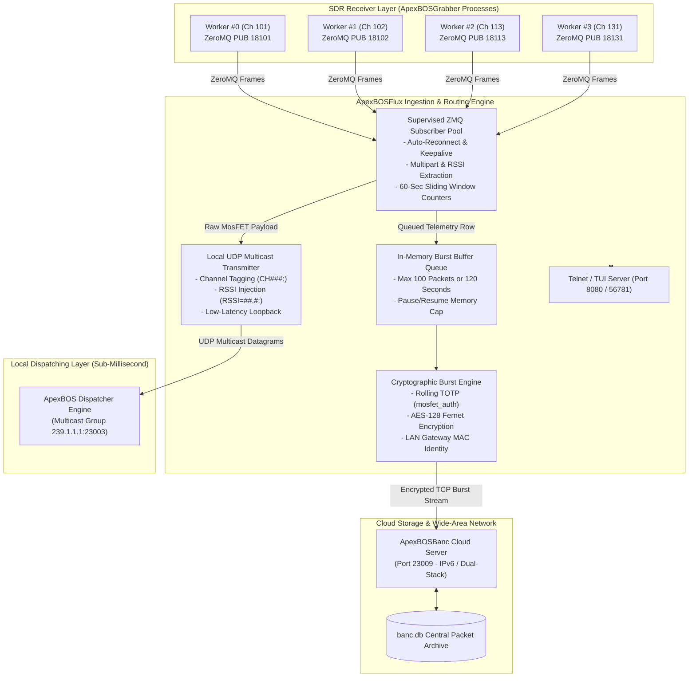
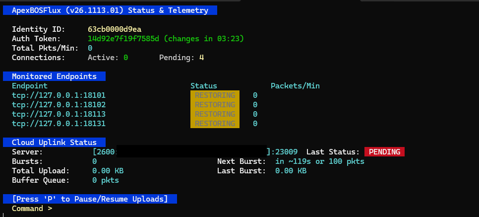

# ApexBOSFlux: Multi-Channel SDR Telemetry Aggregator, Local Multicast Relay & Cloud Bursting Uplink

> [!IMPORTANT]
> **Disclaimer & Intended Use**: **ApexBOS is NOT a real Positive Train Control (PTC) system and is not affiliated with any railroad or government agency.** ApexBOS is an experimental reference tool designed for amateur train enthusiasts and radio telemetry hobbyists. It attempts to decode 220 MHz digital telemetry packets to facilitate hobbyist research and visualize the status of elements defined on a layout. It must never be used for train movement control, safety-critical railway operations, or commercial dispatching.

**ApexBOSFlux** (formerly MosFET) is an asynchronous telemetry ingestion daemon, local UDP multicast relay, and secure cloud bursting uplink designed for the **ApexBOS** Railroad Dispatcher & Trackside Simulation ecosystem.

Operating at the critical junction between RF physical receivers and dispatcher visualization systems, ApexBOSFlux aggregates real-time multi-band telemetry streams from **ApexBOSGrabber** (220 MHz PTC, `18071–18131`), **ApexBOSLatch** (900 MHz ATCS, `18201`), and **ApexBOSFred** (450 MHz EOT/HOT/DPU/RLC, `18301`) via ZeroMQ PUB/SUB sockets, distributes them locally across low-latency UDP multicast for real-time dispatching, and packages, encrypts, and bursts historical telemetry (along with optional opt-in private sensor anchors for Banc k>=3 RF triangulation) to **ApexBOSBanc Cloud** over IPv4 or IPv6. On non-ANSI consoles (Legacy Windows Console, `TERM=dumb`, or redirected pipes), Flux automatically falls back to clean plain-text scroll mode (`--no-tui --no-color`).

---

## Table of Contents

1. [Architectural Overview & Data Flow](#architectural-overview--data-flow)
2. [Dashboard Overview & Screenshot](#dashboard-overview--screenshot)
3. [Operating Modes & Ingestion Options](#operating-modes--ingestion-options)
   - [1. Dual-Path Telemetry Distribution](#1-dual-path-telemetry-distribution)
   - [2. Multi-Channel ZeroMQ Aggregation](#2-multi-channel-zeromq-aggregation)
   - [3. Dynamic Port Auto-Discovery](#3-dynamic-port-auto-discovery)
   - [4. ITCMon Legacy Import (`--itcmon`)](#4-itcmon-legacy-import---itcmon)
4. [Cloud Bursting Protocol & Security](#cloud-bursting-protocol--security)
   - [Dual-Frame Wire Protocol](#dual-frame-wire-protocol)
   - [Dynamic Rolling TOTP Authentication](#dynamic-rolling-totp-authentication)
   - [Stable Home-Network Node Identity (Gateway MAC)](#stable-home-network-node-identity-gateway-mac)
   - [CSV Burst Record Specification](#csv-burst-record-specification)
5. [Interactive Console Commands & Keybindings](#interactive-console-commands--keybindings)
6. [Setup Wizard & Deployment Guide](#setup-wizard--deployment-guide)
7. [Configuration Reference (`config.json` / `MosFET.json`)](#configuration-reference-configjson--mosfetjson)

---

## Architectural Overview & Data Flow

ApexBOSFlux acts as a dual-path telemetry multiplexer:



---

## Dashboard Overview & Screenshot

ApexBOSFlux features a high-density, real-time ANSI terminal dashboard that provides instant visibility into SDR subscriber health, throughput rates, and cloud bursting status:



### Dashboard Functional Zones:

1. **Header & Node Identity Zone**:
   - **Identity ID**: Cryptographically derived network identifier (e.g. `d71477755787`), deterministically computed by hashing the local LAN default gateway's MAC address so every computer on the same home network shares one stable identity.
   - **Auth Token**: Active **Rolling TOTP Token** with a live countdown timer showing the remaining window (e.g. `56C361 (changes in 08:32)`).
   - **Total Pkts/Min**: Aggregated rolling packet rate across all connected RF channels over a 60-second sliding window.
   - **Connections**: Summary counters showing `Active` vs `Pending / Restoring` ZeroMQ subscriber sockets.

2. **Monitored Endpoints Table**:
   - **Endpoint**: Network URI of the monitored SDR publisher (e.g. `tcp://127.0.0.1:18101`).
   - **Status Badge**:
     - `[ACTIVE]`: Socket connected and actively streaming decoded RF packets.
     - `[RESTORING]`: Connection dropped or publisher restarting; supervisor actively retrying with exponential backoff.
     - `[INITIALIZING]`: Socket setup and monitor handshake in progress.
     - `[DISCONNECTED]`: Endpoint unreachable.
   - **Packets/Min**: Per-channel rolling packet throughput rate over the preceding 60 seconds.

3. **Cloud Uplink Status Zone**:
   - **Server**: Target Banc cloud host and port formatted cleanly with IPv6 bracket notation when applicable (e.g. `[2600:1f18:6325:4000:abcd:ef01:2345:6789]:23009`).
   - **Last Status**: `[SUCCESS]` (green), `[PAUSED]` (yellow), or `[FAIL: ...]` (red error with socket exception).
   - **Bursts**: Total cumulative count of successful encrypted burst transmissions uploaded to Banc.
   - **Next Burst**: Real-time countdown timer and packet threshold (e.g. `in ~42s or 73 pkts`).
   - **Total Upload**: Lifetime data volume transmitted to the cloud in kilobytes.
   - **Last Burst**: Payload size of the most recent cloud transmission in kilobytes.
   - **Buffer Queue**: Count of decoded packets currently queued in memory awaiting the next burst window.

4. **Interactive Command Prompt**:
   - Displays status notices and allows immediate control (e.g., pressing `P` toggles cloud upload pause/resume).

---

## Operating Modes & Ingestion Options

### 1. Dual-Path Telemetry Distribution

ApexBOSFlux simultaneously services two decoupled network paths:
- **Low-Latency Local Multicast**:
  Every packet received from ZeroMQ is immediately wrapped with an ASCII transport header:
  ```text
  CH<channel:03d>:RSSI=<rssi:.1f>:<binary_mosfet_frame>
  ```
  *(Example: `CH101:RSSI=-68.4:I\x00\x18\x06\x00...`)*
  This datagram is broadcast over UDP Multicast (`239.1.1.1:23003` by default) with TTL=2, enabling local Dispatcher Engines on the same LAN or host to process wayside status changes with sub-millisecond latency.
- **Cloud Bursting Uplink**:
  Simultaneously, packets are formatted into structured CSV rows and queued into an in-memory buffer. When either threshold is satisfied ($N \ge 100\text{ packets}$ or $t \ge 120\text{ seconds}$), the batch is encrypted and uploaded to Banc.

### 2. Multi-Channel ZeroMQ Aggregation

Flux connects to any number of ZeroMQ `PUB` endpoints specified in configuration:
- Ingests multipart frames containing:
  - Raw binary MosFET frames (`b'I' <2-byte size> <type> <flags> <payload>`).
  - Raw ASCII hex strings (with or without RSSI metadata).
  - JSON metadata packets (`{"hex": "...", "rssi": -65.2, "channel": 102}`).
- **True RSSI Extraction**: Automatically extracts signal strength (in dBm or dBFS) from JSON metadata, comma-separated tags, or raw text patterns (`RSSI=-##.#`).
- **Resilient Auto-Reconnection**: Each endpoint is managed by an independent `ZmqConnection` supervisor task using TCP keepalives (`TCP_KEEPALIVE_IDLE=30`, `TCP_KEEPALIVE_INTVL=5`) and automatic reconnection with backoff (`RECONNECT_IVL=500ms`, `RECONNECT_IVL_MAX=3000ms`).

### 3. Dynamic Port Auto-Discovery

If a bare host or IP address is supplied in `sources` without an explicit port (e.g., `"127.0.0.1"` or `"192.168.1.50"`), ApexBOSFlux automatically enters **Auto-Discovery Mode**:
- Builds a candidate scan pool across standard receiver port ranges:
  - Channels 77–172: Ports `18077` – `18172`
  - High-band Channels: Ports `20101` – `20174`
- Runs a background scanner every 60 seconds. When an `ApexBOSGrabber` worker opens a port on that host, Flux detects the open TCP socket and dynamically spawns a subscriber.
- Automatically cleans up dead connections if a worker process terminates.

### 4. ITCMon Legacy Import (`--itcmon`)

For backwards compatibility with existing railroad radio deployments using `itcmon.json`, Flux can dynamically import all enabled receiver endpoints at launch:
```bash
python ApexBOSFlux.py --config MosFET.json --itcmon /etc/itcmon.json --display
```
Flux parses `itcmon.json`, extracts all active `ip:port` definitions, merges them into the configured `sources` list, updates the config file on disk, and begins monitoring immediately.

---

## Cloud Bursting Protocol & Security

### Dual-Frame Wire Protocol

When a burst window triggers, ApexBOSFlux opens a direct TCP connection to the cloud Banc server (supporting both IPv4 and IPv6) and transmits a dual-frame encrypted payload:

$$\text{Transmission} = \underbrace{[\text{4-byte Big-Endian Length}] + [\text{Encrypted Header}]}_{\text{Authentication Frame}} + \underbrace{[\text{4-byte Big-Endian Length}] + [\text{Encrypted Payload}]}_{\text{Telemetry Payload Frame}}$$

1. **Header Frame**:
   - Plaintext format: `PUT:<identity>:<token>`
   - Encrypted with the shared 44-character Base64 Fernet key.
2. **Payload Frame**:
   - Plaintext format: Newline-delimited CSV rows containing the batched packets.
   - Encrypted with the same Fernet key.

### Dynamic Rolling TOTP Authentication

Rather than transmitting a static password, Flux and Banc use **Time-Based One-Time Passwords (TOTP)** via `mosfet_auth`:
$$\text{Token} = \text{HMAC-SHA256}(\text{Secret}, \lfloor t_{\text{UTC}} / 600 \rfloor)$$
- Tokens are valid for 10 minutes (600 seconds), with a $\pm 60$-second clock skew tolerance.
- Compromised or intercepted network traffic cannot be replayed outside the active 10-minute window.

### Stable Home-Network Node Identity (Gateway MAC)

Flux, Dispatcher Engine, and the Setup Wizard all share a single network identity generator (`mosfet_client.generate_identity`) anchored to the local router rather than volatile ISP hops:
1. Queries the OS routing table and ARP/neighbor cache to locate the **physical IPv4 default gateway MAC address** (automatically skipping virtual VPN/TUN routes that lack an Ethernet ARP entry).
2. Normalizes the MAC address to canonical lowercase, zero-padded `aa:bb:cc:dd:ee:ff` form so Windows, Linux/Raspberry Pi, and macOS machines on the same home LAN produce the **exact same identity**.
3. Computes a one-way 12-character SHA-256 hash (the raw router MAC is never transmitted):
   $$\text{Identity} = \text{SHA256}(\text{"apexbos-lan-v1:gw:"} + \text{GatewayMAC})[:12]$$
4. **Fallbacks & Edge Cases** (zero third-party servers contacted):
   - On IPv6-only networks, falls back to the IPv6 default gateway neighbor MAC.
   - If a shared enterprise virtual-router MAC (VRRP/HSRP/GLBP) is detected, mixes in a local network differentiator.
   - On direct PPPoE/cellular/VPS hosts without a Layer-2 gateway MAC, falls back to the local outbound IPv6 `/64` prefix or public IPv4, and finally to a deterministic local fallback.
   - If Banc is disabled (`cloud_server: "None"`), uses `"LOCAL"`.
   - For isolated VLANs or double-NAT setups, you can explicitly pin `"identity": "<custom_id>"` in `config.json` / `MosFET.json`.
5. Because the identity is tied to the home router's globally unique MAC address, it remains **100% immune to ISP routing changes and dynamic WAN IP renewals**, never collides across different users' private `192.168.x.x` LANs, and allows Banc owners to authorize a user's home network once across all their computers.

### CSV Burst Record Specification

Each line within the decrypted payload represents a single decoded telemetry message:

```text
2026-11-15 22:15:30,1763266530.42,d71477755787,4900180600004801...,101,-68.4,2849102842,-68.40,0,"NA"
```

| Field Index | Name | Format / Type | Description |
| :---: | :--- | :--- | :--- |
| **0** | `date_str` | `YYYY-MM-DD HH:MM:SS` | Human-readable local/UTC timestamp. |
| **1** | `unix_ts` | Float (`1763266530.42`) | Microsecond-accurate epoch timestamp. |
| **2** | `identity` | String (`12 hex chars`) | Cryptographic Network Identity of the sending Flux station. |
| **3** | `hex_data` | Uppercase Hex String | Complete raw hex representation of the telemetry frame. |
| **4** | `channel` | Integer (`101`) | 220 MHz RF channel number (e.g. 101, 102, 113...). |
| **5** | `rssi` | Float / `"NA"` (`-68.4`) | True received signal strength in dBm or dBFS. |
| **6** | `pkt_hash` | Unsigned 32-bit Integer | Packet payload hash for deduplication. |
| **7** | `b1_val` | Float (`-68.40`) | Calibrated RF signal metric. |
| **8** | `flags` | Integer (`0`) | Reserved physical layer status flags. |
| **9** | `extra` | String (`"NA"`) | Reserved expansion field. |

---

## Interactive Console Commands & Keybindings

ApexBOSFlux can be controlled interactively via its local console (`--display`) or remotely via Telnet/Netcat (`nc <host> <command_port>`):

| Command / Hotkey | Description |
| :---: | :--- |
| `P` or `p` | **Toggle Cloud Upload Pause/Resume**: Instantly pauses or resumes encrypted bursts to Banc.<br>• While paused, local UDP multicast continues uninterrupted.<br>• Packets buffer safely in memory.<br>• Buffer is capped automatically to prevent memory exhaustion during prolonged pauses. |
| `Ctrl+C` | Gracefully shuts down ZeroMQ subscribers, closes sockets, clears console display, and exits. |

---

## Setup Wizard & Deployment Guide

The ApexBOS Setup Wizard (`setup.bat`, `setup.sh`, or `setup_wizard.py`) automatically configures ApexBOSFlux to match your hardware and network topology:

```
+-----------------------------------------------------------------------------+
| OPTION 1: Local Network Only (No Cloud / Multicast Only)                   |
|   • Sets cloud_server to "None" and cloud_port to 0.                       |
|   • Configures multicast_group (239.1.1.1) and multicast_port (23003).     |
|   • Generates local auth secrets and connects to local Grabber ports.       |
+-----------------------------------------------------------------------------+
                                      │
                                      ▼
+-----------------------------------------------------------------------------+
| OPTION 2 / 3 / 4: Cloud-Connected Deployment                                |
|   • Configures cloud_server (IPv4, bare IPv6, or bracketed IPv6 host).      |
|   • Sets cloud_port (default: 23009).                                       |
|   • Synchronizes auth_secret and 44-char encryption_key with Banc.          |
|   • Maps Grabber worker ports (e.g. 18101..18131) into Flux sources.        |
|   • Sets burst parameters: burst_max_packets (100), interval (120s).        |
+-----------------------------------------------------------------------------+
```

### Starting ApexBOSFlux:
- **Inside Launcher**: Select **[F] ApexBOSFlux** from `launcher.py` or `ApexBOSLauncher.bat`.
- **Standalone Terminal**:
  ```bash
  python ApexBOSFlux.py --config config.json --display
  ```
- **Headless Background Service**:
  ```bash
  nohup python3 ApexBOSFlux.py --config config.json >> flux.log 2>&1 &
  ```

---

## Configuration Reference (`config.json` / `MosFET.json`)

ApexBOSFlux supports both modern unified `config.json` files and standalone legacy `MosFET.json` files:

### Modern Unified Structure (`config.json`):
```json
{
  "version": "v26.1127.14",
  "common": {
    "deployment_mode": "cloud",
    "banc": {
      "enabled": true,
      "host": "2600:1f18:6325:4000:abcd:ef01:2345:6789",
      "port": 23009,
      "auth_secret": "YourSecretPhraseMin8Chars",
      "encryption_key": "YOUR_44_CHARACTER_BASE64_FERNET_KEY="
    },
    "multicast": {
      "flux_group": "239.1.1.1",
      "flux_port": 23003
    }
  },
  "flux": {
    "sources": "127.0.0.1:18131, 127.0.0.1:18101, 127.0.0.1:18102, 127.0.0.1:18113",
    "command_port": 8080,
    "burst_max_packets": 100,
    "burst_interval_sec": 120,
    "multicast_group": "239.1.1.1",
    "multicast_port": 23003,
    "cloud_server": "2600:1f18:6325:4000:abcd:ef01:2345:6789",
    "cloud_port": 23009,
    "auth_secret": "YourSecretPhraseMin8Chars",
    "encryption_key": "YOUR_44_CHARACTER_BASE64_FERNET_KEY="
  }
}
```

### Parameter Reference Table:

| Parameter | Type | Default | Description |
| :--- | :--- | :--- | :--- |
| `sources` | String | `"127.0.0.1:18131..."` | Comma-separated list of ZeroMQ publishers (`host:port` or bare `host` for auto-scan). |
| `command_port` | Integer | `8080` | Port for the Telnet/Netcat remote TUI server. |
| `burst_max_packets` | Integer | `100` | Packet threshold that triggers an immediate cloud burst upload. |
| `burst_interval_sec`| Integer | `120` | Maximum time interval (in seconds) between cloud burst uploads. |
| `multicast_group` | String | `"239.1.1.1"` | UDP multicast group IP for local sub-millisecond packet relaying. |
| `multicast_port` | Integer | `23003` | UDP multicast port for local packet relaying. |
| `cloud_server` | String | `"None"` | Remote Banc cloud server address (IPv4, bare IPv6, or hostname). Set to `"None"` to disable cloud uploads. |
| `cloud_port` | Integer | `23009` | Inbound TCP data port on the Banc cloud server. |
| `auth_secret` | String | `"DEFAULT_SECRET"` | Shared secret phrase used for rolling TOTP token generation. |
| `encryption_key` | String | `null` | 44-character Base64 Fernet key used for symmetric payload encryption. |
| `identity` | String | `"auto"` | Optional override for the node identity string. Leave unset or `"auto"` to derive automatically from the LAN default gateway MAC hash. |

---

## Operational Verification Checklist

- [x] ZeroMQ publisher ports match running `ApexBOSGrabber` worker processes.
- [x] All monitored endpoints report `[ACTIVE]` status on the Flux dashboard.
- [x] `Total Pkts/Min` indicates positive incoming RF packet ingestion.
- [x] Local Dispatcher Engine receives packets on UDP Multicast (`239.1.1.1:23003`).
- [x] Cloud Uplink reports `[SUCCESS]` with ascending `Bursts` counter and transmitted KB.
- [x] Remote Banc server reflects matching node identity in its `Top 10 Active Identities` table.
