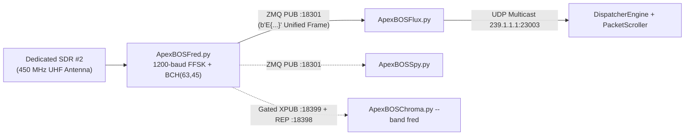

# ApexBOSFred: Clean-Room 450 MHz EOT / HOT (AAR S-9152) SDR Demodulator

> [!IMPORTANT]
> **Disclaimer & Intended Use**: **ApexBOS is NOT a real railway safety or braking telemetry system and is not affiliated with any railroad or government agency.** ApexBOSFred is an independent, clean-room MIT-licensed reference tool developed for amateur train enthusiasts and RF telemetry hobbyists. It must never be used for train movement control, safety-critical railway operations, or commercial dispatching.

**ApexBOSFred** ([ApexBOSFred.py](ApexBOSFred.py)) is a standalone, clean-room Python/NumPy Software-Defined Radio (SDR) demodulator and decoder for North American railroad **End-of-Train (EOT / "FRED", `457.9375 MHz`)** and **Head-of-Train (HOT, `452.9375 MHz`)** telemetry governed by **AAR Standard S-9152**.

Designed to run on a dedicated SDR alongside [ApexBOSGrabber](GRABBER_README.md) (220 MHz PTC) and [ApexBOSLatch](LATCH_README.md) (900 MHz ATCS), `ApexBOSFred` decodes live rear-end brake pipe pressure, motion state, marker light, battery health, and arming/emergency status, publishing them directly into **ApexBOSFlux**, **Dispatcher Engine**, the **Layout Packet Scroller**, **ApexBOSSpy**, and **ApexBOSChroma**.

---

## Table of Contents

1. [Multi-SDR Architecture & Ecosystem Integration](#multi-sdr-architecture--ecosystem-integration)
2. [450 MHz Railroad Telemetry Channel Plan (EOT / HOT / DPU / RLC)](#450-mhz-railroad-telemetry-channel-plan-eot--hot--dpu--rlc)
3. [Clean-Room FFSK & BCH(63, 45) DSP Pipeline](#clean-room-ffsk--bch63-45-dsp-pipeline)
4. [Decoded Telemetry Fields (EOT / HOT)](#decoded-telemetry-fields-eot--hot)
5. [DPU / DSU Decoded Fields & Abbreviations Reference](#dpu--dsu-decoded-fields--abbreviations-reference)
6. [Customizing DPU & RLC Display (`config/dpu_rules.json` & `config/rlc_rules.json`)](#customizing-dpu--rlc-display-configdpu_rulesjson--configrlc_rulesjson)
7. [Quick Start & Multi-SDR Examples](#quick-start--multi-sdr-examples)
8. [Command-Line Reference](#command-line-reference)

---

## Multi-SDR Architecture & Ecosystem Integration



- **Dedicated SDR Support**: Reuses Grabber's cross-platform SDR drivers—supporting **RTL-SDR** (`--pipe`, `--rtlsdr`, `--rtl-tcp`), **SDRplay RSP1B / RSP1A / RSPdx / RSPduo** (`--rsp-tcp`, `--rsp-16bit`), **SoapySDR** (`--soapy`), and `--stdin` IQ playback (`u8` and `s16`).
- **Unified Layout Packet Scroller & Spy**: Publishes grabber-compatible 4-part ZMQ messages with a self-describing `b'E{...}'` JSON frame. Add `tcp://127.0.0.1:18301` to `flux.sources` in `config.json` and live EOT/HOT lines automatically appear in the layout **Packet Scroller** (e.g., `[EOT #41822] 89 PSI | MOVING | Mkr:ON | Batt:OK(94%) | Valve:OK | Arm`) and in **ApexBOSSpy**.
- **Chroma Integration**: Launch `python ApexBOSChroma.py --band fred` (or click the **`Band:`** toolbar button in Chroma to cycle to **`Band:FRED 457`**) to view live 457.9375 / 452.9375 MHz RF chirps and flowing EOT/HOT blips (`EOT #41822 89PSI`)—with zero overhead on Fred when Chroma is closed.

---

## 450 MHz Railroad Telemetry Channel Plan (EOT / HOT / DPU / RLC)

| Channel ID | Alias | Protocol | Frequency (MHz) | Modulation & Framing |
| :---: | :---: | :---: | :---: | :--- |
| `1` | `EOT` | **EOT → HOT** | **`457.93750`** | AAR S-9152 1200-baud coherent 1200/1800 Hz FFSK + BCH(63,45) |
| `2` | `HOT` | **HOT → EOT** | **`452.93750`** | AAR S-9152 1200-baud coherent 1200/1800 Hz FFSK + BCH(63,45) |
| `3` | `DPU1` | **DPU Ch 1 (Lead)** | **`452.92500`** | Dual-mode CCITT V.23 1200 AFSK (`1300/2100 Hz`) & 4800 2-FSK + HDLC CRC-16 |
| `4` | `DPU2` | **DPU Ch 2 (Lead)** | **`452.95000`** | Dual-mode CCITT V.23 1200 AFSK & 4800 2-FSK + HDLC CRC-16 |
| `5` | `DPU3` | **DPU Ch 3 (Remote)** | **`457.92500`** | Dual-mode CCITT V.23 1200 AFSK & 4800 2-FSK + HDLC CRC-16 |
| `6` | `DPU4` | **DPU Ch 4 (Remote)** | **`457.95000`** | Dual-mode CCITT V.23 1200 AFSK & 4800 2-FSK + HDLC CRC-16 |
| `7` | `RLC1` | **RLC Ch 1** | **`452.93125`** | 12.5 kHz narrowband 2400/4800 2-FSK/GFSK + HDLC CRC-16 |
| `8` | `RLC2` | **RLC Ch 2** | **`452.94375`** | 12.5 kHz narrowband 2400/4800 2-FSK/GFSK + HDLC CRC-16 |
| `9` | `RLC3` | **RLC Ch 3** | **`452.95625`** | 12.5 kHz narrowband 2400/4800 2-FSK/GFSK + HDLC CRC-16 |
| `10` | `RLC4` | **RLC Ch 4** | **`452.96250`** | 12.5 kHz narrowband 2400/4800 2-FSK/GFSK + HDLC CRC-16 |
| `11` | `RLC5` | **RLC Ch 5** | **`452.96875`** | 12.5 kHz narrowband 2400/4800 2-FSK/GFSK + HDLC CRC-16 |

- **Default (`457 MHz` sub-band, 1 RTL-SDR @ `240 kS/s`)**: Monitors **EOT (`457.9375`) + DPU Ch 3 (`457.9250`) + DPU Ch 4 (`457.9500`)** simultaneously (`25 kHz` span; `240 kS/s` is the narrowest reliable RTL2832U rate: exact `28.8 MHz / 120` and `5 × 48 kHz`).
- **`--hot` / `--452` (`452 MHz` sub-band, 1 RTL-SDR @ `240 kS/s`)**: Monitors **HOT (`452.9375`) + DPU Ch 1–2 + all 5 RLC channels (`452.93125`–`452.96875`)** simultaneously (`43.75 kHz` span).
- **`--both` / `--all` (Wideband SDRs: SDRplay RSP1B / Airspy / HackRF)**: Monitors **all 11 channels simultaneously** (`--rate 6144000`).
- *(Note on RLC: exact Cattron/Wabtec proprietary safety-critical RCL bitfield schemas are closed; `ApexBOSFred` provides 12.5 kHz narrowband FSK/HDLC CRC-16 demodulation and raw hex inspection in Spy, Packet Scroller, and Chroma.)*

### Grabber-Style Interactive TUI, Statistics & Commands

`ApexBOSFred` shares the exact same interactive console dashboard and live commands as [ApexBOSGrabber](GRABBER_README.md):
- **Live Integrity & RF Metrics**: 3-row ANSI block **Total Demod Failure Rate** (5s short + 60s sliding window), Sync Signatures, BCH/HDLC-CRC Good & Failures, Peak RSSI with ADC clipping alert, Avg Δf, Auto-PPM (OFF by default for Fred; enable via `--auto-ppm` or `autopm on` for `7s` interval / `±100 Hz`), Lazy PID Auto-Tuner `[P, I, D]`, Per-Channel statistics table (`EOT`, `HOT`, `DPU1–4`, `RLC1–5`), and 6-row Recent Decoded Packets feed.
- **Interactive Commands (`Command >`)**: `p <ppm>`, `g <gain|auto>`, `b <0|1>`, `e <0-2>`, `autopm <on|off|status>`, `tune <on|off|status|interval|bounds>`, `afc <on|off|limit>`, `dedup <sec>`, `+ <ch|alias>`, `- <ch>`, `lock <ch>`, `unlock <ch>`, `chans`, `reset`, `help`, `q`. Pass `--no-tui` for plain log output.

---

## Clean-Room FFSK & BCH(63, 45) DSP Pipeline

1. **Digital Downconversion & NFM Filtering**: Mixes each monitored UHF frequency to `48,000 S/s` (`40 samples/bit` at `1200 baud`) through a tight `±6.0 kHz` windowed-sinc NFM filter.
2. **Quadrature NFM Discriminator**: Recovers clean `48 kHz` audio baseband containing the characteristic EOT chirp tones.
3. **Coherent 1200 Hz / 1800 Hz FFSK Matched Filter**: Computes sliding complex matched-filter energy against exact 1-bit quadrature templates at `1200 Hz` (1.0 cycle/bit) and `1800 Hz` (1.5 cycles/bit) and sweeps symbol clock phases across both polarities.
4. **AAR S-9152 74-Bit Sync & BCH(63, 45) Error Correction**:
   - Correlates the 11-bit frame sync pattern (`0b11101100010`, tolerating ≤ 1 bit error).
   - Unmasks the 18-bit checkbit XOR cipher (`0b101011011101110000`) and validates/corrects the 63-bit codeword against the exact AAR S-9152 degree-18 generator polynomial (`0b1111001101000001111`) using a precomputed $O(1)$ syndrome table correcting up to **2 corrupted bits**.

---

## Decoded Telemetry Fields (EOT / HOT)

- **Unit Address / ID** (`unit_id`): 5-digit EOT/HOT device address (e.g., `#41822`)
- **Brake Pipe Pressure** (`pressure_psi`): Rear trainline air brake pressure in PSI (`0–127 PSI`)
- **Motion Sensor** (`motion`): `MOVING` vs. `STOPPED`
- **Marker Light & Battery** (`marker_light`, `marker_batt_ok`): Rear flashing marker ON/OFF state
- **Main Battery Health** (`battery_cond`, `battery_pct`): `OK` / `Low` / `Very Low` / `Dead` + charge %
- **Valve & Turbine Status** (`valve_ok`, `turbine_ok`): Emergency brake valve circuit & air turbine generator state
- **Arming & Emergency Flags** (`armed`, `emergency`): Two-way HOT/EOT arming and emergency brake command flags

---

## DPU / DSU Decoded Fields & Abbreviations Reference

Distributed Power (DPU / Locotrol DSU) packets carry dense railroad shorthand. `ApexBOSFred`, **Dispatcher Engine**, and **ApexBOSSpy** decode every field into structured attributes and render a human-readable summary in the **Packet Scroller**:

- **Command (`CM`) example**:
  `[DPU Ch1 LEAD] CMD #41234 (Tr:77, Direct, 2 rem) | Notch 6 Fwd [Motoring, Valve In, Sand] | BP:-14psi Ind:FULL | Seq:19`
- **Status (`ST`) example**:
  `[DPU Ch3 REMOTE] STAT #55120 (Tr:77, Repeat, 2 rem) | Set-Out Cntr [Valve In] | BP:88 ER:90 MR:136 BC:72 psi Flow:24 Eff:-42 | ALARM:PCS,BPDR | Seq:20`
- **Link (`LK`) / Link Reply (`LR`) examples**:
  `[DPU Ch1 LEAD] LINK #41234 (Tr:77, Direct) | UNLINK (0 rem) | Seq:0`
  `[DPU Ch3 REMOTE] LINK-ACK #55120 (Tr:77, Direct, 2 rem) | Handshake OK | Seq:1`

### 1. Header & Routing Fields (All DPU/DSU Packets)

| Protocol Abbrev. | Display Label | Range / Values | Description |
| :---: | :---: | :---: | :--- |
| **`ADDR`** | `#<id>` | `0 – 65535` | 16-bit permanent hardware ID of the transmitting locomotive's DPU radio. |
| **`TRID`** | `Tr:<id>` | `0 – 255` | 8-bit temporary Train / Consist Session ID assigned during linking. |
| **`TP`** | `CMD` / `STAT` / `LINK` / `LINK-ACK` | `CM`, `ST`, `LK`, `LR` | **Packet Type**: `CM` = Command (Lead → Remote), `ST` = Status (Remote → Lead), `LK` = Link setup/teardown (Lead → Remote), `LR` = Link Reply handshake (Remote → Lead). |
| **`OR`** | `LEAD` / `REMOTE` | `LD`, `RM` | **Packet Origin**: `LD` = Lead locomotive, `RM` = Remote locomotive. |
| **`RP`** | `Direct` / `Repeat` / `Offboard` | `DI`, `RP`, `RO` | **Repeat Code**: `DI` = Direct transmission, `RP` = Repeated by an in-train DPU unit, `RO` = Repeated by an offboard wayside repeater. |
| **`SEQ`** | `Seq:<n>` | `0 – 31` | 5-bit rolling sequence counter (increments per exchange and wraps from `31` back to `0`). |
| **`NRM`** | `<n> rem` | `0 – 5` | **Number of Remotes** linked in the consist (`0` inside an `LK` packet commands an **UNLINK**). |

### 2. Power, Reverser & Control Flags (`CM` and `ST` Packets)

| Protocol Abbrev. | Display Label | Values | Description |
| :---: | :---: | :---: | :--- |
| **`Power`** | `Idle`, `IdleMode`, `Set-Out`, `Notch 1..8`, `DynSetup`, `DynBrk 0.00..8.00` | `IDLE`, `IDLMD`, `SETOT`, `N1`–`N8`, `BSTUP`, `B0.00`–`B8.00` | **Throttle / Dynamic Brake**: `IDLE` = Idle, `IDLMD` = Idle Mode, `SETOT` = Set-Out Mode (holds ~72 PSI brake cylinder and ignores automatic brake changes), `N1`–`N8` = Throttle Notches 1–8, `BSTUP` = Dynamic Brake Setup, `B0.00`–`B8.00` = Dynamic Braking effort level. |
| **`REV`** | `Cntr` / `Fwd` / `Rev` | `CT`, `FO`, `RE` | **Reverser Handle**: `CT` = Centered (Neutral), `FO` = Forward, `RE` = Reverse. |
| **`MTR`** | `Motoring` | `0` / `1` | **Motoring**: `0` = Not motoring, `1` = Applying tractive effort. |
| **`BVIN`** | `Valve In` | `0` / `1` | **Brake Valve Cut-In**: `0` = Cut-out requested (remote automatic brake valve isolated), `1` = Cut-in requested (remote assisting brake pipe control). |
| **`Sand`** | `Sand` | `0` / `1` | **Manual Sand**: `0` = Off, `1` = Sanding applied. |
| **`PRK`** | `ParkBrk` | `0` / `1` | **Parking Brake**: `0` = Released, `1` = Applied. |

### 3. Brake Commands (`CM` Command Packets Only)

| Protocol Abbrev. | Display Label | Values | Description |
| :---: | :---: | :---: | :--- |
| **`BPRED`** | `BP:Rel` / `BP:EMER` / `BP:-<n>psi` | Numeric PSI/kPa, `REL`, `EMER` | **Target Brake Pipe Reduction**: Numeric target reduction in PSI/kPa, `REL` = Release automatic brakes, `EMER` = Emergency brake application. |
| **`IB`** | `Ind:<n>psi` / `Ind:Bail` / `Ind:FULL` / `Ind:EMER` | Numeric PSI, `B`, `FULL`, `EMER` | **Independent (Locomotive) Brake**: Numeric brake cylinder target pressure, `B` = Bail-off (actuate), `FULL` = Full independent application (~72 PSI), `EMER` = Emergency cylinder target (~45 PSI). |

### 4. Remote Telemetry & Alarm Codes (`ST` Status Packets Only)

| Protocol Abbrev. | Display Label | Units / Meaning | Description |
| :---: | :---: | :---: | :--- |
| **`BP`** | `BP:<n>` | PSI | **Brake Pipe** pressure at the remote unit. |
| **`ER`** | `ER:<n>` | PSI | **Equalizing Reservoir** pressure. |
| **`MR`** | `MR:<n>` | PSI | **Main Reservoir** air supply pressure. |
| **`BC`** | `BC:<n>` | PSI | **Brake Cylinder** pressure on the remote locomotive. |
| **`AF`** | `Flow:<n>` | CFM | **Air Flow** meter reading (brake pipe recharge/leakage rate). |
| **`TRE`** | `Eff:<±n>` | Tractive Effort | **Tractive Effort** (positive = pulling/motoring, negative = dynamic braking). |
| **`AL`** | `ALARM:<codes>` | `EMR`, `PEN`, `PCS`, `BPRS`, `BPDR` | **Active Alarm Codes**: `EMR` = Emergency brake active, `PEN` = Penalty brake application, `PCS` = Power Cutout Switch open (knockdown), `BPRS` = Uncommanded Brake Pipe rise, `BPDR` = Uncommanded Brake Pipe drop. |

---

## Customizing DPU & RLC Display (`config/dpu_rules.json` & `config/rlc_rules.json`)

- **`config/dpu_rules.json` (included, standard `parse_packets.py` rule format, hot-reloaded)**:
  - Uses the exact same `parse_packets.py` / `PackFIG.py` JSON rule list format (`u16`, `u8`, `i8`, `int_bits`, `lookup`, `calc`, `branch`, and `printf` -> `_scroll_ptc_`) as the PTC rule files (`x33_rule.json`, `x01_rules.json`, etc.).
  - Every DSU/DPU field is decoded, mapped via `lookup`/`calc`, and formatted into `_scroll_ptc_` inside the `CM`, `ST`, `LK`, and `LR` branches—edit any `lookup` mapping or `printf` `_scroll_ptc_` format string live while Engine or Spy is running to customize what appears in the Packet Scroller.
  - If `config/dpu_rules.json` is deleted or absent, the Engine automatically falls back to the built-in default DPU/DSU decoder with identical output.
- **`config/rlc_rules.json` (optional & hot-reloaded)**:
  - When present in `config/`, decodes RLC Frame Type (`OCU->LCU CTRL`, `LCU->OCU STAT`, `LINK`), `OCU`/`LCU` addresses, rolling `SEQ`, speed steps (`STOP`, `COAST`, `1`/`4`/`7`/`10`/`15 mph`), reverser (`F`/`N`/`R`), independent/automatic brakes (`IB`/`AB`), `HORN`/`BELL`/`SAND`/`MAN-DOWN` flags, and `CRC:OK|SYNC`.
  - When absent, the Engine falls back to the built-in RLC frame summary (`[RLC Ch#] OCU:0x... Cmd:0x...`).

---

## Quick Start & Multi-SDR Examples

```bash
# 1. Monitor EOT (457.9375 MHz) on dedicated SDR #2:
python ApexBOSFred.py --device 2 --gain 28.0

# 2. Monitor HOT (452.9375 MHz) instead of EOT:
python ApexBOSFred.py --device 3 --hot --zmq-port 18302

# 3. Monitor BOTH EOT & HOT simultaneously on an SDRplay RSP1B (6.144 MS/s):
python ApexBOSFred.py --rsp-tcp --rsp-16bit --both --rate 6144000

# 4. Offline synthetic 457.9375 MHz EOT FFSK test (no SDR required):
python ApexBOSFred.py --mock

# 5. View live 457.9375 MHz EOT chirps & blips in Chroma:
python ApexBOSChroma.py --band fred

# 6. Inspect decoded EOT/HOT telemetry in ApexBOSSpy:
python ApexBOSSpy.py --connect 18301
```

---

## Command-Line Reference

| Flag | Default | Description |
| :--- | :---: | :--- |
| `--chans <list>` | `1` (EOT) | Channels: `1` (EOT `457.9375 MHz`) and/or `2` (HOT `452.9375 MHz`). |
| `--hot` | `False` | Shortcut to monitor HOT (`452.9375 MHz`) only. |
| `--both` | `False` | Monitor both EOT & HOT simultaneously (requires wideband SDR $\ge 6\text{ MS/s}$). |
| `--device <idx>` | `2` | SDR device index (defaults to `2`, leaving `0`=Grabber, `1`=Latch). |
| `--rate <sps>` | `0` (auto: `240000`) | SDR sample rate in S/s (`240 kS/s` for 452/457 MHz sub-bands; auto-scaled when `--both` or SDRplay is used). |
| `--gain <dB>` | `28.0` | Tuner gain in dB (`0` for AGC). |
| `--ppm <int>` | `0` | Master oscillator PPM correction. |
| `-b`, `--bias-tee <0\|1>` | `0` | Enable/disable bias-tee power. |
| `--zmq-port <port>` | `18301` | ZMQ PUB port for Flux, Engine, Spy, and Chroma blips. |
| `--chroma-port <port>` | `18399` | Gated ZMQ XPUB IQ tap port for Chroma (`0` to disable). |
| `--ctrl-port <port>` | `18398` | ZMQ REP control port for Chroma live tuning (`0` to disable). |
| `--sdr-mode <mode>` | `auto` | `auto`, `pipe`, `tcp`, `rtlsdr`, `rsptcp`, `soapy`, `stdin` (plus `--rsp-tcp`, `--rsp-16bit`, `--soapy`, `--soapy-args`, `--sample-format`). |
| `--mock` | `False` | Synthesize live 457.9375 MHz EOT 1200-baud FFSK + BCH RF bursts for offline testing. |

---

## Automatic Detection & Setup Wizard Integration

- **Setup Wizard (`setup_wizard.py`)**: Dedicated **Step 8 (Fred Setup)** lets you include or exclude `ApexBOSFred`, pick its SDR device index (default `2`), and choose channels using mnemonics and/or numbers (e.g., `--chans HOT,DPU1,RLC1,4,7`). When included, **ApexBOSLauncher** displays a dedicated **ApexBOSFred** launch/stop row; when excluded, it is hidden cleanly.
- **RTL-SDR Bandwidth Clustering & AFC Default**: On an RTL-SDR (whose sample rate cannot span the `5 MHz` split between `452 MHz` and `457 MHz`), `ApexBOSFred` automatically clusters channels by frequency proximity and monitors the larger group—preferring the **EOT (`457 MHz`)** group on a tie (e.g., `--chans EOT,HOT` or `--dpu` on RTL-SDR). Channel AFC is **OFF** by default (`--afc` or `afc on` to enable).
- **Auto-Detection in Engine, Spy, & Chroma**: Whenever `ApexBOSFred` is running on its configured port (`18301` / `18398`), **ApexBOS.220 (Engine)**, **ApexBOSSpy**, and **ApexBOSChroma** automatically detect it and display decoded EOT/HOT telemetry (Unit ID, brake pipe PSI, motion, marker light, battery, valve/turbine, arming/emergency) directly in Spy, the Layout Packet Scroller, and Chroma while keeping PTC functionality unchanged.
