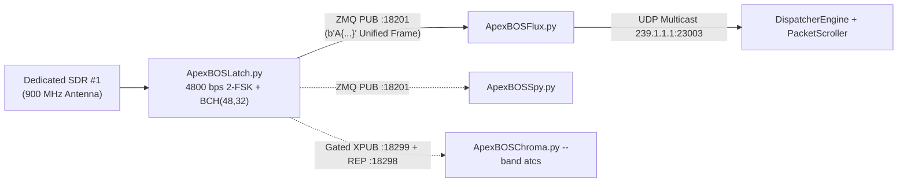

# ApexBOSLatch: Clean-Room 900 MHz ATCS (AAR Spec 200) SDR Demodulator

> [!IMPORTANT]
> **Disclaimer & Intended Use**: **ApexBOS is NOT a real Positive Train Control (PTC) or ATCS signaling system and is not affiliated with any railroad or government agency.** ApexBOSLatch is an independent, clean-room MIT-licensed reference tool developed for amateur train enthusiasts and RF telemetry hobbyists. It must never be used for train movement control, safety-critical railway operations, or commercial dispatching.

**ApexBOSLatch** ([ApexBOSLatch.py](ApexBOSLatch.py)) is a standalone, clean-room Python/NumPy Software-Defined Radio (SDR) demodulator and decoder for North American **900 MHz ATCS (AAR Specification 200)** 4800 bps 2-FSK railway telemetry.

Designed to run on a dedicated SDR alongside [ApexBOSGrabber](GRABBER_README.md) (220 MHz PTC) and [ApexBOSFred](FRED_README.md) (450 MHz EOT/HOT), `ApexBOSLatch` streams decoded wayside indications and control messages directly into **ApexBOSFlux**, **Dispatcher Engine**, the **Layout Packet Scroller**, **ApexBOSSpy**, and **ApexBOSChroma**.

---

## Table of Contents

1. [Multi-SDR Architecture & Ecosystem Integration](#multi-sdr-architecture--ecosystem-integration)
2. [900 MHz ATCS Channel Plan (BCP & MCP)](#900-mhz-atcs-channel-plan-bcp--mcp)
3. [Clean-Room DSP & BCH FEC Pipeline](#clean-room-dsp--bch-fec-pipeline)
4. [Quick Start & Multi-SDR Examples](#quick-start--multi-sdr-examples)
5. [Command-Line Reference](#command-line-reference)

---

## Multi-SDR Architecture & Ecosystem Integration



- **Dedicated SDR Support**: Reuses Grabber's cross-platform SDR drivers—supporting **RTL-SDR** (`--pipe`, `--rtlsdr`, `--rtl-tcp`), **SDRplay RSP1B / RSP1A / RSPdx / RSPduo** (`--rsp-tcp`, `--rsp-16bit`), **SoapySDR** (`--soapy`), and raw `--stdin` playback (`u8` and `s16`).
- **Unified Wire Format**: Publishes grabber-compatible 4-part ZMQ messages with a self-describing `b'A{...}'` JSON frame carrying `protocol: "atcs"`, 14-digit `mcp_addr`, `_node_id_`, indication hex, RSSI, and formatted `_scroll_ptc_` text. Add `tcp://127.0.0.1:18201` to `flux.sources` in `config.json` to flow ATCS packets straight into your layout board and Packet Scroller.
- **Chroma Integration**: Launch `python ApexBOSChroma.py --band atcs` (or click **`Band:PTC 220`** in Chroma's toolbar to cycle to **`Band:ATCS 935`**) to view live 935 MHz spectrum, waterfall, ATCS channel markers, and flowing ATCS blips—with zero overhead on Latch when Chroma is closed.

---

## 900 MHz ATCS Channel Plan (Pre-FCC Re-Structure F-1 to F-6)

A single RTL-SDR or SDRplay RSP1B at `1.92 MS/s`–`2.304 MS/s` centered at `936.4375 MHz` monitors all 6 standard pre-FCC re-structure BCP downlink channels (`1.10 MHz` span) simultaneously:

| Channel | ID (BCP / MCP) | BCP Downlink (MHz) | MCP Uplink (MHz) |
| :---: | :---: | :---: | :---: |
| **F-1** | `1` / `11` | `935.8875` | `896.8875` |
| **F-2** | `2` / `12` | `935.9375` | `896.9375` |
| **F-3** | `3` / `13` | `935.9875` | `896.9875` |
| **F-4** | `4` / `14` | `936.8875` | `897.8875` |
| **F-5** | `5` / `15` | `936.9375` | `897.9375` |
| **F-6** | `6` / `16` | `936.9875` | `897.9875` |

### Grabber-Style Interactive TUI, Statistics & Commands

`ApexBOSLatch` shares the exact same interactive console dashboard and live commands as [ApexBOSGrabber](GRABBER_README.md):
- **Live Integrity & RF Metrics**: 3-row ANSI block **Total Demod Failure Rate** (5s short + 60s sliding window), Sync Signatures, BCH(48,32) Good/Failures, Peak RSSI with ADC clipping alert, Avg Δf, Auto-PPM (`7s` interval, `±100 Hz`), Lazy PID Auto-Tuner `[P, I, D]`, Per-Channel table (`F-1`..`F-6`), and 6-row Recent Decoded Packets feed.
- **Interactive Commands (`Command >`)**: `p <ppm>`, `g <gain|auto>`, `b <0|1>`, `e <0-2>`, `autopm <on|off|status>`, `tune <on|off|status|interval|bounds>`, `afc <on|off|limit>`, `dedup <sec>`, `+ <ch|F-1..F-6>`, `- <ch>`, `lock <ch>`, `unlock <ch>`, `chans`, `reset`, `help`, `q`. Pass `--no-tui` for plain log output.

---

## Clean-Room DSP & BCH FEC Pipeline

1. **Per-Channel Digital Downconversion & Filtering**: Mixes each active 12.5 kHz channel to `48,000 S/s` (`10 samples/symbol` at `4800 bps`) through a tight `±5.5 kHz` windowed-sinc low-pass filter.
2. **Quadrature FM Discriminator**: Extracts instantaneous frequency deviations immune to amplitude fading, with median DC-offset compensation for carrier frequency error.
3. **Multi-Phase 4800 bps 2-FSK Clock Recovery**: Matched boxcar integrate-and-dump across all 10 symbol clock phases, automatically checking both normal and inverted FSK polarities.
4. **Sync Correlation & BCH(48, 32) Error Correction**: Correlates the 16-bit frame sync word (`0x168A`, tolerating ≤ 1 bit error) and decodes multi-block systematic 48-bit BCH codewords using a precomputed $O(1)$ syndrome table correcting up to **2 bit errors per block**.
5. **ATCS Frame Extraction**: Extracts 14-digit BCD MCP/BCP wayside addresses (compatible with layouts imported via [atcs_converter.py](atcs_converter.py)), message category (`IND`, `CTL`, `POLL`, `ACK`, `BEACON`, `LOCO`), and indication bitmaps.

---

## Quick Start & Multi-SDR Examples

```bash
# 1. Monitor all 6 BCP channels (935.8875–936.9875 MHz) on SDR #1:
python ApexBOSLatch.py --device 1 --chans 1,2,3,4,5,6 --gain 28.0

# 2. Monitor 896 MHz MCP uplinks on a separate SDR:
python ApexBOSLatch.py --device 2 --uplink --zmq-port 18202 --chroma-port 18297 --ctrl-port 18296

# 3. Run on an SDRplay RSP1B via rsp_tcp (16-bit extended mode):
python ApexBOSLatch.py --rsp-tcp --rsp-16bit --rate 2304000 --chans 1,2,3,4,5,6

# 4. Offline synthetic 935 MHz RF test (no SDR required):
python ApexBOSLatch.py --mock

# 5. Inspect live 935 MHz spectrum & ATCS blips in Chroma:
python ApexBOSChroma.py --band atcs

# 6. Inspect decoded ATCS packets in ApexBOSSpy:
python ApexBOSSpy.py --connect 18201
```

---

## Command-Line Reference

| Flag | Default | Description |
| :--- | :---: | :--- |
| `--chans <list>` | `1..6` (BCP) | Comma-separated ATCS channels (`1`–`6` BCP, `11`–`16` MCP). |
| `--uplink` | `False` | Default to 896 MHz MCP uplink channels (`11`–`16`). |
| `--device <idx>` | `1` | SDR device index (defaults to `1`, leaving `0` for `ApexBOSGrabber`). |
| `--rate <sps>` | `1920000` | SDR sample rate in S/s (auto-clamped $\ge 2.112\text{ MS/s}$ for SDRplay). |
| `--gain <dB>` | `28.0` | Tuner gain in dB (`0` for AGC). |
| `--ppm <int>` | `0` | Master oscillator PPM correction. |
| `-b`, `--bias-tee <0\|1>` | `0` | Enable/disable bias-tee power. |
| `--zmq-port <port>` | `18201` | ZMQ PUB port for Flux, Engine, Spy, and Chroma blips. |
| `--chroma-port <port>` | `18299` | Gated ZMQ XPUB IQ tap port for Chroma (`0` to disable). |
| `--ctrl-port <port>` | `18298` | ZMQ REP control port for Chroma live tuning (`0` to disable). |
| `--sdr-mode <mode>` | `auto` | `auto`, `pipe`, `tcp`, `rtlsdr`, `rsptcp`, `soapy`, `stdin` (plus `--rsp-tcp`, `--rsp-16bit`, `--soapy`, `--soapy-args`, `--sample-format`). |
| `--mock` | `False` | Synthesize live 935 MHz 4800 bps FSK + BCH RF bursts for offline testing. |

---

## Automatic Detection & Setup Wizard Integration

- **Setup Wizard (`setup_wizard.py`)**: Dedicated **Step 7 (ATCS Setup)** lets you include or exclude `ApexBOSLatch`, pick its SDR device index (default `1`), and choose channels using mnemonics (`BCP1`–`BCP6`, `MCP1`–`MCP6`, `F-1`–`F-6`) or numbers (`1`–`6`, `11`–`16`). When included, **ApexBOSLauncher** displays a dedicated **ApexBOSLatch** launch/stop row; when excluded, it is hidden cleanly.
- **RTL-SDR Bandwidth Clustering & AFC Default**: If both BCP (`935 MHz`) and MCP (`896 MHz`) channels are listed, `ApexBOSLatch` automatically groups channels by frequency proximity and monitors the larger group (preferring **MCP** on an equal tie). Channel AFC is **OFF** by default (`--afc` or `afc on` to enable).
- **Auto-Detection in Engine, Spy, & Chroma**: Whenever `ApexBOSLatch` is running on its configured port (`18201` / `18298`), **ApexBOS.220 (Engine)**, **ApexBOSSpy**, and **ApexBOSChroma** automatically detect it and display decoded ATCS packet information alongside PTC without disturbing existing PTC functionality.

---

## Custom Decoding with `config/atcs_rules.json` & Layout CTC Binding

Both **DispatcherEngine** and **ApexBOSSpy** automatically watch `config/atcs_rules.json` (hot-reloading on edits).

- **When `config/atcs_rules.json` is present**, ATCS packets are decoded using your station/class/bit-map definitions (or an ApexBOS `PacketParser` JSON rule list) and applied to layout elements via `ctc_id` and `ctc_rules` (e.g., `K11 OR C11,K25`).
- **When `config/atcs_rules.json` is missing**, ApexBOS automatically applies default Spec 200 decoding (14-digit MCP address as `ctc_id` plus standard `K11`–`K48` indication / `C11`–`C48` control code-line bit tokens), displays the decoded packet in **Spy** and the **Layout Packet Scroller**, and attempts to apply matching `ctc_id` / `ctc_rules` to layout elements.

Example `config/atcs_rules.json`:

```json
{
  "classes": {
    "GenericSwitch": {
      "K11": "right_NW_Ind",
      "K12": "right_RW_Ind",
      "K21": "upperLeft_GO_Ind",
      "K25": "upperTrack_Ind"
    }
  },
  "stations": {
    "78020610490202": {
      "name": "Hunts Lane",
      "ctc_id": "CP_HUNTS",
      "class": "GenericSwitch",
      "state_map": {
        "K25": { "occupied": true },
        "K11": { "switch": "normal" },
        "K12": { "switch": "reverse" },
        "K21": { "signal": "green" }
      }
    }
  }
}
```
