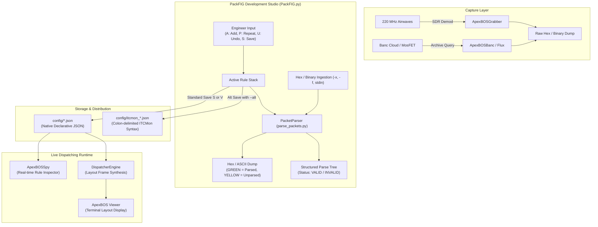
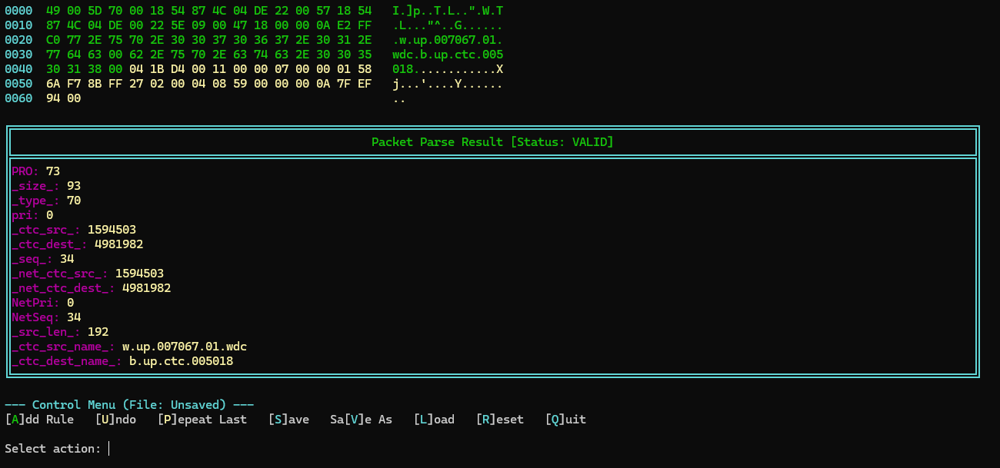
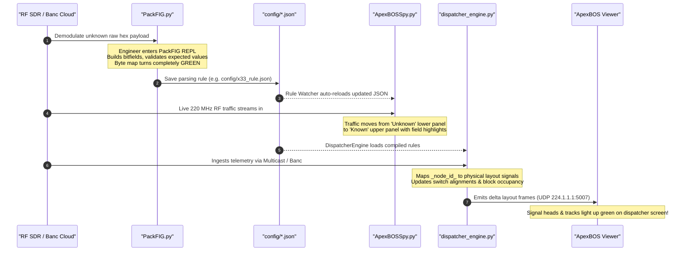

# PackFIG: Interactive Binary Packet Disassembler, Decoder & Rule Development Studio

> [!IMPORTANT]
> **Disclaimer & Intended Use**: **ApexBOS is NOT a real Positive Train Control (PTC) system and is not affiliated with any railroad or government agency.** ApexBOS is an experimental reference tool designed for amateur train enthusiasts and radio telemetry hobbyists. It attempts to decode 220 MHz digital telemetry packets to facilitate hobbyist research and visualize the status of elements defined on a layout. It must never be used for train movement control, safety-critical railway operations, or commercial dispatching.

**PackFIG** (`PackFIG.py`) is an interactive, dual-panel ANSI terminal binary packet disassembler, protocol decoder, and declarative rule authoring studio designed for the **ApexBOS** Railroad Dispatcher & Trackside Simulation ecosystem.

Operating at the critical boundary between raw RF demodulation and automated dispatching visualization, PackFIG gives enthusiasts, experimenters, and software developers the ability to inspect arbitrary 220 MHz telemetry payloads byte-by-byte, author bit-level parsing rules interactively in real time, and export modular parsing schemas used across the entire ApexBOS suite.

```
       +-------------------------------------------------------+
       |   Raw RF Demodulation / Hex Stream / Binary Capture   |
       |     (ApexBOSGrabber / Banc / Flux / Wireshark)        |
       +---------------------------+---------------------------+
                                   |
                                   v
       +-------------------------------------------------------+
       |          PackFIG: Interactive Decoder Studio          |
       |  - Visual Green / Yellow Byte Boundary Tracking       |
       |  - Real-Time Type Autocompletion & Validation Engine  |
       |  - Dynamic Rule History, Clones & Undo                |
       +---------------------------+---------------------------+
                                   |
                  +----------------+----------------+
                  |                                 |
                  v                                 v
   +-----------------------------+   +-----------------------------+
   |  Native ApexBOS Rule JSON   |   | Legacy ITCMon Alt Format    |
   |     (`config/*.json`)       |   |   (`itcmon_*.json`)         |
   +--------------+--------------+   +-----------------------------+
                  |
         +--------+--------+
         |                 |
         v                 v
+-----------------+ +--------------------------------------------------+
|   ApexBOSSpy    | | DispatcherEngine (dispatcher_engine.py)          |
| Real-time live  | | - Ingests telemetry via Multicast / Banc         |
| packet spy &    | | - Maps wayside nodes, aspects, track alignments  |
| traffic monitor | | - Broadcasts layout state frames to Viewers      |
+-----------------+ +--------------------------------------------------+
```

---

## Table of Contents

1. [Architectural Overview & Ecosystem Integration](#architectural-overview--ecosystem-integration)
2. [Dashboard Overview & Screenshot](#dashboard-overview--screenshot)
   - [The Color-Coded Hex & ASCII Memory Map](#the-color-coded-hex--ascii-memory-map)
   - [The Packet Parse Result Table](#the-packet-parse-result-table)
   - [The Pinned Control & Navigation Menu](#the-pinned-control--navigation-menu)
3. [Ingestion Modes & Command-Line Arguments](#ingestion-modes--command-line-arguments)
   - [Command-Line Flag Reference](#command-line-flag-reference)
   - [CLI Invocation Examples](#cli-invocation-examples)
4. [Interactive Rule Development Workflow](#interactive-rule-development-workflow)
   - [Live Feedback Loop: Green vs. Yellow Visual Progress](#live-feedback-loop-green-vs-yellow-visual-progress)
   - [Adding Rules with Inline Type Autocompletion (`[A]`)](#adding-rules-with-inline-type-autocompletion-a)
   - [Cloning Rules (`[P]` and Up/Down History Recall `[H]`)](#cloning-rules-p-and-updown-history-recall-h)
   - [Atomic Undo (`[U]`), Reset (`[R]`), and Unsaved Guard (`[Q]`)](#atomic-undo-u-reset-r-and-unsaved-guard-q)
5. [The Declarative Type System & Field Reference](#the-declarative-type-system--field-reference)
   - [Supported Data Types & Aliases](#supported-data-types--aliases)
   - [Contextual Rule Attributes](#contextual-rule-attributes)
   - [Automatic Name Uniqueness Engine](#automatic-name-uniqueness-engine)
6. [Dual Rule Serialization Formats](#dual-rule-serialization-formats)
   - [ApexBOS Native JSON Schema](#apexbos-native-json-schema)
   - [Alternative Legacy ITCMon Format (`--alt` / `itcmon_*.json`)](#alternative-legacy-itcmon-format---alt--itcmon_json)
   - [Format Translation Mechanics & Dynamic Length Field Elision](#format-translation-mechanics--dynamic-length-field-elision)
7. [End-to-End Telemetry Workflow: PackFIG to Live Dispatching](#end-to-end-telemetry-workflow-packfig-to-live-dispatching)
8. [Step-by-Step Tutorial: Dissecting a Class 70 EMP Packet](#step-by-step-tutorial-dissecting-a-class-70-emp-packet)
9. [Interactive Hotkeys & Keyboard Navigation Reference](#interactive-hotkeys--keyboard-navigation-reference)

---

## Architectural Overview & Ecosystem Integration

Digital radio protocols in the 220 MHz spectrum (such as Edge Message Protocol and wayside telemetry) encapsulate multi-tiered headers, variable-length wayside addresses, and bit-packed status structures. Deciphering new or undocumented packet variations traditionally required manual offset calculations or static scripts.

PackFIG eliminates this complexity through a **declarative, visual REPL** (Read-Eval-Print Loop):



### Key Architectural Capabilities

- **Zero-Latency Visual Feedback**: Every time a rule is added, repeated, or undone, the entire packet is immediately re-parsed and rendered.
- **Bit-Level & Byte-Level Precision**: Supports arbitrary bit-width fields (`int_bits`, single flags `bit`/`bool`), byte boundaries, strings (`string`, null-terminated `string_0`), BCD numbers, arrays, and conditional branches.
- **Bi-Directional Rule Portability**: Rules saved in PackFIG adhere to the standard schema interpreted by [parse_packets.py](parse_packets.py), allowing instant plug-and-play operation in [ApexBOSSpy.py](ApexBOSSpy.py) and [dispatcher_engine.py](dispatcher_engine.py).
- **Cross-Ecosystem Translation**: Automatically converts declarative JSON definitions into legacy colon-separated ITCMon syntax (`{name}:{bits}:{format}`) via the `--alt` flag.

---

## Dashboard Overview & Screenshot

PackFIG renders a clean, full-screen ANSI terminal dashboard split into three synchronized functional zones:



### The Three Functional Dashboard Zones:

### 1. The Color-Coded Hex & ASCII Memory Map (Top Zone)
Displays the entire packet payload rendered 16 bytes per line:
- **Byte Offsets (Cyan)**: 4-digit hexadecimal starting offset (e.g. `0000`, `0010`, `0020`...).
- **Hexadecimal Byte Stream**:
  - **GREEN**: Bytes that have been consumed and parsed by the current active rules stack.
  - **YELLOW**: Remaining bytes that have not yet been claimed by any rule (unparsed payload).
- **ASCII Translation (Right Column)**:
  - Printable ASCII characters ($32 \le \text{byte} \le 126$) rendered verbatim.
  - Non-printable or control bytes rendered as periods (`.`).
  - Strict color synchronization: green for parsed characters, yellow for unparsed characters.

### 2. The Packet Parse Result Table (Center Zone)
Enclosed within a double-line cyan border (`╔═══...═══╗`):
- **Header Status Badge**: Shows `[Status: VALID]` in bright green when all expected values and type constraints are satisfied, or `[Status: INVALID / TRUNCATED]` in bright red if a validation fails or EOF is encountered.
- **Field Name & Value Hierarchy**:
  - Field names displayed in **MAGENTA** (e.g. `_type_`, `_ctc_src_name_`).
  - Parsed and formatted values displayed in **YELLOW** (e.g. `70`, `w.up.007067.01.wdc`).
  - Automatically formats arrays, nested sections, and lookup tables with hierarchical indentation.

### 3. The Pinned Control & Navigation Menu (Bottom Zone)
Shows active file context (`File: Unsaved` or file path) and available single-key commands:
```text
--- Control Menu (File: Unsaved) ---
[A]dd Rule   [U]ndo   [P]epeat Last   [S]ave   Sa[V]e As   [L]oad   [R]eset   [Q]uit

Select action: 
```

---

## Ingestion Modes & Command-Line Arguments

PackFIG provides multiple input options to easily ingest packets from text buffers, shell pipes, or binary files.

### Command-Line Flag Reference

| Flag / Argument | Type | Default | Description |
| :--- | :---: | :---: | :--- |
| `packet` | Positional String | *None* | Hexadecimal string of the packet to decode. Whitespace and newlines are automatically stripped. |
| `-x`, `--hex` | String | *None* | Explicit flag to pass a hexadecimal string of the packet. |
| `-f`, `--file` | Path | *None* | Load raw binary packet payload directly from a binary file. |
| `-r`, `--rules` | Path | *None* | Pre-load an existing JSON rules file into the active editing session. |
| `-a`, `--alt` | Flag | `False` | Enable alternative ITCMon compatibility export mode (auto-prefixes output files with `itcmon_`). |

### CLI Invocation Examples

#### 1. Ingest Raw Hex via Positional Argument
```bash
python PackFIG.py 49005D70001854874C04DE2200571854874C04DE00225E0900471800000AE2FFC0772E75702E3030373036372E30312E77646300622E75702E6374632E30303530313800041BD40011000007000001586AF78BFF2702000408590000000A7FEF9400
```

#### 2. Dissect a Binary Dump with an Existing Rule Baseline
```bash
python PackFIG.py -f captures/wiu_beacon.bin -r config/x33_rule.json
```

#### 3. Author Rules in ITCMon Format
```bash
python PackFIG.py -x "490018..." -a
```
*(When saved, the output file is automatically converted to ITCMon format and prefixed with `itcmon_`)*.

#### 4. Launch with No Arguments (Interactive Prompt)
```bash
python PackFIG.py
```
If launched without arguments, PackFIG prompts:
```text
Interactive Packet Decoder
Enter the hex string of the packet to decode:
> 
```

---

## Interactive Rule Development Workflow

Authoring packet parsers in PackFIG is designed to be fast, keyboard-centric, and safe.

### Live Feedback Loop: Green vs. Yellow Visual Progress

When authoring a rule set from scratch:
1. Initially, the entire hex dump is **YELLOW** because 0 bits have been parsed.
2. As you define rules sequentially, the parser consumes bits from the payload.
3. Consumed bytes immediately transition from **YELLOW** to **GREEN**.
4. The remaining unparsed payload stands out in yellow, making it obvious where the next boundary, length byte, or header field begins.

```text
Parsed (GREEN)                           Unparsed Remaining (YELLOW)
[ 49 00 5D 70 00 18 54 87 4C 04 DE ... ] [ 04 1B D4 00 11 00 00 07 ... ]
```

### Adding Rules with Inline Type Autocompletion (`[A]`)

Pressing `A` opens the rule authoring prompt:

```text
--- New Parsing Rule (Use Tab/Enter to skip, Up/Down for history, Ctrl-D to complete early, ESC to cancel) ---
Type: u  (Hints: u8, u16, u32, u64, uint8, uint16, uint32, uint64)
```

- **Dynamic Hints**: As characters are typed, the hint list narrows in real time.
- **Smart Completion**: Pressing `Tab` or `Enter` immediately completes the first matching type. If an exact match is typed, it is accepted automatically.
- **Context-Sensitive Prompts**: Only prompts for parameters applicable to that specific type:
  - If type is `u8` or `u16`, it prompts for `name`, `expected`, `format`, and `lookup`.
  - If type is `skip`, it skips `name` and prompts directly for byte `length`.
  - If type is `array`, it prompts for `name`, `length`, and `item_type`.
- **Fast Exit via `Ctrl+D`**: At any prompt, pressing `Ctrl+D` accepts the current value and immediately finalizes the rule, skipping remaining optional prompts.
- **Safety via `ESC`**: Pressing `ESC` cancels the rule creation immediately with zero side-effects.

### Cloning Rules (`[P]` and Up/Down History Recall `[H]`)

Network protocols frequently feature repetitive fields (e.g. adjacent 24-bit node addresses or arrays of 8-bit flags).

- **Repeat Last Rule (`P`)**: Clones the most recently defined rule and prompts only for a new `name`.
- **History Browsing (`H` via Arrow Keys)**:
  - While on the `Select action:` prompt, press `UP` or `DOWN` arrows to browse through all previously defined rules.
  - The prompt updates inline:
    ```text
    Select action: [History: type=int_bits name=_ctc_src_] 
    ```
  - Press `Enter` on any historical rule to clone it. PackFIG will prompt for a new field name while preserving the type, bit length, format, and lookup configuration.

### Atomic Undo (`[U]`), Reset (`[R]`), and Unsaved Guard (`[Q]`)

- **Undo (`U`)**: Prompts for confirmation to remove the last added rule (`Undo last rule 'FieldName'? (y/N)`). If confirmed, the rule is popped from the stack and the display updates instantly.
- **Reset (`R`)**: Clears the entire active rule set after explicit confirmation (`Are you sure you want to reset all rules? (y/N)`).
- **Unsaved Changes Guard (`Q` / `Ctrl+C`)**: If any modifications were made since the last save (`rules_dirty == True`), PackFIG intercepts the exit and prompts:
  ```text
  Unsaved rules exist. Save before exiting? (Y/n): 
  ```

---

## The Declarative Type System & Field Reference

PackFIG leverages the comprehensive parsing engine implemented in [parse_packets.py](parse_packets.py).

### Supported Data Types & Aliases

| Canonical Type | Shorthand Aliases | Size / Alignment | Description & Typical Telemetry Usage |
| :--- | :---: | :---: | :--- |
| `uint8` | `u8` | 8 bits | Unsigned 8-bit integer (Packet type, priority, sequence counters). |
| `int8` | `i8` | 8 bits | Signed 8-bit integer. |
| `uint16` | `u16` | 16 bits (Big-Endian) | Unsigned 16-bit integer (Payload length, channel frequency index). |
| `int16` | `i16` | 16 bits (Big-Endian) | Signed 16-bit integer (Relative track offsets, velocity deltas). |
| `uint32` | `u32` | 32 bits (Big-Endian) | Unsigned 32-bit integer (Epoch timestamps, WIU beacon identifiers). |
| `int32` | `i32` | 32 bits (Big-Endian) | Signed 32-bit integer (High-precision GPS coordinates). |
| `uint64` | `u64` | 64 bits (Big-Endian) | Unsigned 64-bit integer (Microsecond UTC timestamps). |
| `int64` | `i64` | 64 bits (Big-Endian) | Signed 64-bit integer. |
| `int_bits` | `ib` | Custom bits | Arbitrary-width bitfields (e.g. 24-bit WIU `_node_id_`, 4-bit nibbles). |
| `bit` | `b1` | 1 bit | Single binary flag (0 or 1). |
| `bool` | `bl` | 1 bit | Boolean indicator (`True` or `False`). |
| `float16` | `f16` | 16 bits | Half-precision IEEE 754 floating point. |
| `float` / `float32` | `f`, `f32` | 32 bits | Single-precision IEEE 754 floating point. |
| `float64` | `f64` | 64 bits | Double-precision IEEE 754 floating point. |
| `string` | `s` | `length` bytes | Fixed-length or dynamic-length ASCII string. |
| `string_0` | `s0` | Null-terminated | Zero-delimited C-style string (e.g. CTC hostnames `w.up.007067.01.wdc`). |
| `bcd` | `d` | `length` bytes | Binary Coded Decimal digits (e.g. milepost numbers, locomotive IDs). |
| `skip` | `k` | `length` bytes | Unnamed pad bytes ignored during field parsing. |
| `array` | `a` | `length` elements | Repeated elements of primitive type `item_type`. |
| `cpychk` | `cp` | `length` bytes | Checksum verification window or raw byte slice. |
| `section` | `sec` | Structural | Opens a named nested dictionary scope in the output hierarchy. |
| `end_section`| `esec` | Structural | Closes the current nested dictionary scope. |
| `printf` | `prf` | Non-consuming | Formats an interpolated summary string (e.g. `_scroll_ptc_`). |

### Contextual Rule Attributes

When defining a rule, PackFIG conditionally prompts for the following fields based on the selected type:

1. **`name`**: The dictionary key assigned to the extracted field. Special system keys include:
   - `_node_id_`: Primary wayside or locomotive hardware ID.
   - `_type_`: Protocol packet type identifier.
   - `_scroll_ptc_`: Pinned single-line summary string rendered in [ApexBOSSpy.py](ApexBOSSpy.py).
2. **`length`**: Number of bits (for `int_bits`) or bytes (for `string`, `bcd`, `skip`, `cpychk`). Supports:
   - Integer literal: e.g. `24` for a 24-bit node ID.
   - Dynamic length reference: e.g. `length: "str_len"` dynamically references the numeric value extracted by an earlier field named `str_len`.
3. **`item_type`**: Required for `array` types to specify the data type of each repeating element (e.g. `uint8`).
4. **`expected`**: Validation assertion constraint. Can be entered as decimal (`70`) or hex (`0x46`). If the parsed wire value does not equal this value, the parser marks the packet invalid and fails immediately.
5. **`format`**: Display formatting specifier (`x` for hex, `d` for decimal, `s` for string, `b` for binary).
6. **`lookup`**: JSON dictionary mapping raw wire integers to human-readable labels (e.g. `{"0": "STOP", "1": "CLEAR", "2": "APPROACH"}`).

### Automatic Name Uniqueness Engine

To prevent silent dictionary overwrites when authoring rules rapidly, PackFIG includes `make_unique_name`:
- If an empty name is entered, an automatic sequential name (`field_0`, `field_1`, ...) is generated.
- If a name is entered that already exists in the rule set, PackFIG detects the collision and automatically appends or increments a numerical suffix (e.g. `TrackID` $\rightarrow$ `TrackID_1` $\rightarrow$ `TrackID_2`).

---

## Dual Rule Serialization Formats

PackFIG bridges two distinct configuration paradigms: modern declarative ApexBOS JSON schemas and legacy ITCMon colon-delimited specifications.

### ApexBOS Native JSON Schema

When saving normally (`[S]` or `[V]`), rules are stored as standard JSON lists:

```json
[
    {
        "type": "u8",
        "name": "PRO"
    },
    {
        "type": "u16",
        "name": "_size_"
    },
    {
        "type": "u8",
        "name": "_type_",
        "expected": 70
    },
    {
        "type": "int_bits",
        "name": "_ctc_src_",
        "length": 24
    },
    {
        "type": "string_0",
        "name": "_ctc_src_name_"
    }
]
```

### Alternative Legacy ITCMon Format (`--alt` / `itcmon_*.json`)

When invoked with the `-a` or `--alt` flag, PackFIG activates the `convert_to_alt_format` engine:
1. **Filename Enforcement**: The output file name is automatically prefixed with `itcmon_` if not already present (e.g. saving `rules.json` writes `itcmon_rules.json`).
2. **Colon-Delimited Syntax**: Fields are translated into `{name}:{bits}:{format}` triplets.
3. **Container Schema**: Rules are wrapped in a top-level `{"rules": [...]}` dictionary.

```json
{
    "rules": [
        {
            "field": "PRO:8:d"
        },
        {
            "field": "_size_:16:d"
        },
        {
            "field": "_type_:8:d"
        },
        {
            "field": "_ctc_src_:24:d"
        },
        {
            "field": "_ctc_src_name_:0:s"
        }
    ]
}
```

### Format Translation Mechanics & Dynamic Length Field Elision

The converter performs intelligent structural translations:

- **Bit Length Mapping**:
  - `u8` / `i8` $\rightarrow$ `8`
  - `u16` / `i16` $\rightarrow$ `16`
  - `u32` / `i32` $\rightarrow$ `32`
  - `bit` / `bool` $\rightarrow$ `1`
  - `string_0` $\rightarrow$ `0` (denotes null termination)
  - `skip` $\rightarrow$ Named `"Skip"`, bit length set to $\text{length} \times 8$, format `'x'`
- **Dynamic Length Field Elision**: In ITCMon specifications, length indicator fields preceding dynamic strings or arrays are handled internally. PackFIG scans the rule set for fields referenced as dynamic lengths (e.g. `length: "str_len"`) and automatically elides the redundant length rule from the ITCMon output.
- **Structural Cleanup**: Non-payload rules (`section`, `end_section`, `printf`) are stripped cleanly.
- **Conditional Branching**: Translates `branch` condition rules into ITCMon `"select"` and `"match"` sub-blocks.

---

## End-to-End Telemetry Workflow: PackFIG to Live Dispatching

PackFIG is the entry point of the ApexBOS protocol engineering pipeline:



1. **Capture**: An unknown packet appears on the airwaves or is fetched from historical Banc logs.
2. **Reverse Engineer**: Launch PackFIG with the hex string. Define header boundaries, node IDs, and payload structures until the unparsed yellow bytes vanish.
3. **Commit**: Save the rule directly to `config/xXX_rule.json`.
4. **Inspect in Spy**: Open [ApexBOSSpy.py](ApexBOSSpy.py). The file watcher instantly reloads the rule, immediately classifying previously unknown packets into the Known Packets panel.
5. **Dispatching Execution**: [dispatcher_engine.py](dispatcher_engine.py) compiles the rule, allowing live signals, switch points, and track circuits to dynamically reflect real-world train movements.

---

## Step-by-Step Tutorial: Dissecting a Class 70 EMP Packet

Let us walk through dissecting the authentic 220 MHz Class 70 Edge Message Protocol packet captured in the [PackFIG Main Screen Screenshot](#dashboard-overview--screenshot).

**Payload**:
`49005D70001854874C04DE2200571854874C04DE00225E0900471800000AE2FFC0772E75702E3030373036372E30312E77646300622E75702E6374632E30303530313800041BD4...`

### Step 1: Ingest into PackFIG
```bash
python PackFIG.py 49005D70001854874C04DE22...
```
*Result: The 93-byte packet is displayed. All bytes are initially bright yellow.*

### Step 2: Define the ITC Protocol Prefix
- Press `A` (Add Rule).
- Type: `u8` [Enter].
- Name: `PRO` [Enter].
- Expected: `0x49` (ASCII `'I'` for Interoperable Train Control) [Enter].
- Format: `d` [Enter].
- Lookup: [Enter] (leave empty).
*Result: Byte 0 (`49`) turns GREEN. Parse tree shows `PRO: 73`.*

### Step 3: Extract Packet Size
- Press `A`.
- Type: `u16` [Enter].
- Name: `_size_` [Enter].
- Expected: [Enter] (any size allowed).
- Press `Ctrl+D` to skip remaining optional fields.
*Result: Bytes 1–2 (`00 5D`) turn GREEN. Parse tree shows `_size_: 93`.*

### Step 4: Extract and Validate Class 70 Message Type
- Press `A`.
- Type: `u8` [Enter].
- Name: `_type_` [Enter].
- Expected: `70` [Enter].
*Result: Byte 3 (`70`) turns GREEN. Parse tree shows `_type_: 70`.*

### Step 5: Read Priority
- Press `A`.
- Type: `u8` [Enter].
- Name: `pri` [Enter].
- Press `Ctrl+D`.
*Result: Byte 4 (`00`) turns GREEN.*

### Step 6: Extract 24-Bit Source and Destination Addresses
- Press `A`.
- Type: `ib` (`int_bits`) [Enter].
- Name: `_ctc_src_` [Enter].
- Length: `24` [Enter].
- Press `Ctrl+D`.
*Result: Bytes 5–7 (`18 54 87`) turn GREEN. Value extracts to decimal `1594503`.*
- Press `P` (Repeat Last Rule).
- New name (was `_ctc_src_`): `_ctc_dest_` [Enter].
*Result: Bytes 8–10 (`4C 04 DE`) turn GREEN. Value extracts to decimal `4981982`.*

### Step 7: Extract Null-Terminated Hostname Strings
- Press `A`.
- Type: `s0` (`string_0`) [Enter].
- Name: `_ctc_src_name_` [Enter].
*Result: The string scanner reads up to byte `0x00`. Bytes turn GREEN through `77 64 63 00`. Value displays `w.up.007067.01.wdc` (Wayside Interface Unit at Union Pacific Milepost 70.67).*
- Press `P` (Repeat).
- New name: `_ctc_dest_name_` [Enter].
*Result: Bytes turn GREEN through `30 31 38 00`. Value displays `b.up.ctc.005018` (Back office CTC server).*

### Step 8: Save the Rule
- Press `S` (Save).
- Prompt: `Save to file (e.g. rules.json): config/x70_rules.json` [Enter].
*Result: File written cleanly. The rule is now available to Spy and Engine.*

---

## Interactive Hotkeys & Keyboard Navigation Reference

PackFIG employs low-level raw terminal character reading (`msvcrt` on Windows, `termios`/`tty` on Linux/macOS) for instant response without requiring `Enter` on top-level menus.

| Key | Mode / Context | Action |
| :---: | :--- | :--- |
| `A` / `a` | Main Menu | **Add Rule**: Launches interactive rule builder with live type hints. |
| `U` / `u` | Main Menu | **Undo**: Prompts to remove the most recently added rule from the stack. |
| `P` / `p` | Main Menu | **Repeat Last**: Clones the last rule and prompts for a new field name. |
| `UP` Arrow | Main Menu | **Browse History**: Navigates backwards through existing rule configurations. |
| `DOWN` Arrow| Main Menu | **Browse History**: Navigates forwards through existing rule configurations. |
| `Enter` | History Browse | **Clone Historical Rule**: Copies the currently browsed historical rule. |
| `S` / `s` | Main Menu | **Save**: Writes the active rule set to the current file (or prompts if unsaved). |
| `V` / `v` | Main Menu | **Save As**: Prompts for a new destination filename. |
| `L` / `l` | Main Menu | **Load**: Prompts for a filename to load an existing rule set into memory. |
| `R` / `r` | Main Menu | **Reset**: Clears all active rules after user confirmation. |
| `Q` / `q` | Main Menu | **Quit**: Exits PackFIG (checks dirty state and warns if unsaved rules exist). |
| `Tab` | Field Prompt | Accepts the current autocomplete suggestion or default value. |
| `Ctrl+D` | Field Prompt | **Complete Early**: Submits current field and bypasses all remaining optional fields. |
| `ESC` | Field Prompt | **Cancel**: Aborts current input prompt immediately with no changes saved. |
| `Backspace`| Field Prompt | Deletes the preceding character in the input buffer. |
| `Ctrl+C` | Global | Intercepts keyboard interrupt, checks dirty state, and safely prompts to save. |

---

## Summary of Ecosystem Integration Files

- [PackFIG.py](PackFIG.py) — Interactive packet decoder and rule builder studio.
- [parse_packets.py](parse_packets.py) — Underlying binary parsing engine and serialization logic.
- [ApexBOSSpy.py](ApexBOSSpy.py) — Real-time protocol analyzer and rule verification terminal.
- [dispatcher_engine.py](dispatcher_engine.py) — Core dispatching engine mapping rule fields to layout frames.
- [SPY_README.md](SPY_README.md) — Comprehensive guide to live packet spying and rule inspection.
- [GRABBER_README.md](GRABBER_README.md) — RF demodulation and ZeroMQ capture architecture.
- [BANC_README.md](BANC_README.md) — Cloud packet telemetry and storage server.
- [FLUX_README.md](FLUX_README.md) — Real-time telemetry ingestion and Banc streaming client.
