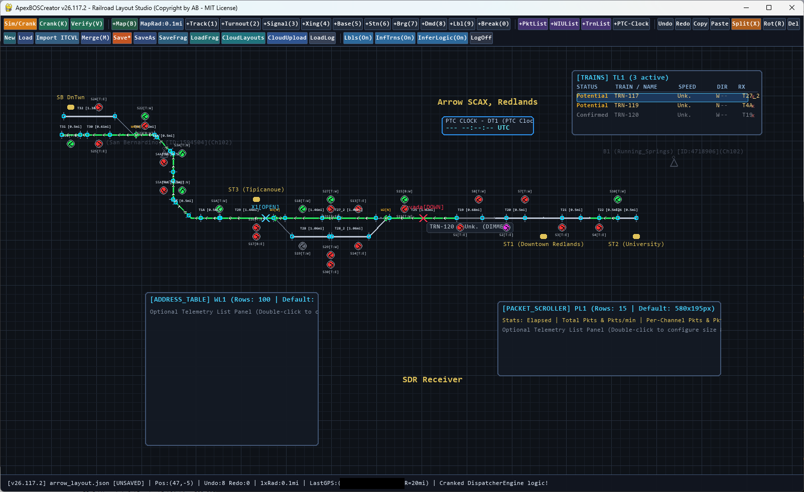

# ApexBOS.220

A minimalist railway dispatching game and trackside board simulator—or maybe something tuned a little closer to the real mainline. Built for armchair dispatchers who like their virtual boards suspiciously lifelike.

Compatible with Katso "The Train Watcher" ITCMon.

Thanks to the Rail Roading Groups.io communities such as ATCSMon and PTC Talk, and to the PTC amateur community at large.
