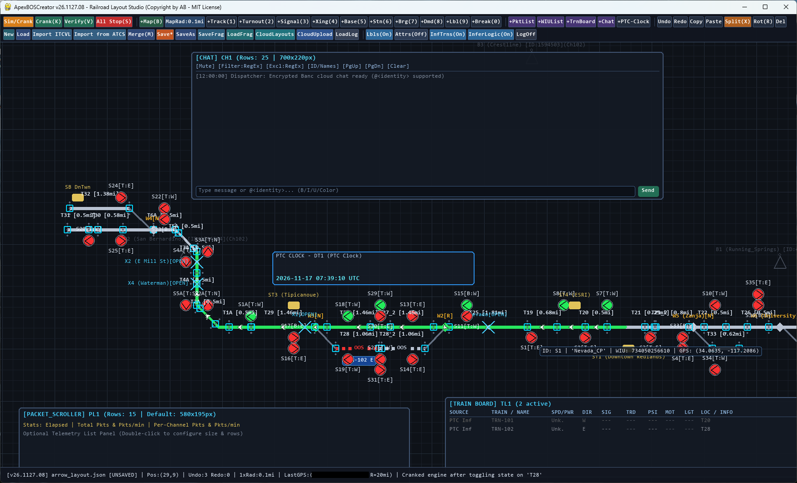
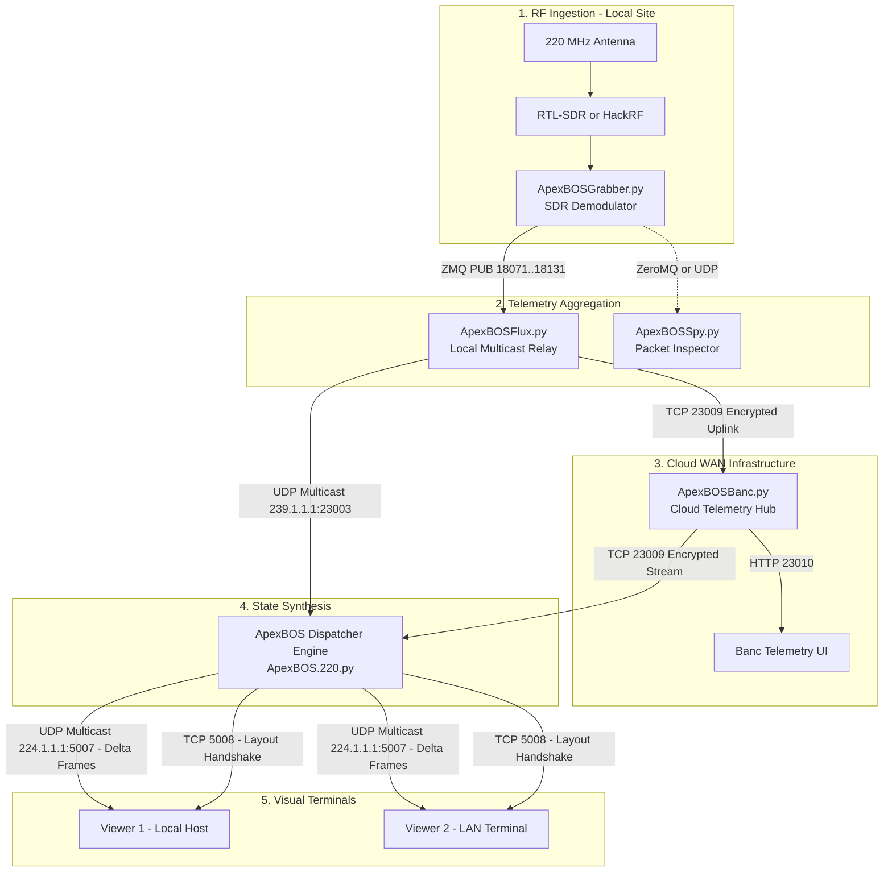
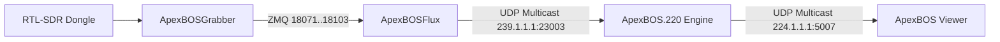
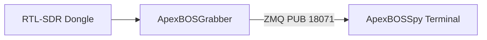
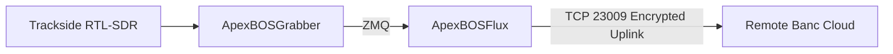
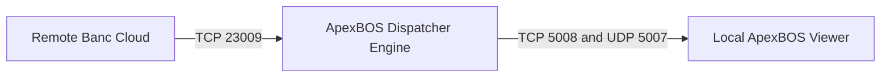
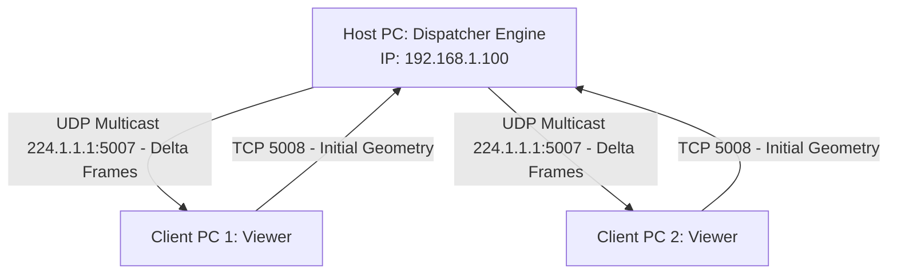

# ApexBOS.220: Railway Dispatcher Simulation & 220 MHz Telemetry Analysis Suite

A minimalist railway dispatching game and trackside board simulator—or maybe something tuned a little closer to the real mainline. Built for armchair dispatchers who like their virtual boards suspiciously lifelike.



> [!IMPORTANT]
> ### Disclaimer & Non-Affiliation
> **ApexBOS is NOT a real Positive Train Control (PTC) system and is not certified or approved for operational railway control.**
> ApexBOS is an experimental software suite and reference tool developed strictly for amateur train enthusiasts, hobbyists, and digital radio listeners. It attempts to demodulate and decode digital telemetry packets transmitted across the 220 MHz VHF spectrum to facilitate amateur research and visualize the simulated or observed operational status of track elements defined on a layout schematic.
> 
> **ApexBOS does NOT send control commands to physical railway equipment, does not guarantee data accuracy, and must NEVER be used for train movement control, safety-critical interlocking decisions, collision prevention, or actual railroad dispatching.**

---

## Table of Contents

1. [Ecosystem Overview: The Dual-World Architecture](#ecosystem-overview-the-dual-world-architecture)
2. [Component Catalog & Role Index](#component-catalog--role-index)
3. [Network Topology, Architecture & Port Reference](#network-topology-architecture--port-reference)
4. [Installation & Setup Paths](#installation--setup-paths)
   - [Path A: Automated Setup Wizard (`setup.bat` / `setup.sh`)](#path-a-automated-setup-wizard-setupbat--setupsh)
   - [Path B: Manual Command-Line Installation](#path-b-manual-command-line-installation)
5. [Update & Maintenance Paths](#update--maintenance-paths)
   - [Path A: Automated In-Place Updater (`update.bat` / `update.sh`)](#path-a-automated-in-place-updater-updatebat--updatesh)
   - [Path B: Manual Git / Archive Upgrade](#path-b-manual-git--archive-upgrade)
6. [Practical "How-To" Operational Guides](#practical-how-to-operational-guides)
   - [How to 1: Full Local Stack (SDR $\rightarrow$ Grabber $\rightarrow$ Flux $\rightarrow$ Engine $\rightarrow$ Viewer)](#how-to-1-full-local-stack-sdr--grabber--flux--engine--viewer)
   - [How to 2: Just an SDR (Demodulate & Spy Without Pygame)](#how-to-2-just-an-sdr-demodulate--spy-without-pygame)
   - [How to 3: Feed a Remote Cloud Banc (Field Sensor Station)](#how-to-3-feed-a-remote-cloud-banc-field-sensor-station)
   - [How to 4: Cloud-Fed Dispatching (No Local Antenna Required)](#how-to-4-cloud-fed-dispatching-no-local-antenna-required)
   - [How to 5: Multiple Dispatch Displays Across Different Computers](#how-to-5-multiple-dispatch-displays-across-different-computers)
   - [How to 6: Designing, Managing & Switching Multiple Layouts](#how-to-6-designing-managing--switching-multiple-layouts)
7. [Hardware Requirements & SDR Tuning](#hardware-requirements--sdr-tuning)
8. [Community Credits & Protocol Compatibility](#community-credits--protocol-compatibility)

---

## Ecosystem Overview: The Dual-World Architecture

Is ApexBOS a lightweight desktop train simulation game where you route trains across custom schematic interlocking boards? Or is it an SDR-powered physical telemetry processor decoding real-world 220 MHz digital railway packets from nearby tracks?

The answer is **both**. ApexBOS is architected as a modular ecosystem where the boundary between simulation and live telemetry ingestion is completely transparent:

- **Offline Simulation Mode**: You can author track layouts, drop switches, signals, and block circuits, and simulate train progression with an internal kinematic crank engine—all without an antenna or external feed.
- **Live Telemetry Observation Mode**: Connect an inexpensive Software-Defined Radio (SDR), tune to 220 MHz railway telemetry frequencies, and the exact same layout board animates in real time as wayside interface units report switch points, signal aspects, and track circuit drops from passing trains.

```
       +---------------------------------------------------------------------------------+
       |                        PHYSICAL RF & CLOUD INGRESS LAYER                        |
       |  220 MHz Airwaves (RTL-SDR)   <--->   ApexBOSBanc Cloud Telemetry (TCP/IPv6)    |
       +---------------------------------------+-----------------------------------------+
                                               |
                                               v
       +---------------------------------------------------------------------------------+
       |                      TELEMETRY RELAY & STREAMING LAYER                          |
       |  ApexBOSGrabber (Baseband Demod)  -->  ApexBOSFlux (Multicast Aggregator)       |
       +---------------------------------------+-----------------------------------------+
                                               |
                                               v
       +---------------------------------------------------------------------------------+
       |                    CORE STATE SYNTHESIS & LOGIC ENGINE                          |
       |  ApexBOS Dispatcher Engine (ApexBOS.220.py / dispatcher_engine.py)             |
       |  - Bitfield Rule Engine               - Dynamic Headway & Collision Warning     |
       |  - Wayside Node Address Resolver      - Compressed Delta-Frame Broadcast        |
       +-------------------+---------------------------------------+---------------------+
                           |                                       |
                           v                                       v
       +---------------------------------------+ +---------------------------------------+
       |           VIEWER INTERFACE            | |         DEVELOPER / SPY SUITE         |
       |  ApexBOS Viewer (Pygame Display)      | |  PackFIG (Packet Disassembler)        |
       |  - Interactive Track Schematic        | |  ApexBOSSpy (ANSI Protocol Spy)       |
       |  - Train Tracking & GPS Speed         | |  ApexBOSCreator (Layout Studio)       |
       |  - Foamer Chat & Audio Annunciator    | |  parse_packets.py (Rule Compiler)     |
       +---------------------------------------+ +---------------------------------------+
```

---

## Component Catalog & Role Index

ApexBOS is partitioned into modular, independently executable components. Each component is thoroughly documented in its own dedicated README:

| Component | Source File | Documentation | Role & Capabilities |
| :--- | :--- | :--- | :--- |
| **ApexBOSGrabber** | [ApexBOSGrabber.py](ApexBOSGrabber.py) | [GRABBER_README.md](GRABBER_README.md) | High-speed SDR receiver and $\pi/4$-DQPSK demodulator. Decodes 220 MHz bursts, executes Viterbi and Reed-Solomon FEC, and publishes streams over ZeroMQ PUB sockets (defaulting to ports 18071–18131) and UDP. |
| **ApexBOSScanner** | [ApexBOSScanner.py](ApexBOSScanner.py) | [SCANNER_README.md](SCANNER_README.md) | Automated ITC 220 MHz channel scanner & master oscillator PPM calibrator. Hunts active PTC channels (97–176), sweeps tuner offsets $\pm 4$ PPM, calculates consensus tuner PPM and safe gain headroom, and updates Grabber configurations. |
| **ApexBOSFlux** | [ApexBOSFlux.py](ApexBOSFlux.py) | [FLUX_README.md](FLUX_README.md) | Asynchronous multi-channel telemetry aggregator. Collects ZMQ worker streams, performs sliding-window deduplication, relays packets locally on UDP multicast (`239.1.1.1:23003`), and uploads encrypted bursts to Banc Cloud. |
| **ApexBOSBanc** | [ApexBOSBanc.py](ApexBOSBanc.py) | [BANC_README.md](BANC_README.md) | Dual-stack (IPv4/IPv6) cloud telemetry server. Features SQLite WAL database storage, rolling TOTP authentication (`mosfet_auth`), centralized layout distribution, and inter-station Foamer Chat relay (TCP `23009`). |
| **Dispatcher Engine** | [ApexBOS.220.py](ApexBOS.220.py)<br/>[dispatcher_engine.py](dispatcher_engine.py) | [ENGINE_README.md](ENGINE_README.md) | The computational heart of the system. Compiles layout geometries, ingests telemetry from multicast or Banc, resolves WIU bit offsets, computes train speeds, predicts collisions, and broadcasts delta frames (`224.1.1.1:5007`). |
| **ApexBOS Viewer** | [View_ApexBOS.220.py](View_ApexBOS.220.py) | [VIEWER_README.md](VIEWER_README.md) | Hardware-accelerated Pygame trackside display. Renders glowing track blocks, multi-head signal masts, power switch alignments, locomotive train tags, right-click GPS mini-map, WIU tables, and operator chat. |
| **ApexBOS Creator** | [ApexBOSCreator.py](ApexBOSCreator.py) | [CREATOR_README.md](CREATOR_README.md) | Graphical layout authoring environment. Features GPS Big Map satellite alignment, 1-cell magnetic gapless track welding, 45-degree route snapping, relationship hover leaders, and integrated crank simulation. |
| **ApexBOSSpy** | [ApexBOSSpy.py](ApexBOSSpy.py) | [SPY_README.md](SPY_README.md) | Dual-panel ANSI terminal protocol analyzer. Splits incoming 220 MHz traffic into Known vs. Unknown packets, validates fields against modular JSON rules, and supports live rule reloading (`'r'`) without restarting. |
| **PackFIG** | [PackFIG.py](PackFIG.py) | [PACKFIG_README.md](PACKFIG_README.md) | Interactive visual binary packet disassembler. Features real-time type autocompletion, green/yellow unparsed byte maps, and exports parsing schemas directly to native ApexBOS JSON or legacy ITCMon formats (`--alt`). |
| **Setup Wizard** | [setup_wizard.py](setup_wizard.py)<br/>`setup.bat` / `setup.sh` | [Installation Guide](#installation--setup-paths) | Interactive cross-platform setup wizard. Automates Python dependencies, topology selection, radio channel allocation, SDR driver configuration, and system service installation. |
| **In-Place Updater** | [update.py](update.py)<br/>`update.bat` / `update.sh` | [Update Guide](#update--maintenance-paths) | Automated in-place software updater with SHA-256 integrity verification, process management, automatic user data preservation, and instant rollback. |

---

## Network Topology, Architecture & Port Reference

The diagram below illustrates the end-to-end data pipeline across local hardware, network relays, cloud servers, and client display terminals:



### Complete Network Port Reference Table

| Port / Address | Transport Protocol | Direction | Source Component | Destination Component | Purpose & Description |
| :--- | :--- | :---: | :--- | :--- | :--- |
| `18071`–`18131` | TCP (ZeroMQ PUB/SUB) | Unicast | ApexBOSGrabber | ApexBOSFlux / ApexBOSSpy | High-speed channelized telemetry slices published by Grabber demodulator workers (starting at 18071, 18000 + channel). |
| `239.1.1.1:23003` | UDP Multicast | Local LAN | ApexBOSFlux | Dispatcher Engine / Spy | Local area network telemetry distribution for sub-millisecond packet delivery. |
| `23009` | TCP (Dual-Stack IPv4/IPv6) | WAN / LAN | ApexBOSFlux / Engine / Viewer | ApexBOSBanc Cloud | Encrypted cloud telemetry uplink, packet archives, layout synchronization, and Foamer Chat. |
| `23010` | TCP (HTTP / Telnet) | Localhost / LAN | Browser / Terminal | ApexBOSBanc | Banc cloud telemetry monitoring dashboard, active connection table, and cooldown manager. |
| `224.1.1.1:5007` | UDP Multicast | Local LAN | Dispatcher Engine | ApexBOS Viewer | Real-time layout delta-frame broadcast (LZ4/ZLIB compressed state updates, 10–30 Hz). |
| `5008` | TCP | Unicast | ApexBOS Viewer | Dispatcher Engine | Viewer initial connection handshake, static layout geometry transfer, and time sync. |

> [!TIP]
> **Windows Firewall Configuration**:
> Windows Defender Firewall blocks inbound UDP multicast by default. To unblock ApexBOS telemetry on Windows, run [enable_firewall.bat](enable_firewall.bat) as Administrator, or paste the following into an Administrator PowerShell prompt:
> ```powershell
> New-NetFirewallRule -DisplayName "ApexBOS Inbound UDP Multicast" -Direction Inbound -LocalPort 23003,5007 -Protocol UDP -Action Allow -Profile Domain,Private,Public
> New-NetFirewallRule -DisplayName "ApexBOS Inbound TCP Services" -Direction Inbound -LocalPort 1234,5008,18071-18135,23009,23010 -Protocol TCP -Action Allow -Profile Domain,Private,Public
> New-NetFirewallRule -DisplayName "ApexBOS Inbound IGMP" -Direction Inbound -Protocol 2 -Action Allow -Profile Domain,Private,Public
> route add 224.0.0.0 mask 240.0.0.0 0.0.0.0 metric 1
> ```

---

## Installation & Setup Paths

ApexBOS supports two installation paths: an automated interactive wizard or manual command-line installation.

### Path A: Automated Setup Wizard (`setup.bat` / `setup.sh`)

The automated installer configures your environment, creates a virtual environment, installs Python packages, sets up RTL-SDR drivers, configures cloud credentials, and optionally registers background services.

#### On Windows:
1. Double-click [setup.bat](setup.bat), or open PowerShell / Command Prompt:
   ```cmd
   cd C:\ApexBOS.220
   setup.bat
   ```
2. The wizard prompts you to choose your topology:
   - **Local Network Only**: For standalone SDR setups or pure simulation.
   - **With Cloud Support**: Connect to a remote Banc server or host Banc locally.
3. Select your radio channels, enter Banc host credentials (if using cloud), and let the wizard complete.

#### On Linux / macOS:
```bash
cd /opt/ApexBOS.220
chmod +x setup.sh
./setup.sh
```

---

### Path B: Manual Command-Line Installation

If you prefer full control over your Python environment, follow these step-by-step instructions:

#### Step 1: Verify Python Version
ApexBOS requires **Python 3.8 through 3.14**:
```bash
python --version
# or on Windows:
py -3 --version
```

#### Step 2: Create and Activate Virtual Environment
```bash
# Windows (PowerShell)
py -3 -m venv venv
.\venv\Scripts\Activate.ps1

# Windows (Command Prompt)
py -3 -m venv venv
.\venv\Scripts\activate.bat

# Linux / macOS
python3 -m venv venv
source venv/bin/activate
```

#### Step 3: Install Required Dependencies
Install the required packages from [requirements.txt](requirements.txt):
```bash
pip install -r requirements.txt
```
*Core packages installed*: `pygame-ce` (or `pygame`), `pyzmq`, `cryptography`, `requests`, `urllib3`, `lz4`.

#### Step 4: SDR Driver & Library Setup
If you plan to ingest live 220 MHz radio signals:
- **Windows**:
  1. Plug in your RTL-SDR USB dongle.
  2. Download and run [Zadig](https://zadig.akeo.ie/).
  3. Select **Options $\rightarrow$ List All Devices**, pick your RTL2838 / RTL-SDR device, and install the **WinUSB** driver.
  4. Ensure `rtlsdr.dll` and `libusb-1.0.dll` are located in your working directory or system PATH.
- **Linux (Ubuntu/Debian)**:
  ```bash
  sudo apt-get update
  sudo apt-get install -y rtl-sdr librtlsdr-dev
  # Install udev rule to allow non-root USB access:
  sudo wget -O /etc/udev/rules.d/20-rtlsdr.rules https://raw.githubusercontent.com/osmocom/rtl-sdr/master/rtl-sdr.rules
  sudo udevadm control --reload-rules && sudo udevadm trigger
  ```

---

## Update & Maintenance Paths

### Path A: Automated In-Place Updater (`update.bat` / `update.sh`)

The ApexBOS updater safely updates the codebase while preserving all your custom layouts (`layouts/*.json`), user preferences (`prefs_*.json`), database records (`banc.db`), and customized configuration files:

```bash
# Windows
update.bat

# Linux / macOS
./update.sh
```

The updater executes in two safe stages:
1. **Verification & Snapshot**: Validates the distribution archive, stops active processes, and creates a full snapshot in `backups/update_<old>_<timestamp>/`.
2. **Deep Configuration Merge**: Updates system code while deep-merging newly added settings into your existing `config.json`.

> [!TIP]
> **Instant Rollback**: If an update causes an issue, immediately restore the prior working state with:
> ```bash
> python update.py --rollback latest
> ```

---

### Path B: Manual Git / Archive Upgrade

If managing via Git:
```bash
git pull origin main
pip install -r requirements.txt --upgrade
```

---

## Practical "How-To" Operational Guides

Here are step-by-step command-line walkthroughs for the most common deployment and operational scenarios.

---

### How to 1: Full Local Stack (SDR $\rightarrow$ Grabber $\rightarrow$ Flux $\rightarrow$ Engine $\rightarrow$ Viewer)

Run the entire pipeline on a single computer equipped with an RTL-SDR dongle and a 220 MHz antenna.



#### Step 1: Terminal 1 — Start the SDR Demodulator (Grabber)

> [!TIP]
> **Not sure which 220 MHz channels are active in your area?**
> Run the automated scanner to hunt active channels (97–176) and calibrate tuner PPM:
> ```bash
> python ApexBOSScanner.py --dwell 3.5
> ```
> Or in `ApexBOSLauncher.py`, click **[Scan 220 MHz Channels]** (or **[SCAN]** on the Grabber row) to automatically inherit your SDR settings and apply discovered channels directly to `config.json`. See [SCANNER_README.md](SCANNER_README.md).

Tune Grabber to monitor active 220 MHz telemetry channels (e.g. 71, 101, 102) via RTL-SDR pipe:
```bash
python ApexBOSGrabber.py --channels 71,101,102 --pipe --gain 42
```
*You will see the ANSI dashboard show RF sample flow and decoded packet counters on ports 18071, 18101, etc.*

#### Step 2: Terminal 2 — Start the Local Telemetry Relay (Flux)
Flux subscribes to the Grabber channels, deduplicates frames, and rebroadcasts them on local multicast:
```bash
python ApexBOSFlux.py --display
```

#### Step 3: Terminal 3 — Start the Dispatcher Engine
Launch the Engine with your chosen track layout. The Engine ingests multicast telemetry, resolves WIU bit offsets, and tracks train movements:
```bash
python ApexBOS.220.py --layout layouts/arrow_layout.json --source mcast
```

#### Step 4: Terminal 4 — Launch the Graphical Viewer
Open the Pygame trackside dispatcher display:
```bash
python View_ApexBOS.220.py
```
*The board will light up. As trains drop track circuits and line signals in the real world, the virtual board reflects their movements.*

---

### How to 2: Just an SDR (Demodulate & Spy Without Pygame)

Ideal for field monitoring, checking antenna reception, or reverse-engineering unknown radio telemetry without loading layouts or graphical user interfaces.



#### Step 1: Terminal 1 — Launch Grabber on Target Channel
Tune Grabber to monitor channel 71 in pipe mode:
```bash
python ApexBOSGrabber.py --channels 71 --pipe
```

#### Step 2: Terminal 2 — Launch ApexBOSSpy Protocol Analyzer
Connect Spy directly to the local Grabber process:
```bash
python ApexBOSSpy.py --connect 18071
```
*Features available in Spy*:
- **Upper Panel**: Shows validated, decoded wayside packets with field breakdown.
- **Lower Panel**: Shows raw unparsed hex and printable ASCII strings.
- Press **`'r'`** at any time to hot-reload parsing rules from `config/*.json` without dropping packets.
- Press **`'p'`** to pause scrolling and inspect byte fields.

---

### How to 3: Feed a Remote Cloud Banc (Field Sensor Station)

Set up a headless remote station (such as a Raspberry Pi or trackside PC) that receives 220 MHz radio signals and uploads encrypted telemetry bursts to a central cloud Banc server.



#### Step 1: Configure Cloud Credentials in `MosFET.json`
Edit your local `MosFET.json` to define the cloud server endpoint and encryption key:
```json
{
  "banc_enabled": true,
  "banc_host": "banc.yourdomain.com",
  "banc_port": 23009,
  "banc_secret": "YourSecretPhraseMin8Chars",
  "banc_encryption_key": "YOUR_44_CHARACTER_BASE64_FERNET_KEY=",
  "burst_interval": 3.0,
  "sources": [
    "tcp://127.0.0.1:18071",
    "tcp://127.0.0.1:18101"
  ]
}
```

#### Step 2: Launch Grabber in Daemon Mode
```bash
python ApexBOSGrabber.py --channels 71,101 --pipe --workers 2
```

#### Step 3: Launch Flux with Cloud Uplink
```bash
python ApexBOSFlux.py --config MosFET.json --display
```
*Flux will establish an authenticated connection to the cloud Banc server via rolling TOTP and stream real-time packet bursts over IPv4 or IPv6.*

---

### How to 4: Cloud-Fed Dispatching (No Local Antenna Required)

If you do not have an SDR antenna or live in an area without 220 MHz railway traffic, you can feed your Dispatcher Engine directly from a remote peer's Banc cloud server.



#### Step 1: Configure Banc Credentials in `config.json`
Set your Banc credentials in your local `config.json`:
```json
{
  "banc_host": "banc.yourdomain.com",
  "banc_port": 23009,
  "auth_secret": "YourSecretPhraseMin8Chars",
  "encryption_key": "YOUR_44_CHARACTER_BASE64_FERNET_KEY="
}
```

#### Step 2: Start the Dispatcher Engine in Banc Mode
```bash
python ApexBOS.220.py --layout layouts/arrow_layout.json --source banc
```
*The Engine connects to the cloud server, synchronizes recent packet history, and begins streaming live telemetry.*

#### Step 3: Start the Viewer Display
```bash
python View_ApexBOS.220.py
```

---

### How to 5: Multiple Dispatch Displays Across Different Computers

You can run a single Dispatcher Engine on a central machine and connect multiple Viewers running on different computers across your local network or VPN.



#### Step 1: Start Dispatcher Engine on the Host Computer (e.g. `192.168.1.100`)
```bash
python ApexBOS.220.py --layout layouts/arrow_layout.json --layout-port 5008
```

#### Step 2: Launch Viewers on Remote Client Computers
On each client computer connected to the same LAN:
```bash
python View_ApexBOS.220.py --engine-host 192.168.1.100 --engine-port 5008
```
*How it works*:
1. Each client Viewer performs a one-time TCP handshake to `192.168.1.100:5008` to download the static layout geometry.
2. The Viewer then listens on local UDP multicast `224.1.1.1:5007` to receive real-time, low-latency delta state frames broadcast by the Engine.

---

### How to 6: Designing, Managing & Switching Multiple Layouts

ApexBOS allows you to design custom layouts, organize them in the `layouts/` directory, and switch between them seamlessly.

#### Step 1: Launch ApexBOS Creator to Build or Edit a Layout
```bash
python ApexBOSCreator.py --layout layouts/MyCustomSubdivision.json
```
- Press **`'B'`** to open the **GPS Big Map Modal**. Pan to physical railway coordinates on OpenStreetMap or ESRI Satellite imagery.
- Click any physical turnout or signal on the satellite map to instantiate it directly onto the schematic grid.
- Press **`'a'`** to invoke the **Automatic Topology Assistant**, which wires neighbor tracks, normal/reverse switch legs, and signal governance.
- Press **`'k'`** to engage the **Kinematic Crank Simulator** to verify that trains traverse interlockings and display green clear signals.
- Press **`'v'`** to run the **Automated Layout Audit**, checking for orphaned endpoints, short circuits, or unmapped WIU addresses.
- Press **`Ctrl+S`** to save your layout.

#### Step 2: Run the Engine with Your Specific Layout
Launch the Engine referencing your newly created layout:
```bash
python ApexBOS.220.py --layout layouts/MyCustomSubdivision.json
```

#### Step 3: Run Multiple Independent Layout Engines Simultaneously
To monitor two different subdivisions at the same time on the same machine, run two Engine instances configured with distinct ports:

**Instance 1 (Subdivision A)**:
```bash
python ApexBOS.220.py --layout layouts/SubdivisionA.json --layout-port 5008 --engine-mcast-port 5007
python View_ApexBOS.220.py --engine-port 5008 --mcast-port 5007
```

**Instance 2 (Subdivision B)**:
```bash
python ApexBOS.220.py --layout layouts/SubdivisionB.json --layout-port 5018 --engine-mcast-port 5017
python View_ApexBOS.220.py --engine-port 5018 --mcast-port 5017
```

---

## Hardware Requirements & SDR Tuning

### Recommended SDR Hardware
- **RTL-SDR Blog V3 / V4**: High-stability TCXO ($\le 1\text{ PPM}$), SMA connector, software-controllable bias-tee. Excellent value for 220 MHz reception.
- **Airspy R2 / Mini**: High dynamic range and wide bandwidth, ideal for multi-channel reception across the full 220–222 MHz band.
- **HackRF One**: Wideband transceiver for multi-MHz spectrum capture.

### Antennas & RF Filtering
- **Tuned 220 MHz Ground Plane or Yagi**: A vertical whip cut to approximately 12.8 inches (quarter-wave) or a tuned directional Yagi provides strong signal gain.
- **220 MHz Bandpass Filter**: Highly recommended in urban environments. Attenuates strong out-of-band interference (broadcast FM at 88–108 MHz and VHF paging at 152–158 MHz) that can overload the SDR tuner.

### Automatic Frequency Calibration & Gain Optimization
- **ApexBOSScanner**: Built-in channel scanner and oscillator calibration tool ([ApexBOSScanner.py](ApexBOSScanner.py) / [SCANNER_README.md](SCANNER_README.md)). Sweeps channels 97 to 176, identifies active transmitters via physical-layer 64-bit unique word correlation, performs a $\pm 4\text{ PPM}$ sweep to find the consensus tuner offset, and calculates the optimal RF gain providing $\ge 12\text{ dB}$ headroom to prevent front-end clipping. Run standalone or from the Launcher dashboard.

---

## Community Credits & Protocol Compatibility

- **ITCMon Compatibility**: Compatible with ITCMon layouts and rule formats via PackFIG's `--alt` export flag.
- **Community Thanks**: Deep gratitude to the railway enthusiast community, including the **Rail Roading Groups.io** communities (such as **ATCSMon** and **PTC Talk**), and to the dedicated amateur railway radio community whose collective research makes trackside telemetry analysis accessible to enthusiasts everywhere.

---

### Software License & Privacy Policy
- **Software License**: ApexBOS.220 is free and open-source software licensed under the **MIT License**. See [LICENSE](LICENSE) for complete terms, copyright notices, and warranty disclaimers.
- **Privacy Policy**: Neither the software nor the developer collects any personal identifying information (PII). All signal processing and configuration stay strictly local. See [PRIVACY.md](PRIVACY.md) for full privacy details, security guidelines, and open-source user notices.
