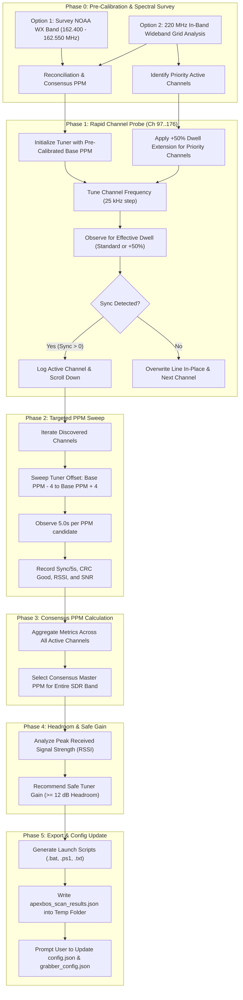

# ApexBOSScanner: ITC 220 MHz Channel Scanner & PPM Calibrator

> [!IMPORTANT]
> **Disclaimer & Intended Use**: **ApexBOS is NOT a real Positive Train Control (PTC) system and is not affiliated with any railroad or government agency.** ApexBOS is an experimental reference tool designed for amateur train enthusiasts and radio telemetry hobbyists. It attempts to decode 220 MHz digital telemetry packets to facilitate hobbyist research and visualize the status of elements defined on a layout. It must never be used for train movement control, safety-critical railway operations, or commercial dispatching.

**ApexBOSScanner** is an automated channel hunting and hardware calibration utility built for the ApexBOS 220 MHz telemetry ecosystem. It rapidly surveys the 220 MHz VHF frequency band, detects active railway telemetry channels transmitting 64-bit $\pi/4$-DQPSK unique word sync signatures, optimizes Software-Defined Radio (SDR) master oscillator Parts-Per-Million (PPM) frequency corrections, and automatically generates production-ready startup configurations for [ApexBOSGrabber](GRABBER_README.md).

---

## Table of Contents

1. [Key Features & Capabilities](#key-features--capabilities)
2. [Multi-Phase Scanning & Optimization Workflow](#multi-phase-scanning--optimization-workflow)
3. [Interactive ANSI Terminal UI & Hotkeys](#interactive-ansi-terminal-ui--hotkeys)
4. [Control Center (Launcher) Integration](#control-center-launcher-integration)
5. [Grabber & Direct CLI Integration](#grabber--direct-cli-integration)
6. [Command-Line Reference](#command-line-reference)
7. [Hardware Considerations & Operational Tips](#hardware-considerations--operational-tips)

---

## Key Features & Capabilities

- **Phase 0 Pre-Calibration & Spectral Survey**: Automatically determines an initial tuner PPM estimate prior to channel probing by combining **Option 1 (NOAA Weather Radio 162.400–162.550 MHz broadcast carriers)** and **Option 2 (220 MHz in-band wideband spectral grid analysis)**.
- **Priority Channel Dwell Extension (+50%)**: Candidate channels exhibiting RF spectral energy during Phase 0 wideband analysis automatically receive a +50% dwell extension during Phase 1 (`effective_dwell = probe_duration_sec * 1.5`), ensuring sporadic wayside interface unit (WIU) bursts are reliably captured.
- **Automated ITC Channel Sweep**: Scans Channel 97 to 176 ($220.0125\text{ MHz}$ to $221.9875\text{ MHz}$) using exact $25\text{ kHz}$ channel spacing.
- **Configurable Dwell Time**: User-selectable observation dwell per channel (`-d` / `--dwell`, e.g. 2.0s quick, 3.5s standard, 5.0s deep).
- **Physical-Layer Sync Correlation**: Demodulates $\pi/4$-DQPSK bursts and correlates against the standardized 64-bit PTC unique word preamble without requiring full packet CRC passes to confirm channel presence.
- **Permissive 8-Bit Hamming Error Threshold**: Tolerates up to 8 bit errors in the 64-bit unique word preamble (`-E 8`) to cast the widest net possible, catching distant, degraded, or multipath-impaired wayside transmissions that stricter thresholds would drop.
- **$\pm 4$ PPM Multi-Channel Fine Sweep**: For every discovered channel, evaluates candidate tuner offsets in $1\text{ PPM}$ increments over 5.0-second test windows to maximize sync packet yield and signal-to-noise ratio.
- **Consensus PPM Optimization**: Computes a single optimal master oscillator PPM setting that maximizes packet reception across all active local channels simultaneously.
- **Dynamic Headroom & Safe Gain Recommendation**: Analyzes peak and average RSSI to recommend an RF tuner gain providing at least $12\text{ dB}$ of ADC headroom to prevent clipping.
- **Selective Locked Channels Output (`.` Suffix)**: Channels that ever received a valid CRC during the scan are automatically locked with the `.` suffix in `--chans` output (e.g. `101.`) and saved to `locked_channels`. Channels detected via sync signatures that did not pass CRC are listed normally (e.g. `102`), allowing dynamic runtime retuning while permanently locking verified channels against worker pruning or retuning.
- **Setup Wizard Initial Scan Integration**: Step 5 of the ApexBOS Setup Wizard provides an automated prompt and a one-click GUI button to perform an initial 10-second dwell scan, applying discovered channels (CRC-verified locked), consensus PPM, recommended gain, and ZMQ ports as defaults.
- **Multi-Worker Port & Process Allocation**: Automatically divides discovered active channels across Grabber worker processes and computes collision-free ZeroMQ ports ($18000 + \text{channel}$).
- **Automated Script & Config Output**: Exports ready-to-run Windows Batch (`.bat`), PowerShell (`.ps1`), plain command line (`.txt`), calibration logs (`.txt`), and structured JSON (`apexbos_scan_results.json`) with absolute file paths.
- **In-Place Selective Scrolling**: Clean ANSI display that overwrites silent channels in place and only scrolls down when active channels with sync signatures are discovered.
- **Interactive Keyboard Controls**: Non-blocking keyboard hotkeys allowing the user to skip to the next channel (`n`), safely abort Phase 1 and proceed to Phase 2 (`s`), or stop Phase 2 and generate final startup scripts (`q`).

---

## Multi-Phase Scanning & Optimization Workflow

ApexBOSScanner operates in six sequential phases:



### Phase 0: Pre-Calibration & Spectral Survey
Before beginning the channel-by-channel probe, ApexBOSScanner conducts a rapid dual-mode spectral survey to solve the "chicken-and-egg" tuner PPM problem:
1. **Option 1: NOAA Weather Radio Sweep (162.400–162.550 MHz)**: Tunes the receiver to $162.4625\text{ MHz}$ (placing the RTL-SDR LO DC spike safely $12.5\text{ kHz}$ away from any broadcast carrier). Computes an averaged Welch PSD, searches the 7 nationwide continuous weather transmitters, and interpolates carrier offsets with 3-point parabolic interpolation ($< 0.01\text{ PPM}$ accuracy).
2. **Option 2: 220 MHz In-Band Wideband Spectral Grid Analysis**: Streams baseband data across half-channel LO centers ($220.350, 221.000, 221.650\text{ MHz}$) covering the requested channel range. Dwells for **10.0 seconds by default** (`--inband-duration 10.0`), accumulating a real-time max-hold Welch PSD to reliably detect sporadic wayside interface unit (WIU) bursts. Detects prominent spectral peaks ($\ge 8\text{ dB}$ SNR), maps them against the $25.0\text{ kHz}$ ITC channel raster, and calculates candidate active channels and per-carrier PPM offsets.
3. **Reconciliation & Best Guess Logic**:
   - If both NOAA and In-Band carriers are detected and agree within $\pm 5\text{ PPM}$, mutual agreement confirms tuner calibration.
   - If NOAA has high SNR ($\ge 15\text{ dB}$), the atomic broadcast standard takes precedence.
   - If multiple in-band carriers agree across the 220 MHz grid, in-band consensus sets initial PPM.
   - Discovered candidate in-band channels are stored as **Priority Channels**.
4. **Phase 0 Bypass**: Can be bypassed via `--skip-phase0` or `ApexBOSChannelScanner(skip_phase0=True)`.

### Phase 1: Rapid Channel Probe (with +50% Priority Dwell)
Loops through channels 97 through 176. For each channel:
- Tunes the SDR to the exact ITC frequency: $f = 217.5875\text{ MHz} + (\text{channel} \times 25\text{ kHz})$ using the pre-calibrated PPM from Phase 0.
- **Priority Dwell Extension**: If the channel was flagged as having RF energy in Phase 0, observation dwell is automatically extended by +50% (`effective_dwell = probe_duration_sec * 1.5`, e.g. 3.0s instead of 2.0s) to maximize chances of catching intermittent WIU transmissions.
- Demodulates differentially encoded symbols and correlates against the 64-bit unique word sync signature.
- If sync signatures are detected, the channel is flagged as active, its progress line is permanently committed to the terminal with a `[PRIORITY]` badge, and scanning advances to the next channel.

### Phase 2: Targeted PPM Calibration Sweep
For each channel identified in Phase 1:
- Evaluates 9 candidate tuner corrections ($\text{Base PPM} - 4$ through $\text{Base PPM} + 4$).
- Dwells on each candidate for 5.0 seconds (`--opt-dwell`).
- Records the total sync signatures detected, valid CRC-16 packets, average RSSI (dBFS), and SNR (dB).
- Identifies the local optimal PPM for each channel.

### Phase 3: Consensus PPM Resolution
Because a single physical SDR tuner must cover all monitored channels simultaneously, ApexBOSScanner computes the global consensus PPM that maximizes total sync and CRC throughput across all channels, weighting channels with higher burst activity.

### Phase 4: Safe Gain & Headroom Recommendation
PTC telemetry transmitters produce short, high-power bursts. Excessive RF gain causes front-end ADC clipping, distorting $\pi/4$-DQPSK phase trajectories and causing Viterbi or Reed-Solomon decoding failures. ApexBOSScanner evaluates the peak RSSI observed during the sweep and recommends an optimal tuner gain providing $\ge 12\text{ dB}$ of headroom:
- Peak RSSI $> -6.0\text{ dBFS} \rightarrow \text{Gain: } 16.6\text{ dB}$
- Peak RSSI between $-12.0$ and $-6.0\text{ dBFS} \rightarrow \text{Gain: } 20.7\text{ dB}$
- Peak RSSI $< -12.0\text{ dBFS} \rightarrow \text{Gain: } 22.9\text{ dB}$

### Phase 5: Script Generation & Configuration Update
Writes startup scripts using absolute paths to the system temporary directory:
- `start_apexbos_grabber.bat`: Windows Command Prompt launcher.
- `start_apexbos_grabber.ps1`: Windows PowerShell launcher.
- `start_apexbos_grabber_cmd.txt`: Raw CLI invocation command.
- `apexbos_channel_scan_report.txt`: Full calibration summary table.
- `apexbos_scan_results.json`: Machine-readable results consumed by `ApexBOSLauncher.py`.

---

## Interactive ANSI Terminal UI & Hotkeys

While running, ApexBOSScanner displays a dynamic status line that updates in real time with countdown timer and signal statistics:

```text
[*] [1/80] Ch 101 (220.1125 MHz) | [T-2.1s] Sync: 14  CRC: 12  RSSI: -12.4 dBFS  SNR: 32.8 dB  ...
```

### In-Place Selective Scrolling
- Channels with zero activity update on the same line using carriage returns (`\r`), keeping your terminal clean and uncluttered.
- As soon as a channel produces a sync signature, a newline (`\n`) is printed, permanently preserving that channel's discovery on the screen.

### Non-Blocking Hotkeys
ApexBOSScanner monitors keyboard input asynchronously during scans without interrupting I/Q sample ingestion:

| Key | Action | Description |
| :---: | :--- | :--- |
| **`n`** | **Next Channel** | Immediately terminates the dwell on the current channel and advances to the next channel in sequence. |
| **`s`** | **Stop Phase 1** | Safely aborts the broad Phase 1 scan early and proceeds immediately to Phase 2 with whatever active channels have been discovered so far. |
| **`q`** | **Stop Phase 2 & Quit** | Safely halts Phase 2 calibration early and immediately computes consensus PPM, generating final reports and startup scripts. |

---

## Control Center (Launcher) Integration

ApexBOSScanner is fully integrated into the Pygame-native [ApexBOSLauncher](README.md):

```
       +-----------------------------------------------------------+
       |   ApexBOS Control Center - 220 MHz Telemetry Launcher     |
       +-----------------------------------------------------------+
       |  Managed Subsystems:                                      |
       |  (o) ApexBOSGrabber SDR #0 (2 procs)   [START] [SCAN] [CMD]|
       |  (o) ApexBOSFlux Relay                 [START]        [CMD]|
       |                                                           |
       |  Utilities & Settings:                                    |
       |  [ Scan 220 MHz Channels ]  [ ApexBOSSpy ]  [ PackFIG ]   |
       +-----------------------------------------------------------+
```

### 1. Starting the Scanner from the Launcher
Clicking **[Scan 220 MHz Channels]** (or **[SCAN]** on the Grabber row) automatically:
- Reads the active `gain`, `bias_tee`, and `ppm` directly from your Grabber configuration in `config.json`.
- Displays an interactive dwell prompt dialog allowing you to adjust observation duration:
  - Quick Presets: `[ 2.0s Quick ]`, `[ 3.5s Default ]`, `[ 5.0s Deep ]`.
  - Editable text field to type custom values.
- Launches `ApexBOSScanner.py` in its own native terminal window with the inherited hardware parameters.

### 2. Automatic Post-Scan Configuration Update
When the scan concludes, `ApexBOSLauncher` detects the new `apexbos_scan_results.json` file and presents an in-dashboard completion modal:

```
+-------------------------------------------------------------------+
|                     Channel Scan Complete!                        |
+-------------------------------------------------------------------+
|  Active Channels (3):      [101, 102, 114]                        |
|  Consensus Tuner PPM:      +6 PPM                                 |
|  Recommended RF Gain:      20.7 dB (Headroom >= 12 dB)            |
|  Calculated Workers:       2 processes (ZMQ Ports: 18101,18102)   |
|                                                                   |
|  Update Grabber configuration (--chans & --procs) in config.json? |
|                                                                   |
|            [ UPDATE GRABBER CONFIG ]      [ Dismiss ]             |
+-------------------------------------------------------------------+
```

Clicking **[UPDATE GRABBER CONFIG]** will automatically:
1. Update `grabber.channels` to the discovered active channels.
2. Update `grabber.chans` comma-separated argument string with locked dot suffix (e.g. `"101., 102., 114."`) and `grabber.locked_channels` list.
3. Update `grabber.ppm` and `grabber.frequency_correction` to the consensus PPM.
4. Recalculate worker processes (`grabber.process_count`) and collision-free ZeroMQ ports (`grabber.ports` and `grabber.procs`).
5. Update `flux.sources` to match the new worker ports.
6. Write changes to unified `config.json` and synchronize legacy `grabber_config.json`.

---

## Setup Wizard Initial Scan Integration

During initial setup via `python setup_wizard.py` (or `python setup_wizard.py --cli`), Step 5 offers an optional automated 220 MHz channel scan:
- **10-Second Observation Dwell**: Performs Phase 0 pre-calibration and surveys channels with `--dwell 10.0` to detect active PTC signals reliably.
- **Default Configuration Pre-Population**: Upon completion, the wizard offers the discovered locked channels (`101., 102.`), optimal master PPM, headroom tuner gain, and corresponding worker processes and ZMQ ports as defaults for the rest of setup.
- **GUI & CLI Support**: Accessible via the `[ 🔍 Initial Scan (10s Dwell) ]` button in the Pygame wizard or the interactive prompt in the CLI wizard. Non-interactive automated setups can trigger it with `python setup_wizard.py --cli --scan`.

---

## Grabber & Direct CLI Integration

You can launch the scanner directly from the command line using either `ApexBOSScanner.py` or the `ApexBOSGrabber.py` convenience flag:

### Option A: Direct Scanner Invocation
```bash
python ApexBOSScanner.py --dwell 3.5 --ppm 6 --gain 20.7 --bias-tee
```

To update `config.json` automatically at conclusion without interactive prompts:
```bash
python ApexBOSScanner.py --dwell 3.5 --ppm 6 --update-config
```

### Option B: From ApexBOSGrabber
```bash
python ApexBOSGrabber.py --scan -d 3.5
```

### Option C: From ApexBOSLauncher CLI
```bash
python ApexBOSLauncher.py --scan 3.5
```

---

## Command-Line Reference

| Argument | Type | Default | Description |
| :--- | :---: | :---: | :--- |
| `--start-ch` | `int` | `97` | Starting ITC channel number ($220.0125\text{ MHz}$). |
| `--end-ch` | `int` | `176` | Ending ITC channel number ($221.9875\text{ MHz}$). |
| `-d`, `--dwell`, `--dwell-time` | `float` | `2.0` | Observation dwell duration per channel in seconds during Phase 1 probe. |
| `--opt-dwell`, `--ppm-dwell` | `float` | `5.0` | Observation dwell duration per candidate PPM in seconds during Phase 2 sweep. |
| `--inband-duration`, `--survey-duration` | `float` | `10.0` | Observation sampling dwell per center in seconds for Phase 0 Option 2 in-band spectral survey. |
| `--ppm` | `int` | `0` | Base master tuner PPM offset (inherited from Grabber config). |
| `--gain` | `float` | `20.7` | SDR tuner gain in dB (`0` or `auto` for hardware AGC). |
| `--rate` | `int` | `960000` | SDR baseband sample rate in samples per second. |
| `--device` | `int` | `0` | RTL-SDR USB device index. |
| `-E`, `--max-errors` | `int` | `8` | Maximum allowable Hamming bit errors in the 64-bit unique word sync signature. |
| `--bias-tee` | flag | `False` | Enables 4.5V DC phantom power for external active LNAs or antennas. |
| `--skip-phase0` | flag | `False` | Bypasses Phase 0 NOAA and in-band spectral pre-calibration. |
| `--mock` | flag | `False` | Executes an offline synthetic sweep for testing without physical SDR hardware. |
| `--output-dir` | `str` | `%TEMP%` | Directory to save generated start scripts and report files. |
| `--update-config` | flag | `False` | Automatically writes discovered channels, ports, and PPM to `config.json`. |
| `--config` | `str` | `config.json` | Path to unified configuration file to update. |
| `--quiet` | flag | `False` | Suppresses detailed per-channel log output. |

---

## Hardware Considerations & Operational Tips

### 1. DVB-T Dongles vs RTL-SDR Blog V4
- **Generic DVB-T Sticks**: Standard blue or black DVB-T RTL2832U dongles typically use ordinary uncompensated crystals that drift substantially as the dongle warms up (often shifting by $30$ to $70\text{ PPM}$, or $6$ to $15\text{ kHz}$ at $220\text{ MHz}$). Always let generic dongles warm up for 5 to 10 minutes before running ApexBOSScanner to obtain stable PPM measurements.
- **RTL-SDR Blog V4**: Equipped with a 1 PPM Temperature-Compensated Crystal Oscillator (TCXO) and built-in notch filtering. Drift is negligible ($< 1\text{ PPM}$), and scanner calibration typically confirms a stable offset between $0$ and $+1\text{ PPM}$.

### 2. Dwell Time Selection
- **2.0 seconds (`-d 2.0`)**: Quick scan. Recommended when railroad traffic is dense and wayside units transmit frequently.
- **3.5 seconds (`-d 3.5`)**: Standard scan. Recommended for general monitoring across most territories.
- **5.0 seconds (`-d 5.0`)**: Deep scan. Recommended in rural territories or on lightly traveled branch lines where wayside units report less frequently.

### 3. Preventing Receiver Overload
PTC ground base stations and trackside wayside interface units (WIUs) transmit with substantial effective radiated power. If your antenna is close to active tracks, high gain settings can saturate the RTL-SDR 8-bit ADC, destroying the $\pi/4$-DQPSK constellation.
- Always check the **Recommended RF Gain** reported at the conclusion of the scan.
- Ensure your peak RSSI stays below $-6.0\text{ dBFS}$ to maintain at least $12\text{ dB}$ of dynamic headroom for incoming bursts.

---

## License & Credits

ApexBOSScanner is part of the **ApexBOS.220** project.
Copyright (c) 2026 AB. Licensed under the MIT License.
Contains physical-layer demodulation and forward error correction algorithms developed for amateur radio telemetry research.
