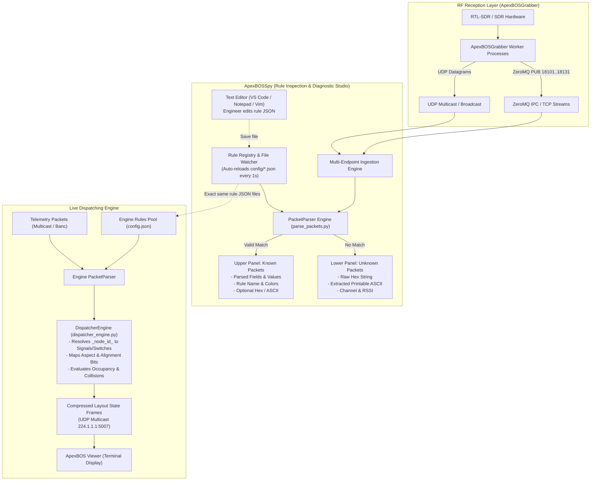
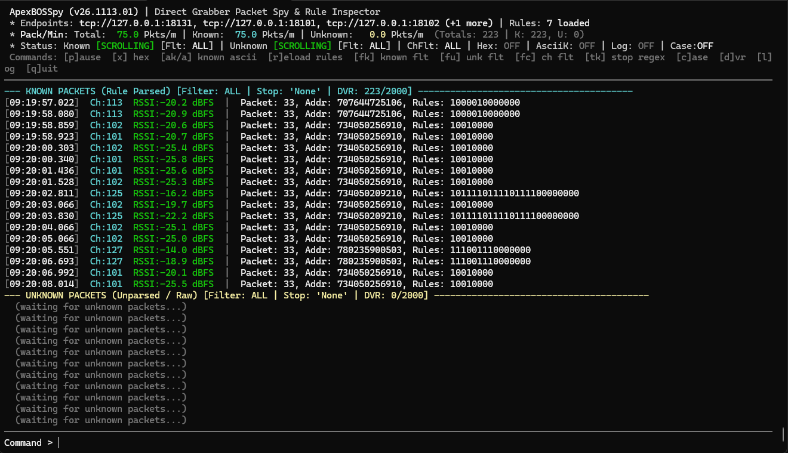
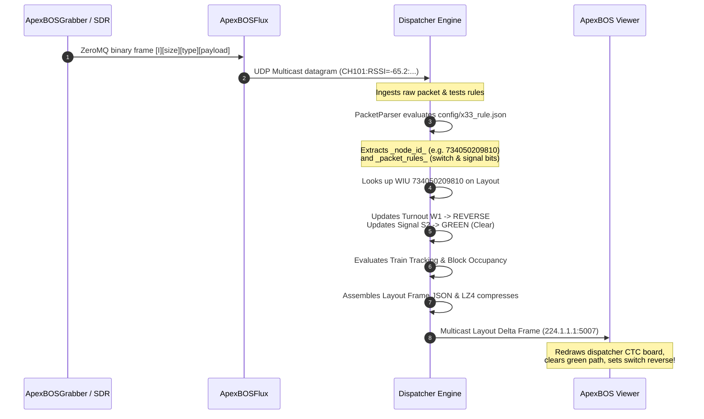

# ApexBOSSpy: Real-Time Packet Spy, Protocol Analyzer & Rule Inspector

> [!IMPORTANT]
> **Disclaimer & Intended Use**: **ApexBOS is NOT a real Positive Train Control (PTC) system and is not affiliated with any railroad or government agency.** ApexBOS is an experimental reference tool designed for amateur train enthusiasts and radio telemetry hobbyists. It attempts to decode 220 MHz digital telemetry packets to facilitate hobbyist research and visualize the status of elements defined on a layout. It must never be used for train movement control, safety-critical railway operations, or commercial dispatching.

**ApexBOSSpy** is an interactive, dual-panel ANSI terminal protocol analyzer, real-time packet spy, and modular rule inspector designed for the **ApexBOS** Railroad Dispatcher & Trackside Simulation ecosystem.

Connecting directly to the ZeroMQ `PUB` and UDP broadcast streams of **ApexBOSGrabber** (220 MHz PTC), **ApexBOSLatch** (900 MHz ATCS, port `18201`), and **ApexBOSFred** (450 MHz EOT/HOT/DPU/RLC, port `18301`), ApexBOSSpy automatically detects running receivers and decodes multi-band railway telemetry messages on the fly. It splits incoming traffic into a high-visibility, dual-panel display: **Known Packets** (validated by modular rule parsers including `ctc_rules.json`, `x33_rule.json`, `dpu_rules.json`, `atcs_rules.json`, and `rlc_rules.json`) and **Unknown Packets** (unparsed raw frames). On terminals without ANSI/VT100 support (Legacy Windows Console, `TERM=dumb`, or redirected pipes), ApexBOSSpy automatically switches to clean plain-text streaming mode.

> [!NOTE]
> **Grabber Control-Packet Filter**: By default, `ApexBOSGrabber` withholds `QSTAT/ACK` (`0x01`), `ACQ` (`0x04`), and `CNTL` (`0x05`) from its outbound ZeroMQ/UDP feeds (`--filter-ctrl`). If you want to inspect those control packets in ApexBOSSpy, start Grabber with `--no-filter-ctrl` (or type `filter off` in Grabber's console).

ApexBOSSpy functions as both an observational diagnostic terminal and an **interactive rule development laboratory**—allowing enthusiasts and researchers to author or modify packet parsing rules in any text editor, hot-reload them on the fly without restarting, and immediately deploy those exact same rules to the **ApexBOS Dispatcher Engine** for live layout frame rendering.

---

## Table of Contents

1. [Architectural Overview & Integration](#architectural-overview--integration)
2. [Dashboard Overview & Screenshot](#dashboard-overview--screenshot)
3. [How Packet Rules Work (The Declarative Rule Engine)](#how-packet-rules-work-the-declarative-rule-engine)
   - [Sequential Bit-Level Scanning](#sequential-bit-level-scanning)
   - [Supported Data Types & Modifiers](#supported-data-types--modifiers)
   - [Validation Constraints & Failure Fallthrough](#validation-constraints--failure-fallthrough)
   - [Standard Telemetry Semantic Attributes](#standard-telemetry-semantic-attributes)
4. [Interactive Rule Authoring & Hot-Reload Workflow](#interactive-rule-authoring--hot-reload-workflow)
   - [Live Engineering Feedback Loop](#live-engineering-feedback-loop)
   - [Step-by-Step Tutorial: Authoring a New Rule](#step-by-step-tutorial-authoring-a-new-rule)
5. [How the Dispatcher Engine Uses Rules to Generate Layout Frames](#how-the-dispatcher-engine-uses-rules-to-generate-layout-frames)
   - [From Wire Bits to Visual Layout States](#from-wire-bits-to-visual-layout-states)
   - [Delta Frame Broadcast to Viewers](#delta-frame-broadcast-to-viewers)
6. [Interactive Console Commands & Keybindings](#interactive-console-commands--keybindings)
7. [Operating Modes & Connectivity Options](#operating-modes--connectivity-options)
   - [Local & Remote Multi-Worker ZeroMQ Ingestion](#local--remote-multi-worker-zeromq-ingestion)
   - [UDP Datagram Monitoring](#udp-datagram-monitoring)
   - [Line-by-Line Streaming Mode (`--stream`)](#line-by-line-streaming-mode---stream)
   - [DVR Ring Buffer & Historical Logging](#dvr-ring-buffer--historical-logging)
8. [Annotated Rule Examples](#annotated-rule-examples)
   - [Example 1: Wayside Interface Unit (WIU) Status (`x33_rule.json`)](#example-1-wayside-interface-unit-wiu-status-x33_rulejson)
   - [Example 2: Synchronized UTC Time Broadcast (`x06_rules.json`)](#example-2-synchronized-utc-time-broadcast-x06_rulesjson)

---

## Architectural Overview & Integration

ApexBOSSpy bridges the gap between raw RF demodulation and dispatcher visualization:



---

## Dashboard Overview & Screenshot

ApexBOSSpy features a pinned-header, dual-panel scrolling ANSI terminal interface:



### The Six Functional Dashboard Zones:

1. **Pinned Header & System Metrics (Rows 1–3)**:
   - **Version & Title**: Current release identifier and operating mode.
   - **Connected Endpoints**: Real-time summary of monitored ZeroMQ/UDP sockets (e.g. `tcp://127.0.0.1:18101, tcp://127.0.0.1:18102...`).
   - **Active Rules**: Total count of modular JSON rule parsers currently compiled into memory.
   - **Pack/Min Rates**: Rolling 60-second throughput statistics:
     - **Total**: Aggregated packet rate across all channels.
     - **Known**: Rate of packets successfully matched and decoded by rules.
     - **Unknown**: Rate of unparsed packets falling through to the lower panel.
     - **Cumulative Totals**: Lifetime packet counter totals ($T$, $K$, $U$).

2. **Status & Filter Indicator Bar (Row 4)**:
   - **Known / Unknown Scroll State**: `[SCROLLING]` (green) or `[PAUSED]` (red).
   - **Active Filters**: Current RegEx filters applied to Known (`Flt`), Unknown, or RF Channels (`ChFlt`).
   - **Hex & ASCII Indicators**: Live toggles showing whether raw hex (`Hex: ON`) or printable ASCII (`AsciiK: ON`) are enabled.
   - **Logging & Case Sensitivity**: `Log: ON/OFF` and `Case: ON/OFF`.

3. **Quick Commands Reference Bar (Row 5)**:
   - Contextual reference of primary hotkeys (`[p]ause`, `[x] hex`, `[r]eload`, `[fk] known flt`, `[tk] stop regex`, etc.).

4. **Upper Panel: Known Packets (Rule Parsed)**:
   - Occupies the upper, primary viewing area.
   - Displays packets that matched at least one active rule.
   - Each row color-codes:
     - Microsecond-accurate timestamp (`HH:MM:SS.mmm`).
     - RF Channel number (e.g. `CH101`).
     - Signal strength (`RSSI: -68.4 dBm`).
     - Matching rule name (e.g. `[x33_rule.json]`, `[x06_rules.json]`).
     - Extracted payload fields or formatted summary text (`_scroll_ptc_`).
     - Optional offset raw hex line and printable ASCII translation line.

5. **Lower Panel: Unknown Packets (Unparsed / Raw)**:
   - Occupies the lower section of the screen.
   - Displays packets that failed validation across all active rules.
   - Displays timestamp, channel number, RSSI, raw hexadecimal byte string, and extracted printable ASCII characters (with non-printables rendered as dots `.`).
   - Serves as the primary discovery canvas for new or proprietary packet formats.

6. **Interactive Command Prompt (Footer)**:
   - Always-accessible input line allowing users to type single-character hotkeys or parameterized commands (e.g. `fk 18433`, `tk ACQ`, `r`, `x`).

---

## How Packet Rules Work (The Declarative Rule Engine)

Packet rules in ApexBOS are written in pure, human-readable JSON files located in the `config/` directory. Rather than requiring compiled C code or Python logic, rules are **declarative bitstream specifications** interpreted by `PacketParser` (`parse_packets.py`).

### Sequential Bit-Level Scanning

When a binary packet arrives, `PacketParser` sets an internal pointer (`bit_pos = 0`) and iterates sequentially through the rule's array of field definitions. Each field reads a designated number of bits or bytes, converts them to their specified type, and advances `bit_pos`.

### Supported Data Types & Modifiers

The rule engine supports both standard types and shorthand aliases:

| Long Form | Shorthand | Description |
| :--- | :---: | :--- |
| `uint8`, `uint16`, `uint32`, `uint64` | `u8`, `u16`, `u32`, `u64` | Unsigned big-endian integers (8, 16, 32, or 64 bits). |
| `int8`, `int16`, `int32`, `int64` | `i8`, `i16`, `i32`, `i64` | Signed two's-complement integers. |
| `int_bits` | `ib` | Arbitrary bit-length integer (e.g. `"length": 40` for 5-byte WIU addresses, or `"length": "end"` to read all remaining bits). |
| `bit`, `bool` | `b1`, `bl` | Single bit flag (returns `0` or `1`, or boolean `true`/`false`). |
| `float16`, `float32`, `float64` | `f16`, `f32`, `f64` | IEEE floating-point numbers. |
| `string`, `string_0` | `s`, `s0` | Fixed-length ASCII string, or null-terminated ASCII string. |
| `skip` | `k` | Advances `bit_pos` by $N$ bits without recording a field. |
| `bcd` | `d` | Binary-Coded Decimal decoding. |
| `calc` | `cl` | Evaluates arithmetic or bitwise expressions without consuming bits (e.g. bit deltas, address copies). |
| `branch` | `b` | Conditional block: evaluates nested sub-rules only if a condition on previously extracted fields evaluates to true. |
| `printf` | `prf` | Formats extracted variables into a composite string using `{field_name}` interpolation. |

### Validation Constraints & Failure Fallthrough

A rule is only considered a **valid match** if every constraint defined in the rule passes:

- **Exact Match (`expected` / `e`)**:
  ```json
  { "type": "u8", "name": "Prefix", "expected": 73 }
  ```
  *(73 is ASCII `'I'`. If the first byte is not 73, the rule immediately fails).*
- **Set Membership (`expected_in` / `ei`)**:
  ```json
  { "type": "u8", "name": "Type", "expected_in": [51, 52] }
  ```
  *(Matches if Type byte is either 0x33 or 0x34; otherwise fails).*

If any field fails an `expected` constraint, or if the packet contains fewer bits than the rule requires, `PacketParser` raises `PacketValidationError`. ApexBOSSpy immediately catches the error, discards partial extractions, and advances to test the next rule in the registry. If all rules fail, the packet is routed to the **Unknown Packets** panel.

### Standard Telemetry Semantic Attributes

Certain field names carry standardized meaning recognized by both ApexBOSSpy and the Dispatcher Engine:

- `_node_id_`: Unique 40-bit or 24-bit physical address of the Wayside Interface Unit (WIU) or Base Station.
- `_type_`: Categorical label displayed in user interfaces (e.g. `"WIU Status"`, `"Date/Time:"`, `"CTRL Pkt"`).
- `_packet_rules_`: Raw aspect and switch alignment bitmask evaluated against signal rules.
- `_scroll_ptc_`: Complete formatted string rendered directly into the Dispatcher and Viewer scrollers.
- `_sequence_`: Packet transmission sequence counter used for hardware deduplication and packet loss tracking.

---

## Interactive Rule Authoring & Hot-Reload Workflow

### Live Engineering Feedback Loop

One of ApexBOSSpy's most powerful capabilities is its **instant live reloading engine**. You do not need to restart ApexBOSSpy, recompile code, or reconnect to SDR hardware when authoring or debugging rules.

ApexBOSSpy runs a dedicated background file-watcher that computes cryptographic SHA-256 hashes and modification timestamps across all files in `config/` every second. The moment you save changes in your text editor:
1. ApexBOSSpy detects the modified file.
2. Compiles the updated JSON rule into memory.
3. Displays a prominent blue status banner: `[RULES] Auto-reloaded N rule parser(s) at HH:MM:SS`.
4. The very next packet matching your new rule instantly switches from the lower **Unknown** panel to the upper **Known** panel!

---

### Step-by-Step Tutorial: Authoring a New Rule

Suppose you observe unfamiliar packets appearing in the Unknown panel on Channel 101:
```text
[14:22:01.104] [CH101] [RSSI: -65.2 dBm] UNKNOWN HEX: 49000C06000048011A0B090E1E2D
    ASCII: I.......H.......-
```

#### Step 1: Analyze the Raw Hex
- Byte 0: `0x49` (ASCII `'I'` = 73, standard MosFET framing header).
- Bytes 1–2: `0x000C` (Length = 12 bytes).
- Byte 3: `0x06` (Message Type = 6).
- Byte 4: `0x00` (Flags = 0).
- Bytes 5–7: `0x004801` (Node ID = 18433).
- Bytes 8–13: `0x1A 0x0B 0x09 0x0E 0x1E 0x2D` (Decimal: 26, 11, 09, 14, 30, 45 $\rightarrow$ Date: 2026-11-09 14:30:45 UTC).

#### Step 2: Create the Rule File in an Editor
Open your editor (VS Code, Notepad, etc.) and create `config/x06_my_time_rule.json`:

```json
[
    { "type": "u8", "name": "Prefix", "expected": 73 },
    { "type": "u16", "name": "PacketSize" },
    { "type": "u8", "name": "Type", "expected": 6 },
    { "type": "u8", "name": "Flags" },
    { "type": "int_bits", "name": "_node_id_", "length": 24, "format": "i" },
    { "type": "u8", "name": "year" },
    { "type": "u8", "name": "month" },
    { "type": "u8", "name": "day" },
    { "type": "u8", "name": "hour" },
    { "type": "u8", "name": "minute" },
    { "type": "u8", "name": "second" },
    {
        "type": "printf",
        "name": "_scroll_ptc_",
        "format": "UTC Time Broadcast: 20{year:02d}-{month:02d}-{day:02d} {hour:02d}:{minute:02d}:{second:02d} from Node {_node_id_}"
    }
]
```

#### Step 3: Save and Verify in Spy
1. Save `config/x06_my_time_rule.json`.
2. Within 1 second, ApexBOSSpy's header updates: `Rules: 13 loaded`.
3. The next Type 6 packet immediately appears in the **Known Packets** panel:
   ```text
   [14:22:02.105] [CH101] [RSSI: -65.2 dBm] [x06_my_time_rule.json]
       UTC Time Broadcast: 2026-11-09 14:30:45 from Node 18433
   ```
4. Set a stop breakpoint to freeze the screen on the next arrival:
   ```text
   Command > tk 18433
   ```
   When the packet arrives, scrolling automatically halts, allowing full inspection.

---

## How the Dispatcher Engine Uses Rules to Generate Layout Frames

The exact same JSON rule files authored and verified in ApexBOSSpy are loaded directly by the **ApexBOS Dispatcher Engine** (`dispatcher_engine.py`).

### From Wire Bits to Visual Layout States



### The Ingestion Pipeline in `dispatcher_engine.py`:

1. **Parser Initialization (`reload_parsers`)**:
   During startup or when triggered via the dispatcher menu, the Engine scans `config/` (or paths listed in `config.json` under `engine.parsers`) and compiles an identical array of `PacketParser` instances.
2. **Ingesting Packets (`ingest_raw_packet`)**:
   When a packet arrives from UDP Multicast or Banc Cloud:
   ```python
   for parser in self.parsers:
       res = parser.parse(packet_bytes)
       if res["is_valid"]:
           # Match found!
           parsed_data = res["data"]
           node_id = parsed_data.get("_node_id_")
           ...
   ```
3. **Topological Element State Mapping**:
   The Engine iterates through layout elements associated with `_node_id_`:
   - **Turnouts (`Turnout`)**: Reads `cmd_bit_offset` from `_packet_rules_` to determine physical switch points (Normal vs Reverse).
   - **Signals (`Signal`)**: Reads `sig_bit_offset` to decode signal lamp aspects against regional aspect definition tables (`signals_default.json` or `signals_NNN.json`).
   - **Track Segments (`TrackSegment`)**: Reads `occ_bit_offset` to detect hardware block occupancy.
4. **Layout Frame Synthesis & Viewer Broadcast**:
   The Engine compiles the updated physical states, active green routes, inferred train markers, and collision warnings into a full layout frame dictionary. It then compresses the state delta using LZ4 and broadcasts it over UDP Multicast (`224.1.1.1:5007` by default).
   
Every connected **ApexBOS Viewer** receives this delta and immediately repaints its dispatching board!

---

## Interactive Console Commands & Keybindings

Commands can be entered directly into the footer command prompt. Single-key shortcuts execute immediately; parameterized commands are submitted by pressing `Enter`:

| Command / Hotkey | Full Syntax | Description |
| :---: | :--- | :--- |
| `p` | `p` or `pause` | Toggle scrolling pause/resume across **BOTH** panels simultaneously. |
| `pk` | `pk` or `pause-known` | Pause/resume scrolling for the **Known Packets** panel only. |
| `pu` | `pu` or `pause-unknown` | Pause/resume scrolling for the **Unknown Packets** panel only. |
| `x` | `x` or `hex` | Toggle displaying the raw hexadecimal string on an offset line. |
| `ak` | `ak` or `ascii-known` | Toggle displaying extracted printable ASCII text under known packets. |
| `au` | `au` or `ascii-unknown`| Toggle displaying extracted printable ASCII text under unknown packets. |
| `r` | `r` or `r [path]` | Immediately reload all packet rules from disk. |
| `fk` | `fk <regex>` | Apply RegEx filter to Known packets (e.g. `fk 18433` or `fk UTC`). Leave blank to clear (`fk`). |
| `fu` | `fu <regex>` | Apply RegEx filter to Unknown packets (e.g. `fu 49000C`). Leave blank to clear (`fu`). |
| `fc` | `fc <regex>` | Apply shared RF Channel filter across **BOTH** panels (e.g. `fc ^10[12]$`). Leave blank to clear. |
| `f` | `f <regex>` | Apply a shared text RegEx filter across **BOTH** panels. |
| `tk` | `tk <regex>` | Set a **Breakpoint Trigger** for Known packets: automatically pauses scrolling the moment a matching packet arrives! |
| `tu` | `tu <regex>` | Set a Breakpoint Trigger for Unknown packets. |
| `t` | `t <regex>` | Set a Breakpoint Trigger across both panels. |
| `c` | `c` or `case` | Toggle case-sensitive vs case-insensitive matching for all RegEx filters. |
| `d` | `d [file.txt]` | Dump the DVR ring buffers of **BOTH** panels to disk. |
| `dk` | `dk [file.txt]` | Dump the DVR ring buffer of the **Known Packets** panel to disk. |
| `du` | `du [file.txt]` | Dump the DVR ring buffer of the **Unknown Packets** panel to disk. |
| `l` | `l [file.log]` | Toggle continuous disk logging of all incoming filtered traffic. |
| `s` | `s` or `status` | Print full internal diagnostic report to console. |
| `h` | `h` or `help` | Display interactive command reference and hotkey help. |
| `q` | `q` or `quit` | Cleanly shut down sockets, restore terminal state, and exit. |

---

## Operating Modes & Connectivity Options

### Local & Remote Multi-Worker ZeroMQ Ingestion

ApexBOSSpy seamlessly connects to multiple ZeroMQ publisher endpoints from Grabber:

- **Local Multi-Worker Grabber**:
  ```bash
  python ApexBOSSpy.py --connect 18101,18102,18113,18131
  ```
- **Remote Host Grabber Monitoring**:
  Monitor an SDR receiver running on a remote Raspberry Pi, server, or field appliance:
  ```bash
  python ApexBOSSpy.py --host 192.168.1.50 --connect 20101,20102,20113,20131
  ```
- **Full URI Specifications**:
  ```bash
  python ApexBOSSpy.py --connect tcp://10.0.0.5:5555,tcp://10.0.0.6:5555
  ```

### UDP Datagram Monitoring

ApexBOSSpy can listen directly on a UDP socket to monitor multicast or broadcast streams:
```bash
python ApexBOSSpy.py --udp 23003
```

### Line-by-Line Streaming Mode (`--stream`)

When piping packet logs into scripts, grep, or terminal redirectors, use `--stream` to disable the curses-like full-screen TUI and output clean, newline-delimited text records:
```bash
python ApexBOSSpy.py --stream | grep "WIU" > wiu_events.log
```

### DVR Ring Buffer & Historical Logging

ApexBOSSpy maintains an internal in-memory ring buffer (default: 2,000 messages per panel, configurable via `--dvr-size`). Even if packets scroll by too fast to read, you can dump the exact history to disk at any time:
```text
Command > dk captured_wiu_burst.txt
[+] Saved 2,000 Known DVR records to 'captured_wiu_burst.txt'
```

---

## Annotated Rule Examples

### Example 1: Wayside Interface Unit (WIU) Status (`x33_rule.json`)

Used across North American freight railroads for wayside signal and switch telemetry:

```json
[
    { "type": "u8", "name": "Prefix", "expected": 73 },
    { "type": "u16", "name": "PacketSize" },
    { "type": "u8", "name": "Type", "format": "x", "expected_in": [51, 52] },
    { "type": "u8", "name": "Channel" },
    { "type": "int_bits", "name": "_node_id_", "length": 40, "format": "i" },
    { "type": "calc", "name": "_src_id_", "expression": "_node_id_" },
    { "type": "int_bits", "name": "skip", "length": 16, "format": "b" },
    { "type": "u8", "name": "_sequence_" },
    { "type": "calc", "name": "st_ptr_bit", "expression": "__cur_bit__" },
    { "type": "int_bits", "name": "_packet_rules_", "length": "end", "format": "i" },
    { "type": "calc", "name": "en_ptr_bit", "expression": "__cur_bit__" },
    { "type": "calc", "name": "_base_", "expression": "en_ptr_bit - st_ptr_bit" },
    { "type": "calc", "name": "pr", "expression": "_packet_rules_", "format": "b" },
    {
        "type": "printf",
        "name": "_scroll_ptc_",
        "format": "Packet: {Type}, Addr: {_node_id_}, Rules: {pr}"
    }
]
```

### Example 2: Synchronized UTC Time Broadcast (`x06_rules.json`)

Used by base stations to distribute network-wide time synchronization:

```json
[
    { "type": "u8", "name": "Prefix", "expected": 73 },
    { "type": "u16", "name": "PacketSize" },
    { "type": "u8", "name": "Type", "expected": 6 },
    { "type": "u8", "name": "Flags" },
    { "type": "int_bits", "name": "_node_id_", "length": 24, "format": "i" },
    { "type": "u8", "name": "year2", "format": "02d" },
    { "type": "u8", "name": "mon", "format": "02d" },
    { "type": "u8", "name": "day", "format": "02d" },
    { "type": "u8", "name": "hh", "format": "02d" },
    { "type": "u8", "name": "mm", "format": "02d" },
    { "type": "u8", "name": "ss", "format": "02d" },
    {
        "type": "printf",
        "name": "_scroll_ptc_",
        "format": "{hh}:{mm}:{ss} {mon}/{day}/{year2} UTC"
    }
]
```

---

## Operational Verification Checklist

- [x] ZeroMQ publisher ports match running `ApexBOSGrabber` worker processes.
- [x] Both `Known` and `Unknown` panels scroll smoothly with live RF packets.
- [x] Rule files in `config/` reload automatically within 1 second upon saving changes in an editor.
- [x] Extracted `_node_id_` and `_scroll_ptc_` fields match expected wayside hardware.
- [x] Exact same rule files verified in `DispatcherEngine` (`dispatcher_engine.py`) to generate visual layout frames.
- [x] Stop breakpoints (`tk <regex>`) trigger reliably to freeze the display for packet inspection.
