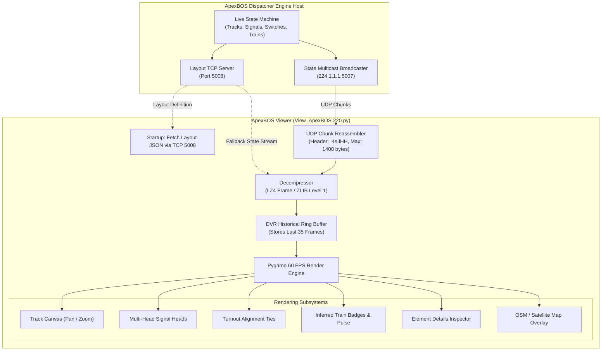
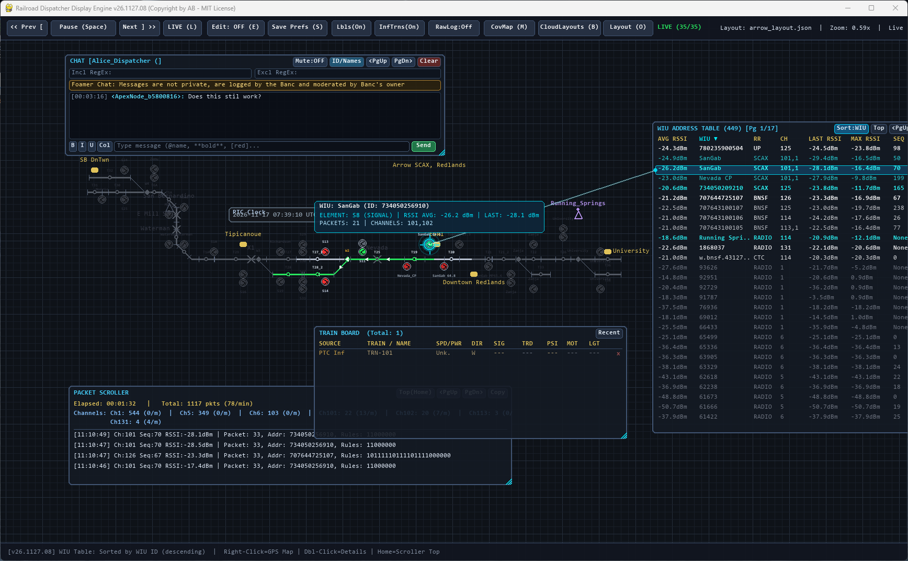
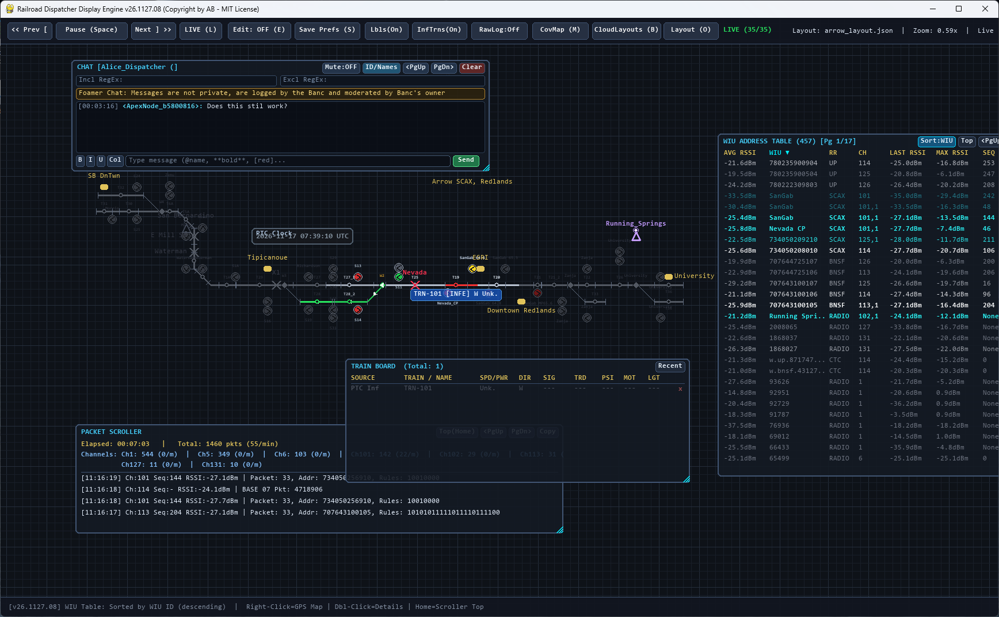
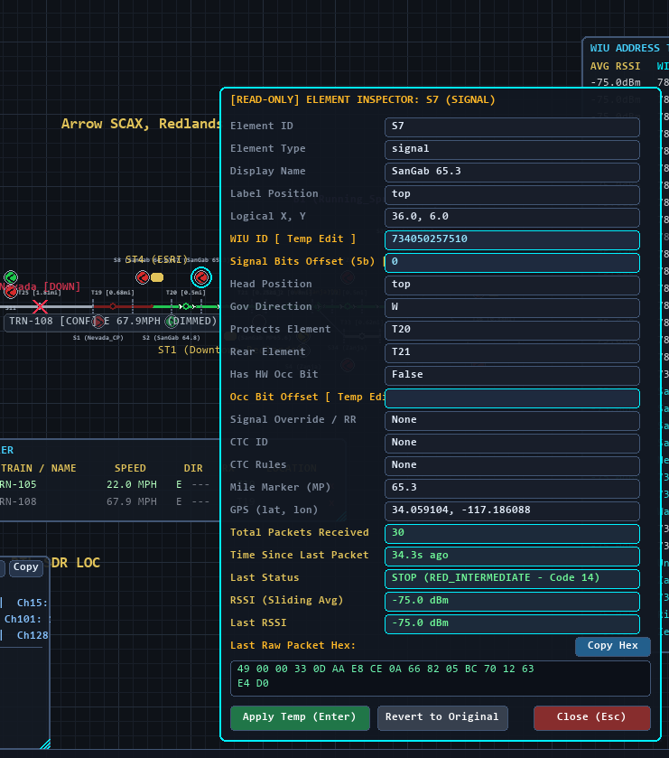
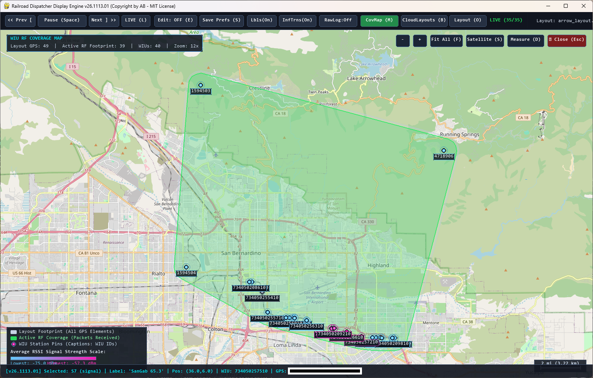
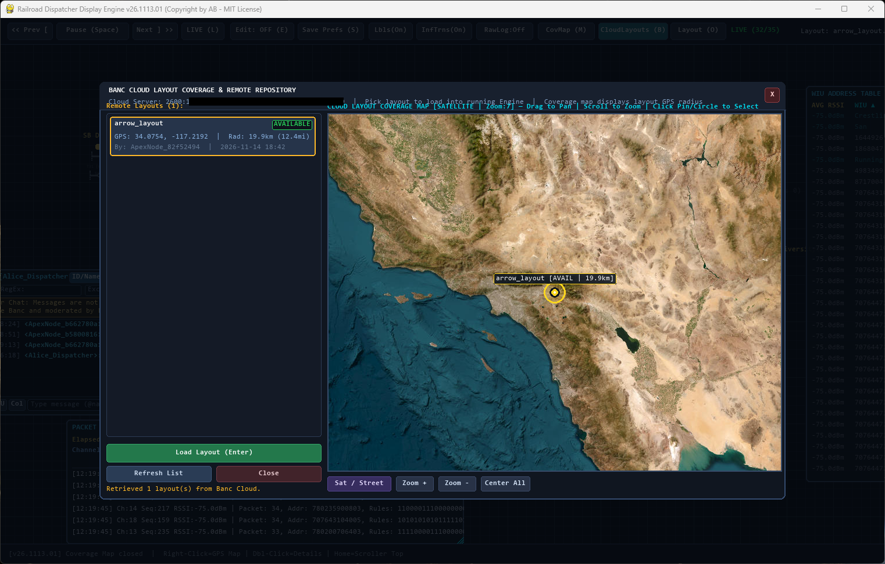
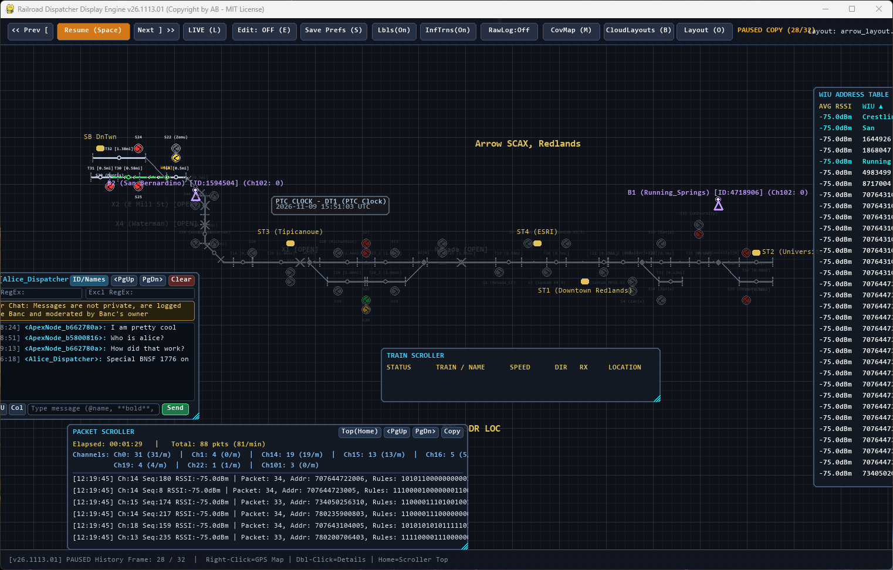

# ApexBOS Viewer: Pygame Dispatcher Display & Real-Time Visualization Terminal

> [!IMPORTANT]
> **Disclaimer & Intended Use**: **ApexBOS is NOT a real Positive Train Control (PTC) system and is not affiliated with any railroad or government agency.** ApexBOS is an experimental reference tool designed for amateur train enthusiasts and radio telemetry hobbyists. It attempts to decode 220 MHz digital telemetry packets to facilitate hobbyist research and visualize the status of elements defined on a layout. It must never be used for train movement control, safety-critical railway operations, or commercial dispatching.

The **ApexBOS Viewer** ([View_ApexBOS.220.py](View_ApexBOS.220.py)) is the client-facing graphical display renderer of the **ApexBOS** Railroad Dispatcher & Trackside Simulation ecosystem.

Built on Pygame with hardware-accelerated and CPU-fallback SDL2 rendering, the Viewer transforms real-time state telemetry broadcast by the [ApexBOS Dispatcher Engine](ENGINE_README.md) into an interactive, high-fidelity trackside dispatcher board. It renders dynamic track circuit occupancies, multi-head signal aspects, power turnout alignments, active locomotive tracking with GPS speed estimation, collision alerts, geographical map overlays, and full DVR replay capabilities.

```
+----------------------------------------------------------------------------------------------------+
|                                    TELEMETRY BROADCAST INGRESS                                     |
|  DispatcherEngine UDP Multicast (224.1.1.1:5007)   <--->   Persistent TCP Stream (Port 5008)       |
+--------------------------------------------------+-------------------------------------------------+
                                                   |
                                                   v
+----------------------------------------------------------------------------------------------------+
|                       APEXBOS VIEWER (View_ApexBOS.220.py Pygame Renderer)                         |
|                                                                                                    |
|  [ Ingress & Reassembly ]   --> [ Canvas Renderer ]        --> [ Element Visualization ]           |
|  - MTU Chunk Reassembly         - Smooth Panning & Zoom         - Dynamic Track Blocks (White/Grn) |
|  - LZ4 / ZLIB Decompression     - DPI Scaled Grid Engine        - Multi-Head Signals (Top/Mid/Bot) |
|  - TCP Fallback Engine          - Anti-Aliased Track Vectors    - Turnouts (Normal / Reverse Ties) |
|                                                                                                    |
|  [ Train & Safety Systems ]                                 [ Interactive Operator Tools ]         |
|  - Inferred Train Badges (MPH, Dir)                         - Element Inspector & Hex Dump Popup   |
|  - Opposite-Side Label Anchoring                            - Fullscreen OpenStreetMap / Satellite |
|  - Pulsing Position Line & Circle                           - Banc Coverage Map Modal ('b')        |
|  - Active Flashing Collision Alerts                         - DVR Replay & Historical Scrubbing    |
+----------------------------------------------------------------------------------------------------+
```

---

## Table of Contents

1. [Architectural Overview & System Integration](#architectural-overview--system-integration)
2. [Display Overview & Visual Gallery](#display-overview--visual-gallery)
   - [Primary Dispatcher Board (`ViewerMainScreen.png`)](#primary-dispatcher-board-viewermainscreenpng)
   - [Inferred Train Tracking & Kinematics (`ViewerInferredTrains.png`)](#inferred-train-tracking--kinematics-viewerinferredtrainspng)
   - [Element Details Inspector & Raw Hex (`ViewerElementInspector.png`)](#element-details-inspector--raw-hex-viewerelementinspectorpng)
   - [Geographical Coverage Map Overlay (`ViewerCoverageMap.png`)](#geographical-coverage-map-overlay-viewercoveragemappng)
   - [Banc Cloud Coverage Map Modal (`ViewerBancCoverageModal.png`)](#banc-cloud-coverage-map-modal-viewerbanccoveragemodalpng)
   - [DVR Replay & Timeline Scrubbing (`ViewerDVRReplay.png`)](#dvr-replay--timeline-scrubbing-viewerdvrreplaypng)
3. [Track Layout & Signal Head Visualization](#track-layout--signal-head-visualization)
   - [Color States: Clear, Route-Authorized, Occupied & Stale](#color-states-clear-route-authorized-occupied--stale)
   - [Multi-Head Signal Stacking (Top, Middle, Bottom)](#multi-head-signal-stacking-top-middle-bottom)
   - [Flashing & Lunar Lamp Aspect Simulation](#flashing--lunar-lamp-aspect-simulation)
   - [Power Turnout Points & Dynamic Tie Alignment](#power-turnout-points--dynamic-tie-alignment)
   - [Grade Crossing Warning States](#grade-crossing-warning-states)
4. [Train Tracking, Kinematics & Collision Alerts](#train-tracking-kinematics--collision-alerts)
   - [Train Badges with Speed (MPH) & Directional Heading](#train-badges-with-speed-mph--directional-heading)
   - [Intelligent Opposite-Side Label Anchoring](#intelligent-opposite-side-label-anchoring)
   - [Inferred Train Locations: Connecting Line & Pulsing Ring](#inferred-train-locations-connecting-line--pulsing-ring)
   - [Hovering Over a Train: Dynamic Layout Pinpointing](#hovering-over-a-train-dynamic-layout-pinpointing)
   - [Train Identification Assignment Dialog](#train-identification-assignment-dialog)
   - [High-Priority Collision Warning Animation](#high-priority-collision-warning-animation)
5. [Interactive Inspection, Overlays & Operator HUD](#interactive-inspection-overlays--operator-hud)
   - [Element Details Inspector & Raw Hex Payload Copy](#element-details-inspector--raw-hex-payload-copy)
   - [GPS Position of Elements & GIS Mini-Map Inset (Right-Click)](#gps-position-of-elements--gis-mini-map-inset-right-click)
   - [Hovering Over a WIU: Physical Asset Pinpointing](#hovering-over-a-wiu-physical-asset-pinpointing)
   - [WIU Address Table & Multi-Column Sorting ('w')](#wiu-address-table--multi-column-sorting-w)
   - [Dispatcher Chat ('Foamer Chat') & Persistent Identity Store](#dispatcher-chat-foamer-chat--persistent-identity-store)
   - [Layout Edit Mode ('e'), Visual Adjustments & Saving Preferences ('s')](#layout-edit-mode-e-visual-adjustments--saving-preferences-s)
   - [Interactive Tile-Cached Coverage Map ('m')](#interactive-tile-cached-coverage-map-m)
   - [Banc Cloud Station Coverage Modal ('b')](#banc-cloud-station-coverage-modal-b)
   - [DVR Playback Controls: Pause, Step & Live Resumption](#dvr-playback-controls-pause-step--live-resumption)
   - [Auxiliary Panels: Packet Scroller, WIU Table & Chat](#auxiliary-panels-packet-scroller-wiu-table--chat)
6. [Telemetry Ingestion & Multicast Reassembly Architecture](#telemetry-ingestion--multicast-reassembly-architecture)
   - [Initial Layout TCP Synchronization (Port 5008)](#initial-layout-tcp-synchronization-port-5008)
   - [MTU-Safe UDP Chunk Reassembly (Port 5007)](#mtu-safe-udp-chunk-reassembly-port-5007)
   - [Persistent TCP State Stream Fallback](#persistent-tcp-state-stream-fallback)
7. [Command-Line Options & Configuration Reference](#command-line-options--configuration-reference)
   - [CLI Argument Reference](#cli-argument-reference)
   - [Configuration Schema (`config.json` -> `viewer`)](#configuration-schema-configjson---viewer)
8. [Interactive Keyboard & Mouse Reference](#interactive-keyboard--mouse-reference)
9. [Platform Notes & Hardware Acceleration Fixes](#platform-notes--hardware-acceleration-fixes)

---

## Architectural Overview & System Integration

The Viewer connects to the [ApexBOS Dispatcher Engine](ENGINE_README.md) over standard network interfaces:



---

## Display Overview & Visual Gallery

The Viewer interface provides a clean, dark-mode railway dispatching environment. Below are the core display modes and screenshot references:

### Primary Dispatcher Board (`ViewerMainScreen.png`)



- **Track Layout Canvas**: Anti-aliased track lines rendering line topology, sidings, crossovers, and junctions.
- **Top HUD Control Bar**:
  - Layout title and version badge.
  - UTC and local dispatching clock.
  - Interactive toggles: `Lbls(On/Off)`, `InfTrns(On/Off)`, `Grid(On/Off)`, `Map(On/Off)`, `DVR`, `WIU Table`, `Packets`, `Chat`.
- **Bottom Status & Telemetry Bar**:
  - Real-time frame rate (FPS).
  - Telemetry freshness counter (milliseconds since last received state frame).
  - Active network ingress indicator (`MCAST 224.1.1.1:5007` or `TCP 5008`).
  - Contextual status toast notifications.

---

### Inferred Train Tracking & Kinematics (`ViewerInferredTrains.png`)



- **Active Train Badges**: High-contrast blue indicator badges displaying assigned train symbols or locomotive IDs (e.g. `UP 8444`), instantaneous speed in MPH, and directional arrows (`->` / `<-`).
- **Opposite-Side Label Anchoring**: Train badges dynamically position themselves on the opposite side of the track from static milepost/name labels, preventing text collisions.
- **Inferred Location Vectors**: Smooth line and pulsing circular beacon highlighting the train's calculated physical position along the track block based on speed, distance, and signal headway.

---

### Element Details Inspector & Raw Hex (`ViewerElementInspector.png`)



- **Detailed Property Table**: Clicking or pressing `Enter` on any track, signal, turnout, or WIU opens a floating inspector window.
- **Operational Metrics**: Displays assigned WIU address, governing radio channel, aspect bit offsets, protected track blocks, and switch alignment state.
- **Raw Packet Byte Buffer**: Displays the latest 16-byte spaced hexadecimal packet payload associated with the element, complete with a single-click **Copy Hex** button for immediate analysis in [PackFIG.py](PackFIG.py).

---

### Geographical Coverage Map Overlay (`ViewerCoverageMap.png`)



- **Fullscreen GIS Canvas**: Toggled with `'m'` or the `Map` button.
- **Satellite & Street Tiles**: Integrates OpenStreetMap, ESRI Satellite, and CartoDB Dark map tiles rendered directly beneath track vectors using real-world latitude and longitude coordinates.
- **Measurement Tool**: Operator can measure physical mainline distances in miles and kilometers directly on the map.

---

### Banc Cloud Coverage Map Modal (`ViewerBancCoverageModal.png`)



- **Regional Station Monitoring**: Toggled with `'b'`.
- **Cloud Station Radii**: Displays remote [ApexBOSBanc](BANC_README.md) telemetry receiver stations, coverage circles, active packet ingestion rates, and network latency.

---

### DVR Replay & Timeline Scrubbing (`ViewerDVRReplay.png`)



- **Telemetry Time Machine**: Pressing `Space` pauses live playback and activates the DVR scrubber bar.
- **Frame-by-Frame Stepping**: Step backward (`[` or `,`) and forward (`]` or `.`) across historical packet intervals to analyze signal transitions, route clearance, or incident sequences.
- **Live Snap**: Pressing `'l'` instantly returns the board to real-time live tracking.

---

## Track Layout & Signal Head Visualization

The Viewer adheres to rigorous railway signaling and interlocking visual conventions:

### Color States: Clear, Route-Authorized, Occupied & Stale

| State | Color Code | RGB Value | Meaning & Operational Context |
| :--- | :---: | :---: | :--- |
| **Clear Track** | White | `(185, 195, 210)` | Normal track block. No train detected; no signal route lined across it. |
| **Route-Authorized** | Bright Green | `(40, 230, 95)` | Green Path: Signal cleared and turnout aligned; block locked for impending movement. |
| **Occupied Block** | Coral Red | `(245, 50, 50)` | Shunted track circuit or verified train presence detected on the block. |
| **Stale / Inactive** | Dark Gray | `(82, 88, 98)` | No telemetry received from the governing WIU within `--stale-timeout` seconds. |
| **Collision Threat**| Flashing Red | `(255, 30, 30)` | Imminent head-on, rear-end, or fouling conflict detected by safety logic. |

### Multi-Head Signal Stacking (Top, Middle, Bottom)

Signals are drawn with realistic masts, head backplates, and vertical head stacking:
- **Single Head**: Dwarf or high-mast signals governing simple block occupancy.
- **Two Heads**: Interlocking signals displaying standard routes (`top`) and diverging routes (`middle`).
- **Three Heads**: Complex junction signals displaying high-speed, medium-speed, and slow-speed diverging routes.

### Flashing & Lunar Lamp Aspect Simulation

- **Flashing Aspects**: Flashing Green (`fgr`), Flashing Yellow (`fyl`), and Flashing Red (`frd`) pulse at standard AAR 60 cycles per minute ($1\text{ Hz}$).
- **Restricting & Lunar**: Supports Lunar White lamps (`lu`) and Flashing Lunar (`flu`) for restricting indications into occupied blocks.
- **Dark Aspects**: Unlit lamps render with realistic dark unpowered colors (`DARK_LAMP_COLORS`) rather than disappearing, preserving signal head geometry.

### Power Turnout Points & Dynamic Tie Alignment

- **Tangent Alignment (Normal)**: Turnout points align flush with the mainline track; ties indicate clear through-route.
- **Diverging Alignment (Reverse)**: Turnout points swing to the diverging route vector (`NE`, `NW`, `SE`, `SW`); diverging path lights up green when signaled.
- **Out of Correspondence**: If switch points are in transit or unverified, the turnout points render in caution amber.

### Grade Crossing Warning States

- **Gates Up / Island Clear**: Crossings render in bright cyan `(70, 210, 255)`.
- **Gates Down / Island Activated**: Crossings transition to warning red `(255, 50, 80)` with flashing crossbuck indicators.

---

## Train Tracking, Kinematics & Collision Alerts

### Train Badges with Speed (MPH) & Directional Heading

When the Dispatcher Engine detects an active locomotive, the Viewer displays a floating train pill badge:
- **Symbol**: Locomotive road number or dispatcher-assigned train ID.
- **Speed**: Velocity in miles per hour calculated from successive wayside timestamp deltas.
- **Heading**: Directional arrow indicating compass movement along the track axis.

### Intelligent Opposite-Side Label Anchoring

Track elements frequently feature static text labels (track names, speed restrictions, mile markers). To prevent train badges from obscuring these labels:
- If `label_pos` is set to `top`, the train badge automatically anchors to the `bottom` of the track.
- If `label_pos` is set to `bottom`, the train badge anchors to the `top`.
- Left and right label alignments similarly offset train badges to maintain clear legibility.

### Inferred Train Locations: Connecting Line & Pulsing Ring

Between discrete wayside reporting points, the Viewer projects train motion:
- A dashed blue leader line connects the train badge to its current estimated track segment.
- A pulsing circular radar ring animates around the inferred lead locomotive position, visually illustrating stopping distance and headway progression.

### Hovering Over a Train: Dynamic Layout Pinpointing

When reviewing trains in the Train Scroller panel, hovering the mouse cursor over any train row activates the **Train Locator Subsystem** (`draw_hovered_train_locator`):
- **Live Leader Guide Line**: A smooth, semi-transparent guide line is drawn from the hovered row in the panel directly to the train's current track block on the layout canvas.
- **Route & Path Highlighting**: The track segments representing the train's movement path light up with an accentuated outline, showing cleared route progression.
- **On-Screen Reticle & Callout**: If the train is within the current viewport, the Viewer animates pulsating radar circles around the locomotive and displays a floating callout badge with the train's assigned symbol, instantaneous speed (MPH), and current tracking status (`Confirmed`, `Inferred`, or `Potential`).
- **Off-Screen Edge Beacon**: If the train is currently outside the visible camera view, the guide line leads to the screen border, where an edge arrow beacon and off-screen callout badge (`TRN (OFF-SCREEN)`) indicate the exact direction to pan to locate the train.

### Train Identification Assignment Dialog

Clicking directly on an inferred train badge opens the **Train Assignment Dialog**:
- Assign custom operational train symbols (e.g. `Z-WSPNYC9`, `M-NPPR`, `Amtrak 6`).
- Assign lead locomotive units.
- Operator modifications sync immediately back to the Dispatcher Engine over TCP.

### High-Priority Collision Warning Animation

When [train_logic.py](train_logic.py) detects an impending conflict:
- The affected track blocks and train badges transition to an alternating bright red/dark red flash.
- An alert toast pops up with the specific conflict type (e.g. `COLLISION HAZARD: Head-on conflict on Track T3 between UP 8444 and BNSF 7210`).

---

## Interactive Inspection, Overlays & Operator HUD

### Element Details Inspector & Raw Hex Payload Copy

Clicking any layout element or selecting it with `Tab` and pressing `Enter` opens the floating inspector:
- **Properties Inspected**:
  - Canonical Element ID and Display Label.
  - Assigned 24-bit WIU Address and Channel Frequency.
  - Bit offsets: Signal aspect offset, track occupancy offset, switch position offset.
  - Adjacency links: Protected block, rear block, normal neighbor, reverse neighbor.
- **Raw Hex Inspector**: Shows formatted hexadecimal payload bytes. Pressing the **Copy Hex** button copies the payload to the system clipboard for immediate testing in [PackFIG.py](PackFIG.py) or [ApexBOSSpy.py](ApexBOSSpy.py).

### GPS Position of Elements & GIS Mini-Map Inset (Right-Click)

The Viewer provides instant geographic referencing for any field asset directly from the track canvas:
- **Right-Click Inspection**: Right-clicking directly on any signal, power turnout, or track block queries its configured physical coordinates (`gps: [latitude, longitude]`).
- **Floating Mini-Map Inset**: If coordinates exist, a floating $280 \times 210\text{ px}$ GIS Mini-Map Inset immediately appears in the bottom-right corner of the screen:
  - Renders street or satellite map tiles centered on the element's exact real-world latitude and longitude.
  - Plots all surrounding layout GPS nodes to illustrate geographic network context.
  - Highlights the clicked element with a high-contrast target reticle.
- **Toast Notifications**: If the element lacks GPS coordinates, an informational toast notification appears: `Element '<id>' has no GPS coordinates yet`.
- **Dismissal**: Pressing `Esc` or clicking anywhere on the main canvas dismisses the inset cleanly.

### Hovering Over a WIU: Physical Asset Pinpointing

When examining field equipment in the WIU Address Table, hovering the cursor over any row triggers the **WIU Asset Locator** (`draw_hovered_wiu_locator`):
- **Live Leader Line**: Draws a bright cyan guide line from the hovered table row across the screen directly to the primary wayside element on the canvas.
- **Multi-Element Cluster Highlighting**: In interlocking installations where multiple signals, switch points, and track blocks share a single 24-bit WIU controller, all linked elements highlight simultaneously.
- **Pulsating Radar Reticle**: Renders an animated radar ping with crosshair alignment ticks centered on the primary element.
- **Asset Telemetry Callout**: Displays a floating callout banner with:
  - Station name and 24-bit WIU ID.
  - Element ID and type (`SIGNAL`, `TURNOUT`, or `TRACK`).
  - Average RSSI (dBm) and Last Packet RSSI (dBm).
  - Cumulative packet count, active channels, and count of linked assets.
- **Off-Screen Beacon**: If the physical equipment is currently scrolled out of the camera view, an edge arrow and callout badge (`WIU <ID> (OFF-SCREEN)`) point toward the off-screen location.

### WIU Address Table & Multi-Column Sorting ('w')

The WIU Address Table maintains a real-time inventory of all wayside devices transmitting telemetry to the Dispatcher Engine:
- **Telemetry Columns**:
  - `Status`: Green active vs. gray aging indicator based on last heard timestamp.
  - `WIU ID`: 24-bit decimal hardware address.
  - `Station Name`: Normalized human-readable location tag.
  - `Primary Element`: Linked signal, turnout, or track ID.
  - `Channels`: RF frequencies on which packets were observed (e.g. `Ch101, Ch125`).
  - `Packets`: Cumulative frame count received during the session.
  - `RSSI (Avg / Last)`: Field signal strength in dBm.
- **Multi-Column Sorting**:
  - Press `'w'` to cycle sorting modes:
    $$\text{Sort by ID} \longrightarrow \text{Sort by Name} \longrightarrow \text{Sort by Packets} \longrightarrow \text{Sort by RSSI}$$
  - **Header Button Sorting**: Click any table header (`sort_id`, `sort_name`, `sort_packets`, `sort_rssi`) to sort immediately. Clicking the active column a second time toggles between **Ascending** and **Descending** order.
- **Paging Controls**: Use the on-screen `Top`, `PgUp`, and `PgDn` buttons, mouse wheel, or `PageUp` / `PageDown` keyboard hotkeys to scroll through large territories with hundreds of wayside units.

### Dispatcher Chat ('Foamer Chat') & Persistent Identity Store

The Viewer includes an integrated multi-operator communication terminal accessible via the `Chat` HUD button:
- **Persistent Identity Store (`ChatIdentityStore`)**:
  - Stores identity associations in `.apexbos_chat_identity.json` in the user's home directory.
  - Persists the operator's display name (`self_identity <-> self_name`) and maps remote network IDs to friendly contact aliases.
  - Survives restarts of both Engine and Viewer without leaking into layout files or network packets.
  - **ID Names Modal**: Click `ID Names` (or press hotkey) to assign custom callsigns to yourself or fellow dispatchers.
- **Rich Text Markup Formatting**:
  - Bold: `**text**` or `[b]text[/b]`
  - Italic: `*text*` or `[i]text[/i]`
  - Underline: `__text__` or `[u]text[/u]`
  - Color Tags: `[red]`, `[green]`, `[blue]`, `[yellow]`, `[cyan]`, `[magenta]`, `[orange]`, `[white]`, or `[color=name]`
  - Operator Mentions: `@username`
- **ReDoS Safety**: User-supplied regular expression filters are length-capped at 128 characters and safely compiled to prevent terminal lockups.
- **Navigation Controls**: Scroll history with mouse wheel or `PageUp`/`PageDown`, click `Bottom` to jump to live incoming messages, or click `Clear` to purge local scrollback.

### Layout Edit Mode ('e'), Visual Adjustments & Saving Preferences ('s')

Operators can tailor layout presentation to specific workstation monitors and resolutions:
- **Toggle Edit Mode (`'e'`)**: Press `'e'` to enable visual adjustment mode (`Edit Mode ENABLED`).
- **Interactive Repositioning**:
  - Drag element text labels (`label_pos` offsets) with right-click or left-click to resolve visual congestion in dense terminal yards.
  - Press `'n'` while an element is selected to rename its display label inline.
- **Save Preferences (`'s'`)**:
  - Press `'s'` to persist camera zoom factor, pan coordinates ($X, Y$), custom label positions, and panel dimensions to a dedicated preferences file (`prefs_<layout>.json`, e.g. `prefs_arrow_layout.json`).
  - Next time this layout is opened, the Viewer automatically restores your exact framing and visual overrides.
- **Clear Local Overrides (`'x'`)**:
  - Press `'x'` to erase local label adjustments and revert the canvas back to the default coordinates defined in the layout file.

### Interactive Tile-Cached Coverage Map ('m')

Pressing `'m'` opens the fullscreen GIS map view:
- **Dynamic Tile Fetching**: Downloads map tiles on the fly and caches them in `.map_tile_cache` to minimize bandwidth and enable offline operation.
- **Layer Switching ('s')**: Cycles between OpenStreetMap Standard, ESRI Satellite, and CartoDB Dark/Light styles.
- **Mainline Distance Tool ('d')**: Click two points to measure real-world railroad distance along track alignments.
- **Fit View ('f')**: Automatically frames all layout elements and track networks within the current window.

### Banc Cloud Station Coverage Modal ('b')

Pressing `'b'` opens the **Banc Coverage Map Modal**:
- Lists all active [ApexBOSBanc](BANC_README.md) cloud receiver nodes.
- Renders circular 220 MHz RF coverage zones around station towers.
- Shows real-time packet reception health, channel counts, and cloud sync status.

### DVR Playback Controls: Pause, Step & Live Resumption

The Viewer maintains a ring buffer of the last 35 telemetry frames:
- **Pause / Play (`Space`)**: Freezes live incoming telemetry.
- **Step Backward (`[` or `,`)**: Steps back one frame interval.
- **Step Forward (`]` or `.`)**: Steps forward one frame interval.
- **Resume Live (`l`)**: Resumes live real-time state reception.

### Auxiliary Panels: Packet Scroller, WIU Table & Chat

- **Packet Scroller (`Packets` button)**: Slide-out terminal showing decoded ITC/EMP messages received by the Engine.
- **WIU Address Table (`WIU Table` button)**: Table of all field wayside units with signal strength (RSSI), channel numbers, and packet counters.
- **Dispatcher Chat (`Chat` button)**: Multi-operator text communication channel.

---

## Telemetry Ingestion & Multicast Reassembly Architecture

The Viewer requires minimal network configuration to connect to any running Dispatcher Engine:

### Initial Layout TCP Synchronization (Port 5008)

On startup, the Viewer initiates a brief TCP connection to the Dispatcher Engine on port `5008`:
1. Requests the active layout dictionary (e.g. `arrow_layout.json`).
2. Receives the full element topology, coordinates, and signal tables.
3. Instantiates visual elements and sets up the camera viewport.

### MTU-Safe UDP Chunk Reassembly (Port 5007)

During operations, the Viewer joins the UDP Multicast group `224.1.1.1:5007`:
- **Chunk Reassembly**: Incoming packets are inspected for the 16-byte binary header (`!4sIIHH`).
- **Buffer Pool**: Chunks are collected by `transfer_id`. Once all `total_chunks` are present, the payload is assembled.
- **Fast Decompression**: Decompresses the JSON payload using `lz4` (magic `ABL1`) or `zlib` (magic `ABZ1`).

### Persistent TCP State Stream Fallback

If UDP multicast is blocked by local firewalls, VPNs, or Wi-Fi routers, the Viewer automatically falls back to streaming state frames over the existing TCP port `5008` connection, guaranteeing zero packet loss in restrictive network environments.

---

## Command-Line Options & Configuration Reference

### CLI Argument Reference

```bash
python View_ApexBOS.220.py --engine-host 192.168.1.100 --engine-port 5008 --mcast-group 224.1.1.1 --mcast-port 5007
```

| Argument | Type | Default | Description |
| :--- | :---: | :---: | :--- |
| `--config` | Path | `config.json` | Path to configuration JSON file. |
| `--engine-host` | Host/IP | `127.0.0.1` | Remote DispatcherEngine TCP host serving layout and state stream. |
| `--engine-port` | Port | `5008` | Remote DispatcherEngine TCP port. |
| `--mcast-group` | IP | `224.1.1.1` | UDP Multicast group for state delta reception. |
| `--mcast-port` | Port | `5007` | UDP Multicast port for state delta reception. |
| `--bind-ip`, `--interface` | IP | *None* | Local network interface IP to bind for multicast ingestion. |
| `--stale-timeout` | Float | `120.0` | Inactivity seconds before an element fades to stale gray. |
| `--banc-config` | Path | *None* | Path to configuration file containing Banc Cloud credentials. |

---

### Configuration Schema (`config.json` -> `viewer`)

```json
{
    "viewer": {
        "engine_host": "127.0.0.1",
        "engine_port": 5008,
        "mcast_group": "224.1.1.1",
        "mcast_port": 5007,
        "stale_timeout": 120.0,
        "show_labels": true,
        "show_inferred_trains": true,
        "show_grid": false,
        "map_style": "satellite",
        "fps_limit": 60
    }
}
```

---

## Interactive Keyboard & Mouse Reference

### Keyboard Controls

| Key | Mode / Context | Action |
| :---: | :--- | :--- |
| `Space` | Global | **DVR Pause / Resume**: Toggles live state playback pause. |
| `[` / `,` | Global | **DVR Step Back**: Steps back one historical state frame. |
| `]` / `.` | Global | **DVR Step Forward**: Steps forward one historical state frame. |
| `l` / `L` | Global | **DVR Live Snap**: Snaps playback immediately back to live telemetry. |
| `m` / `M` | Global | **Coverage Map**: Toggles fullscreen GIS map overlay. |
| `b` / `B` | Global | **Banc Coverage Modal**: Opens regional cloud coverage modal. |
| `o` / `O` | Global | **Load Layout**: Prompts to load a local layout JSON file. |
| `e` / `E` | Global | **Edit Mode**: Toggles visual layout editing and element repositioning. |
| `r` / `R` | Global | **Reset Camera**: Centers and resets zoom to default layout view. |
| `f` / `F` | Global / Map | **Fit All**: Zooms and pans to frame all elements on screen. |
| `s` / `S` | Global | **Save Preferences**: Persists camera zoom, pan, and label offsets to `prefs_<layout>.json`. |
| `x` / `X` | Global | **Clear Overrides**: Erases custom local label/position adjustments. |
| `n` / `N` | Edit Mode | **Rename Label**: Inline display label renaming for selected element. |
| `w` / `W` | Global | **Cycle WIU Sort**: Toggles address table sorting (by ID, Name, Packets, RSSI). |
| `Enter` | Selected Elem | **Inspect Element**: Opens floating Details & Raw Hex Inspector. |
| `Esc` | Global | **Close Modal / Inspector**: Dismisses active popup, mini-map inset, or selection. |
| `Arrow Keys`| Canvas | **Pan Camera**: Scrolls viewport Left, Right, Up, or Down. |
| `PageUp` / `PageDn`| Panels | Scrolls active auxiliary panel (Packets, WIU Table, or Chat). |
| `Ctrl+C` | Scroller | Copies selected packet hex lines to system clipboard. |
| `q` / `Q` | Global | **Quit**: Exits the Viewer cleanly. |

### Mouse Controls

- **Left Click & Drag**: Pan layout canvas across the screen.
- **Right Click on Element**: Opens the $280 \times 210\text{ px}$ floating GIS Mini-Map Inset for elements with GPS coordinates.
- **Right Click & Drag**: Pan layout canvas across the screen (in normal mode).
- **Right Click & Drag (Edit Mode)**: Drags and repositions track labels or element anchor offsets.
- **Scroll Wheel**: Smooth zoom in and zoom out centered directly on mouse cursor.
- **Left Click on Element**: Selects element and opens the Details Inspector popup.
- **Left Click on Train Badge**: Opens the Train Symbol / ID Assignment dialog.
- **Hover on Train Row (Train Scroller)**: Activates live visual locator, highlighting route path and drawing leader line with radar pulse to the train.
- **Hover on WIU Row (Address Table)**: Activates live asset locator, drawing leader line to physical equipment and highlighting all linked signals/switches.

---

## Platform Notes & Hardware Acceleration Fixes

### Linux NVIDIA / Nouveau & Xorg Glamor Compatibility

On Linux workstations equipped with NVIDIA graphics cards running Nouveau or proprietary drivers, simultaneous frame updates across multiple processes can trigger Xorg Glamor DMA Copy Engine faults.

[View_ApexBOS.220.py](View_ApexBOS.220.py#L7-L21) includes built-in driver shims configured prior to Pygame initialization:
- `SDL_RENDER_DRIVER=software`
- `SDL_FRAMEBUFFER_ACCELERATION=0`
- `LIBGL_ALWAYS_SOFTWARE=1`
- `GALLIUM_DRIVER=llvmpipe`
- `SDL_VIDEO_X11_XSHM=0`
- `SDL_VIDEO_X11_NET_WM_BYPASS_COMPOSITOR=0`

These settings guarantee rock-solid stability, zero desktop lockups, and smooth 60 FPS software-composited performance across all Linux distributions (Ubuntu, Debian, Fedora, Arch, Mint).

---

## Summary of Ecosystem Integration Files

- [View_ApexBOS.220.py](View_ApexBOS.220.py) — Core Pygame dispatcher display renderer.
- [ApexBOS.220.py](ApexBOS.220.py) — Dispatcher Engine Host process broadcasting layout state.
- [dispatcher_engine.py](dispatcher_engine.py) — Core logic engine evaluating tracks, signals, and switches.
- [train_logic.py](train_logic.py) — Train kinematics, speed calculation, and collision prediction.
- [banc_coverage_modal.py](banc_coverage_modal.py) — Interactive Banc Cloud coverage modal component.
- [itcvl_converter.py](itcvl_converter.py) — Layout converter supporting legacy ITCVL network imports.
- [ENGINE_README.md](ENGINE_README.md) — Comprehensive guide to the Dispatcher Engine Host.
- [BANC_README.md](BANC_README.md) — Cloud telemetry storage and layout repository.
- [FLUX_README.md](FLUX_README.md) — Telemetry streaming hub routing off-air packets to multicast.
- [SPY_README.md](SPY_README.md) — Protocol analyzer and live rule verification terminal.
- [PACKFIG_README.md](PACKFIG_README.md) — Interactive binary packet disassembler and rule builder.
- [GRABBER_README.md](GRABBER_README.md) — Physical layer RF demodulation and receiver engine.
